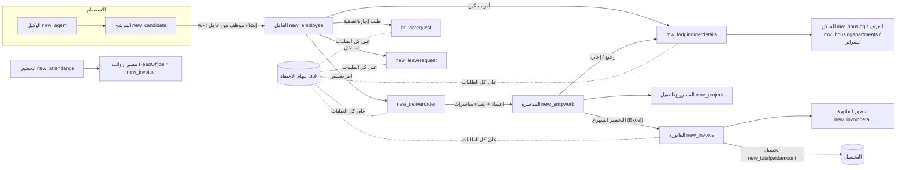

# 01 — خريطة المجال (Domain Map) لنظام CarePro الحالي

> المصدر: كود البوابة `test2\test2` + المكتبة `CarePro.CRM.Core` + قاعدة `Care_Pro_MSCRM` (قراءة فقط، أرقام يوم 2026-10-15).

## 1. النشاط في سطر واحد

شركة **تأجير/تشغيل عمالة (Manpower Outsourcing)**: بتستقدم العامل عن طريق وكيل (Agent)، تسكّنه في سكن الشركة، تسلّمه لمشروع عميل (Project) بسعر خدمة شهري، تحضّره (تعد أيام شغله) كل شهر، تطلع فاتورة للعميل وتحصّلها، وفي نفس الوقت بتدير رواتب موظفي الإدارة (HeadOffice) وإجازات وتصفيات واستئذانات العمالة والموظفين.

## 2. البنية التقنية الحالية

| الطبقة | الموجود |
|---|---|
| البوابة | ASP.NET Web Forms على .NET 4.8 — حوالي 45 صفحة `.aspx` و 5 handlers `.ashx` و 40 Service في `Common\Services` |
| المكتبة | `CarePro.CRM.Core` (`GlobalCode`, `CrmCreateService`, `CrmApprovalService`, `CRMAccessDB`, `ExcelExportService`) |
| الـ Back-end | Microsoft Dynamics CRM 2011 on-prem (org `carepro`) — الكتابة عن طريق SDK (`OrganizationServiceProxy`) بحساب خدمة واحد، والقراءة **SQL مباشر** على الـ views (`new_employee`, `new_empwork`…) في `Care_Pro_MSCRM` |
| منطق مخفي | 58 Workflow نشط على الكيانات اللي البوابة بتستخدمها + plugins (أهمها `Xbitz.Crm.AdvancedCRMAutoNumber` للترقيم و `PrInvDetailsMultiRetriveHO`) + custom workflow activities (`GetWorkFlowUser`, `CallPageUrl`, `AutoNumberWF`, `Kaskela`) |
| الدخول | Active Directory (LDAP `JRCO`) — الصلاحيات من **Teams** في الـ CRM |
| موبايل | تطبيق Flutter (`carepro_mobile`) بيقرا من `ManagementDashboardApi.ashx` |
| ملفات | Excel (ClosedXML + ACE OLEDB) للتحضير والأسعار والحضور؛ مرفقات على `C:\File\CRM` و `new_attachments` |

## 3. الخريطة العامة

## 4. المجالات (Bounded Contexts) كما هي في النظام الحالي

### 4.1 العمالة (Workforce / HR Core)
- **الكيان الرئيسي:** `new_employee` (3,228 سجل) — بيجمع بيانات شخصية، إقامة/جواز/حدود، المهنة والجنسية، الراتب وبدلاته، سعر الخدمة الافتراضي (`new_totalservices`)، رصيد الإجازات، الوكيل، والمشروع الحالي (`new_projectid`).
- **الحالة (`statuscode`)** هي "مكان" العامل الحالي: على رأس العمل (2,558) / في السكن / مرتجع / إجازة / خروج نهائي / إنهاء خدمات / هروب / موقوف … (التفاصيل في [03](03-option-sets-and-statuses.md)).
- **الكفيل/السجل التجاري (`new_sponseredby`)**: 10 كيانات (Care-Pro 05, Esad 01, IRC 02, JAWA 03, Mehan 14, Riadty 09, Watan 12, Ewan 13, Care-pro 07, Maharah 15) ⇒ النظام فعليًا **متعدد الشركات** بدون ما يكون فيه كيان شركة.
- **قطاعات:** قطاع الأعمال (أرقام `BS…`)، قطاع الأفراد، الكيان الرئيسي HeadOffice (357 موظف على مشروع اسمه `HeadOffice`)، قطاع الساعات، نقل الكفالة.
- **الإضافة:** شاشة `HR_Employee_Create` بتنشئ **مرشح** `new_candidate`، والـ workflow "إنشاء موظف من عامل" هو اللي بينشئ `new_employee` لما `new_arrived = true`، والـ workflow "AutoNumber Employee" بيرقّمه حسب نوع الموظف (مثال `BSS002862` لقطاع الأعمال).
- **ملف العامل 360** (`HR_EmployeeDetails` + `EmployeeLifecycleService` + `EmployeeInsightService` + `EmployeeComparisonService`): خط زمني، خريطة أيام (شغل/سكن/إجازة/استئذان)، تقييم وربحية.

### 4.2 المشاريع والعملاء والعقود (Sales / Contracts)
- `new_project` (165) = **عقد مع عميل** في نفس الوقت (اسم، كود `pro…`، نوع العقد `new_contracttype`: مبلغ مقطوع / التكلفة الإجمالية / Total Cost multi Salaries، حالة العقد، بداية ونهاية، مدير المشروع = `ownerid`).
- العميل الحقيقي `account` بيتنشأ تلقائيًا من workflow "Create Customers For Projects" ⇒ المشروع والعميل والعقد **كيان واحد** في الواقع.
- سعر الخدمة للعامل: افتراضي على العامل (`new_employee.new_totalservices`) ويتغطى بسعر على المباشرة (`new_empwork.new_serviceprice`) — شاشة `Sales_ProjectServicePrices` بتحدّثه (Excel import/export).
- كشف حساب المشروع `Sales_ProjectStatement`.

### 4.3 حركة العمالة (Workforce Movements) — قلب النظام
| الحركة | الكيان | المعنى |
|---|---|---|
| أمر تسليم | `new_deliverorder` (1,267 — كلها 2026) | تسليم مجموعة عمال لمشروع: تاريخ تسليم، تاريخ مباشرة، المستلم وصفته، **أرقام العمال كنص** في `new_laborsnumber`، وسعر الخدمة/السكن/المواصلات (أضيفت مؤخرًا) |
| مباشرة عمل | `new_empwork` (7,033) | فترة عمل عامل في مشروع: `new_startdate` (+ `new_enddate` اختياري)، سعر الخدمة، السكن، المواصلات، رقم `SW000000` |
| أمر تسكين / رجيع | `mw_lodginorderdetails` (1,013 — كلها 2026) | دخول العامل السكن: تاريخ الوصول `mw_arrivedate`، نوع الدخول (حديث الوصول / مرتجع / عائد من إجازة)، سبب الرجيع، السكن والغرفة، تاريخ الخروج `new_leavedate`، حالة السكن |
| نقل بين مشاريع | `new_projtransfer` (8,901) | بيتنشأ من workflow "نقل موظف إلى مشروع" (البوابة مابتستخدمهوش مباشرة) |
| إرجاع عامل (CRM فقط) | `new_laborsback` (1,007) | بيتنشأ من workflow "Housing Order Process" عند الرجيع |

**الفترة** (العامل كان فين يوم كذا) **مش متخزنة**؛ بتتحسب كل مرة من تواريخ متفرقة: بداية المباشرة → تنتهي عند (`new_enddate` أو أول تسكين معتمد بعدها لنفس المشروع أو المباشرة اللي بعدها). ده أساس فكرة **سجل الفترات الموحد** في النظام الجديد.

### 4.4 السكن (Housing)
- **العمليات:** أوامر التسكين (`Operations_Housing*`) بموافقات.
- **إدارة السكن (`Operations_HousingManager*`)**: مبنى `mw_housing` (15) → غرفة `mw_housingapartments` (40) → **سرير مخزن في كيان مُعاد استخدامه `new_ajeercontract`** (10) → **تسكين على السرير مخزن في `new_thijridate`** (3) بنوع سكن (تأجيري / لمشروع / للشركة)، نوع سرير، سعر سكن ومواصلات.
- نموذجين منفصلين (أمر التسكين ↔ تسكين السرير) **مش مربوطين** ببعض.

### 4.5 التحضير والفوترة والتحصيل (Attendance → Billing → Collection)
1. `Attendance.aspx`: لكل مشروع وشهر، النظام **يحسب** أيام العمل من المباشرات (`GlobalCode.GetProjectMonthlyAttendanceExportData`) ويطلع ملف Excel من قالب.
2. العميل/المشرف يعدّل الغياب والخصومات في الملف ويرجّعه.
3. `Attendance_CreateInvoice` / `AttendanceInvoiceImportService`: رفع الملف ⇒ مطابقته مع التحضير "الموثوق" من النظام ⇒ إنشاء `new_invoice` (نوع Project Invoice) + `new_invoicdetail` لكل عامل (أيام، راتب، سعر خدمة، غياب، VAT 15%…).
4. Workflow الفاتورة: مراجعة ← مراجعة المالية ← إرسال للعميل ← انتظار التحصيل ← محصل جزئي/كلي.
5. التحصيل = حقل `new_totalpaidamount` على الفاتورة (مافيش كيان سندات قبض مستخدم فعليًا: `new_paymentreceipt` فيه سجل واحد).
- الإجمالي الحالي: 712 فاتورة مشروع بقيمة ≈ **40.97 مليون** محصل منها ≈ **27.74 مليون**.

### 4.6 رواتب الإدارة (HeadOffice Payroll)
- الحضور والانصراف `new_attendance` من ملف بصمة Excel (`HR_Attendance`)، اعتماد يومي (`new_attstatus`) وخصومات.
- `HR_Payroll` يحسب صافي الراتب = الإجمالي − (الإجمالي/30 × أيام الغياب) − خصومات + إضافات، ويُنشئ المسير **كفاتورة `new_invoice` على مشروع HeadOffice** (بنفس نوع Project Invoice!).
- `HR_PayrollInvoices` + `PayrollPayslipEmailService`: صرف وإرسال قسائم بالإيميل (SMTP غير مضبوط حاليًا).
- **مافيش** تكامل حالي مع مُدد / WPS / GOSI (فيه حقول وكيانات قديمة: `mw_wagesprotection`, `new_gossisalary`, `new_bankfile` غير مستخدمة).

### 4.7 الإجازات والاستئذان والتصفية (Leave & Clearance)
- **طلب إجازة/خروج** `hr_vicrequest` (30): خروج وعودة، خروج نهائي، إجازة داخلية، تصفية… بمسار اعتماد طويل (حتى 20 حالة) في workflow "Vacation Request Abdal WF"، وحساب **التصفية** في البوابة (راتب أيام الشهر + بدل الإجازة + مكافأة نهاية الخدمة حسب نظام العمل − سلف/عهد/خصومات) وطباعة المخالصة `HR_VacationClearancePrint`.
- **رصيد الإجازة** بيتحسب في صفحة العامل: (الإجازة السنوية / 365 × الأيام من بداية العقد) − المستهلك.
- **استئذان** `new_leaverequest` (6): تأخير / خروج / إجازة تخصم من الرصيد / مهمة عمل / مرضي / أخرى — مدير مباشر ← HR ← CEO.

### 4.8 الموردين (الوكلاء) Agents
- `new_agent` (9) بمسار اعتماد (استقدام ← قانونية ← مالية ← نائب ← مدير عام) في الـ CRM.
- البوابة (`HR_Agents`, `AgentService`): إنشاء وكيل، ربط عمال بوكيل (`new_employee.new_agent`)، وتسجيل تاريخ "الإرجاع للوكيل/أجير" (`new_ajeerpostdate`).
- تكامل **أجير (Ajeer)** موجود جزئيًا في الـ CRM (`new_ageerlog` 2,403، `new_ajeerfault` 13,888) عن طريق خدمة على `:8001`.

### 4.9 الاعتمادات والمهام (Approvals / Tasks)
- كل طلب بيعمل له workflow في الـ CRM **مهمة `task`** لكل مرحلة؛ البوابة بتوافق/ترفض بتغيير `task.new_approvestatus` (2 موافقة / 3 رفض) والـ workflow هو اللي يكمل.
- صاحب الحق في التصرف: مالك المهمة، أو عضو في الفريق المالك، أو عضو في `TopApproval`.
- ~7,460 مهمة اعتماد، 174 مفتوحة حاليًا. أكتر الكيانات: الفواتير (2,794) ثم أوامر التسليم (2,441) ثم التسكين (2,017).
- `User_Tasks` + `UserNotifications.ashx`: مهامي والمتأخرة (متأخرة = تاريخ الاستحقاق عدّى، أو مفتوحة > 3 أيام بدون استحقاق).

### 4.10 لوحات الإدارة (Dashboards)
`ManagementDashboard` (ديسكتوب + موبايل + API)، `Dashboard` (مديرين المشاريع)، `Operations_WorkforceMovement`، تبويب العمالة الجديدة، التقرير المالي (أعمار الديون، أكبر المديونيات، تغطية الفوترة)، أداء المهام. التفاصيل في [05](05-reports-and-kpis.md).

## 5. الأدوار والفرق (Teams) المستخدمة في الصلاحيات

| Team | الأعضاء | يفتح |
|---|---|---|
| `CareAdmin` | 9 | تعديل بيانات العامل، الربحية، لوحة الإدارة كصفحة رئيسية |
| `CarePayroll` | 4 | صفحات الرواتب |
| `HeadEmp` | 6 | رؤية موظفي HeadOffice |
| `HeadSalary` | 4 | رؤية رواتب HeadOffice |
| `EditDeliver` | 3 | تعديل إجراءات التسليم/المباشرة |
| `ProjectAdmin` | 2 | تغيير مدير المشروع |
| `ChangeStatus` | 1 | تغيير حالة العامل |
| `TopApproval` | 1 | اعتماد/رفض أي مهمة |

المستخدمين: 261 في `SystemUser`، **31 فقط مفعّلين**.

## 6. الكيانات اللي في الـ CRM ومش ظاهرة في البوابة (لازم تتقرر في النطاق)

| الكيان | السجلات | ملاحظة |
|---|---|---|
| `new_employeestatues` | 34,290 | متابعة إجراءات العامل (workflow "CreateEmployeeStatues" بينشئ 17 سجل لكل عامل) |
| `new_employeeaudit` | 13,543 | سجل تغيّر حالة العامل (workflow "CreateEmployeeAudit") — مصدر تاريخي مهم للفترات |
| `new_ajeerfault` / `new_ageerlog` | 13,888 / 2,403 | تكامل أجير |
| `new_empsearch_employee` | 10,520 | بحث عمالة |
| `new_projtransfer` | 8,901 | نقل بين المشاريع |
| `new_laborcontract` | 3,379 | عقد العامل (يتنشأ عند الإضافة وعند تغيير الراتب) |
| `new_candidate` | 3,228 | المرشحين (الاستقدام) |
| `new_replacelabor` | 2,171 | استبدال عامل |
| `new_laborsback` | 1,007 | إرجاع عامل |
| `new_empexpense` | 731 | مصروفات العامل (تأشيرة…) |
| `new_indvstop` | 487 | إيقاف (قطاع الأفراد) |
| `new_bankaccounts` | 388 | حسابات بنكية |
| `new_reqapprovals` | 325 | اعتمادات قديمة |
| `new_projinvoicerpt` | 313 | تقرير فواتير |
| `new_textinvoice` | 179 | فواتير نصية |
| `mw_sysdocument` | 191 | وثائق |
| قطاع الأفراد والساعات | `new_IndvContract`, `new_hourresource`, `new_hourlypricing`, `new_district` (544)… | عقود الأفراد/الساعات؛ أغلبها فاضي أو قليل |

## 7. أحجام البيانات (للتخطيط)

| | 2018 | 2019 | 2025 | 2026 |
|---|---|---|---|---|
| مباشرات `new_empwork` | 1,998 | 870 | — | 4,165 |
| عمال `new_employee` (تاريخ الإنشاء) | — | — | 2,378 | 850 |
| أوامر تسليم / تسكين | — | — | — | 1,267 / 1,013 |
| فواتير `new_invoice` (`new_fromdate`) | 2 (2016) | 9 | 2 | 693 |

⇒ البيانات التشغيلية الفعلية **حديثة (2025–2026)**، وبيانات 2018–2019 قديمة ومن غير مشروع/سعر (راجع [06](06-data-quality-issues.md)). ده بيسهّل الترحيل: الحجم صغير (آلاف مش ملايين) والنطاق الزمني اللي يهم قصير.
