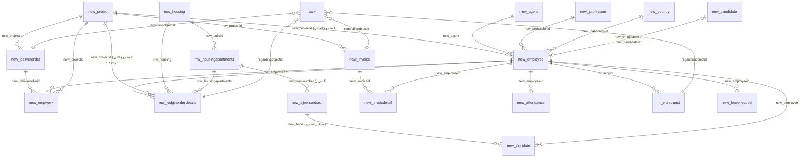

# 02 — الكيانات والحقول المستخدمة في البوابة

> **طريقة الاستخراج:** الحقول هنا هي الحقول الـ custom (ومعاها `statuscode/statecode/createdon/createdby/ownerid`) في كل كيان، اللي **اسمها المنطقي ظاهر في كود البوابة أو المكتبة** (`*.cs`, `*.ashx`). النوع والأسماء العربية/الإنجليزية من الـ Metadata (`AttributeView`, `LocalizedLabelView`، LangId 1025/1033)، والسجلات من `sys.partitions` على الجداول الـ `Base`، و"مستخدم في" = الملفات اللي فيها اسم الحقل (أول 4 + العدد الباقي). ممكن يكون في تطابق اسمي لحقل بنفس الاسم في كيان تاني (زي `new_name`) — اتعامل معاه كمؤشر مش كدليل قاطع.
>
> ملاحظات عامة على التخزين:
> - كل `datetime` متخزن **UTC**؛ التواريخ "date-only" بتتخزن الساعة 21:00 يوم قبلها (توقيت السعودية +3). الكود بيعمل `DATEADD(HOUR, 3, …)` في كل استعلام (6,986 من 7,033 مباشرة الساعة 21:00 UTC، و31 بساعات تانية).
> - حقول الـ Money ليها نسخة `_base` (عملة الأساس) — مش مستخدمة.
> - كل lookup ليه عمود `…Name` في الـ view (مثلاً `new_projectidName`) والبوابة بتعتمد عليه في العرض **وفي المقارنة** (مثلاً `new_projectidName = 'HeadOffice'`).

## 1. ملخص الكيانات

| الكيان | المعنى | السجلات | القراءة | الكتابة من البوابة |
|---|---|---|---|---|
| `new_employee` | العامل/الموظف | 3,228 | SQL view | `Service.Update` (بيانات/حالة/وكيل) + **SQL `UPDATE` مباشر** (رصيد الإجازات، بيانات، سعر الخدمة) |
| `new_project` | المشروع = العميل + العقد | 165 | SQL | `CreateProject`، تحديث مدير المشروع |
| `new_deliverorder` | أمر التسليم | 1,267 | SQL + SDK | إنشاء (`Operations_Transfer_Create`) |
| `new_empwork` | المباشرة (فترة عمل) | 7,033 | SQL | إنشاء عند اعتماد التسليم + **SQL `UPDATE` مباشر** (سعر الخدمة/تواريخ) |
| `mw_lodginorderdetails` | أمر التسكين/الرجيع | 1,013 | SQL | إنشاء (`CrmCreateService.CreateHousingOrder`) |
| `mw_housing` | السكن/المبنى | 15 | SQL | إنشاء |
| `mw_housingapartments` | الغرفة | 40 | SQL | إنشاء/تعديل |
| `new_ajeercontract` | **السرير** (كيان "عقد أجير" مُعاد استخدامه) | 10 | SQL | إنشاء |
| `new_thijridate` | **تسكين على سرير** (كيان "تاريخ هجري" مُعاد استخدامه) | 3 | SQL | إنشاء/قفل |
| `new_attendance` | حضور يومي لموظفي الإدارة | 239 | SQL | إنشاء/تعديل/اعتماد |
| `new_invoice` | فاتورة مشروع **ومسير رواتب** | 715 | SQL | إنشاء + تحديث الإجماليات |
| `new_invoicdetail` | سطر فاتورة/مسير لكل عامل | 12,138 | SQL | إنشاء + **SQL `UPDATE new_invoicdetailBase`** |
| `hr_vicrequest` | طلب إجازة/خروج/تصفية | 30 | SQL | إنشاء + تحديث بيانات التصفية والمرفق |
| `new_leaverequest` | طلب استئذان | 6 | SQL | إنشاء |
| `new_agent` | الوكيل (مورد العمالة) | 9 | SQL | إنشاء |
| `new_candidate` | المرشح (قبل ما يبقى موظف) | 3,228 | SQL | إنشاء (`HR_Employee_Create`) |
| `new_attachments` | المرفقات | 0 | SQL | إنشاء |
| `new_profession` / `new_country` | المهن / الدول والجنسيات | 3,548 / 188 | SQL | — |
| `task` | مهمة اعتماد | ~7,460 | SDK + SQL | تحديث `new_approvestatus` |
| `systemuser` / `team` / `teammembership` | المستخدمين والفرق | 261 / — | SQL + SDK | — |

## 2. العلاقات

**علاقات ناقصة/ضعيفة (مهمة للتصميم الجديد):**
- `new_deliverorder.new_employeeid` موجود لكن **فاضي في كل الـ 1,267 أمر**؛ العمال مربوطين بالأمر **كنص** في `new_laborsnumber` (أرقام مفصولة بـ CRLF، 343 أمر فيهم أكتر من عامل)، والربط الحقيقي بيحصل بس لما تتنشأ المباشرات.
- البحث عن العامل من النص بيطابق على **7 أعمدة**: `new_empidnumber OR new_idnumber OR new_borderno OR new_PassportNumber OR new_sadadworkpermitno OR new_passportvisanumber OR new_onlynumber` (`TransferOrderDetailsService`).
- فترة المباشرة مش ليها نهاية حقيقية في الغالب؛ `new_enddate` اختياري (الكود بيدوّر على `new_enddate` أو `new_endworkdate` ديناميكيًا).
- أمر التسكين مش مربوط بالمباشرة اللي قفلها ولا بتسكين السرير.
- `new_invoicdetail` مش مربوط بالمباشرة (`new_empwork`) — بالعامل والمشروع والفترة بس.

## 3. أعمدة بيتم اكتشافها وقت التشغيل (Schema drift)

الكود بيستعلم `sys.columns` / `RetrieveAttributeRequest` قبل ما يستخدم أعمدة معينة لأنها اتضافت/اتغيرت بمرور الوقت — ده معناه إن **الـ schema مش ثابت**:

| الدالة | الأعمدة البديلة |
|---|---|
| `GlobalCode.GetExistingColumnName` (التحضير) | `new_empwork.new_enddate` / `new_endworkdate`؛ `new_serviceprice` / `new_totalservices`؛ `new_housing` / `new_phallaowance`؛ `new_transportation` / `new_transportationallowance` |
| `HousingManagerService` | جدول الغرف من 10 أسماء محتملة (`mw_housingapartments`, `new_housingapartments`, `new_apartments`…) وعمود ربط السرير من 9 أسماء |
| `MonthlyAttendanceService` | أيام الغياب: `new_numberofdays` / `new_absencedays` / `new_abscentdays` / `new_absence` / `new_absentdays` |
| `CrmCreateService.SetDelayFlag` | نوع `new_delay` (Boolean / Integer / OptionSet) |
| `VacationRequestService.GetAttachmentLookupFieldName` | حقل المرفق في `hr_vicrequest` |
| `PayrollPayslipEmailService` | عمود إيميل الموظف من الإعدادات |

## 4. الحقول لكل كيان

#### `new_employee` — 3228 سجل

| الحقل | النوع | الاسم العربي | الاسم الإنجليزي | يشير إلى | مستخدم في |
|---|---|---|---|---|---|
| `createdby` | Lookup | منشأ بواسطة | Created By | SystemUser | Attendance, AttendanceDetails, EmployeeInvoices, EmployeeLifecycleService (+17) |
| `createdon` | تاريخ/وقت (UTC) | تاريخ الإنشاء | Creation Date |  | ApprovalTimelineService, Attendance, AttendanceDetails, CrmApprovalService (+23) |
| `ownerid` | Owner | الموظف المسئول | Owner | Owner | ApprovalTimelineService, Attendance, AttendanceInvoiceImportService, CrmApprovalService (+15) |
| `statecode` | State | حالة العمل | Status |  | ApprovalTimelineService, CrmApprovalService, DashboardQueryService, ManagementDashboardService |
| `statuscode` | Status | حالة الموظف | Worker Status |  | AgentService, Attendance, AttendanceDetails, CrmApprovalService (+32) |
| `new_agent` | Lookup | الوكيل | Agent | new_agent | AgentService, HR_EmployeeDetails, NewArrivalsDashboardService |
| `new_ajeerpostdate` | تاريخ/وقت (UTC) | تاريخ الإضافة لأجير | Ajeer Date |  | AgentService, HR_EmployeeDetails |
| `new_annualleave` | رقم عشري | الأجازة السنوية | Annual vication |  | HR_EmployeeDetails |
| `new_basicsalary` | مبلغ (Money) | الراتب الأساسي | Basic Salary |  | GlobalCode, HR_EmployeeDetails, HrEmployeeQueryService, PayrollService (+1) |
| `new_borderno` | نص (100) | رقم الحدود | Border No |  | EmployeeMovementValidationService, HR_Employee_Create, TransferOrderDetailsService |
| `new_consumedblalnce` | رقم عشري |  | رصيد مستهلك |  | HR_EmployeeDetails |
| `new_contractenddate` | تاريخ/وقت (UTC) | نهاية العقد | Contract End Date |  | EmployeeInsightService, HR_EmployeeDetails |
| `new_contractstartdate` | تاريخ/وقت (UTC) | بداية العقد | Contract Start Date |  | HR_EmployeeDetails, VacationRequestService |
| `new_custhousing` | مبلغ (Money) |  | CustHousing |  | GlobalCode |
| `new_custsalary` | رقم عشري | راتب العميل | Customer Salary |  | AttendanceInvoiceImportService, GlobalCode |
| `new_custtransport` | مبلغ (Money) |  | CustTransport |  | AttendanceDetails, AttendanceInvoiceImportService, GlobalCode, ManagementDashboardService |
| `new_dateofjoining` | تاريخ/وقت (UTC) | تاريخ وصول المملكة | Joining Date |  | AttendanceInvoiceImportService, EmployeeInsightService, EmployeeLifecycleService, EmployeeService (+2) |
| `new_dueamountpermonth` | رقم عشري | المستحق للموارد | Due to resources |  | GlobalCode, HrEmployeeQueryService, SalesProjectDetailsService, TransferOrderDetailsService |
| `new_empidnumber` | نص (100) | الرقم الوظيفي | EmployeeID |  | AgentService, AttendanceDetails, AttendanceInvoiceImportService, DashboardQueryService (+19) |
| `new_enterdate` | تاريخ/وقت (UTC) | تاريخ الدخول | Enter Date |  | EmployeeLifecycleService, HR_Employee_Create |
| `new_expirydate` | تاريخ/وقت (UTC) | إنتهاء جواز السفر | Passport Expiry Date |  | EmployeeInsightService |
| `new_expirydateg` | تاريخ/وقت (UTC) | تاريخ إنتهاء الإقامة ميلادي | Iqama Expiry Date gergrain |  | EmployeeInsightService, SalesProjectDetailsService, TransferOrderDetailsService |
| `new_foodallowance` | مبلغ (Money) | بدل طعام | Food Allowance |  | GlobalCode, HR_EmployeeDetails, HrEmployeeQueryService |
| `new_govcost` | رقم عشري | govcost | govcost |  | AttendanceInvoiceImportService, EmployeeComparisonService, EmployeeInsightService |
| `new_hardworkallowance` | مبلغ (Money) | بدل امشروع | Project Allowance |  | AttendanceDetails, GlobalCode, ManagementDashboardService |
| `new_housing` | OptionSet | السكن | السكن |  | GlobalCode, HR_EmployeeDetails, Operations_Transfer_Create, ProjectServicePriceUpdateService (+2) |
| `new_housingallowance` | مبلغ (Money) | بدل السكن | Housing Allowance |  | GlobalCode, HR_EmployeeDetails, HrEmployeeQueryService, PayrollService (+1) |
| `new_idnumber` | نص (100) | رقم الإقامة-الهوية | Iqama Number |  | AgentService, AttendanceInvoiceImportService, DashboardQueryService, EmbeddedEmployeeService (+16) |
| `new_insuranceexpirydate` | تاريخ/وقت (UTC) | تاريخ إنتهاء التأمين | Insurance Expiry Date |  | EmployeeInsightService |
| `new_mobileallowance` | مبلغ (Money) | بدل جوال | Fixed Allowance |  | GlobalCode, HR_EmployeeDetails |
| `new_name` | نص (300) | الاسم الإنجليزي | English Name |  | AgentService, Attendance, AttendanceDetails, AttendanceInvoiceImportService (+33) |
| `new_nationalityid` | Lookup | الجنسية | Nationality | new_Country | AgentService, DashboardQueryService, EmployeeComparisonService, GlobalCode (+7) |
| `new_oldconsumedbalance` | رقم عشري |  | رصيد مستهلك قديم |  | HR_EmployeeDetails |
| `new_onlynumber` | نص (100) | رقم فقط وظيفي | No. Only functional |  | EmployeeMovementValidationService, TransferOrderDetailsService |
| `new_otherallowance` | مبلغ (Money) | Other Allowance | Other Allowance |  | GlobalCode, HR_EmployeeDetails, HrEmployeeQueryService, PayrollService (+1) |
| `new_overtimeallowance` | مبلغ (Money) | بدل السكن (عيني) | Overtime Allowance |  | GlobalCode, HR_EmployeeDetails |
| `new_passportnumber` | نص (100) | رقم جواز السفر | Passport Number |  | EmployeeMovementValidationService, EmployeeQuickSearchService, HR_Employee_Create, ManagementDashboardService (+1) |
| `new_passportvisanumber` | نص (100) | رقم تأشيرة السفارة | No. embassy visa |  | EmployeeMovementValidationService, HR_Employee_Create, TransferOrderDetailsService |
| `new_pirodcontract` | رقم صحيح | مدة العقد بالأشهر | Priod Contract by Months |  | HR_EmployeeDetails |
| `new_professionid` | Lookup | المهنة | Profession | new_profession | AgentService, DashboardQueryService, EmployeeComparisonService, GlobalCode (+10) |
| `new_profit` | رقم عشري | profit | profit |  | AttendanceInvoiceImportService |
| `new_projectid` | Lookup | المشروع | Project | new_project | AgentService, Attendance, AttendanceDetails, AttendanceInvoiceImportService (+35) |
| `new_projectjoingdate` | تاريخ/وقت (UTC) | تاريخ مباشرة العامل | Project Joining Date |  | DashboardQueryService, HR_EmployeeDetails, HrEmployeeQueryService, SalesProjectDetailsService (+1) |
| `new_remainingbalance` | رقم عشري |  | الرصيد المتبقي |  | EmployeeInsightService, HR_EmployeeDetails, VacationRequestService |
| `new_sadadworkpermitno` | نص (100) | رقم سداد رخصة العمل | Attendance No |  | EmployeeMovementValidationService, TransferOrderDetailsService |
| `new_serviceprice` | رقم عشري | سعر الخدمة | Service Price |  | GlobalCode, HR_EmployeeDetails, ManagementDashboardService, Operations_Transfer_Create (+3) |
| `new_sponseredby` | OptionSet | Sponsered BY | Sponsered BY |  | HrEmployeeQueryService |
| `new_totalsalary` | مبلغ (Money) | إجمالي الراتب | Total Salary |  | AttendanceDetails, AttendanceInvoiceImportService, EmployeeInvoices, EmployeeService (+11) |
| `new_totalservices` | مبلغ (Money) |  | TotalServices |  | GlobalCode, HR_EmployeeDetails, ProjectServicePriceUpdateService, SalesProjectDetailsService (+1) |
| `new_trasnallowance` | مبلغ (Money) | بدل انتقال | Transportation Allowance |  | GlobalCode, HR_EmployeeDetails, HrEmployeeQueryService, PayrollService (+1) |
| `new_vacationbalance` | رقم عشري |  | رصيد الاجازات |  | HR_EmployeeDetails, VacationRequestService |

#### `new_project` — 165 سجل

| الحقل | النوع | الاسم العربي | الاسم الإنجليزي | يشير إلى | مستخدم في |
|---|---|---|---|---|---|
| `createdby` | Lookup | تاريخ الإنشاء | Creation Date | SystemUser | Attendance, AttendanceDetails, EmployeeInvoices, EmployeeLifecycleService (+17) |
| `createdon` | تاريخ/وقت (UTC) | تاريخ الإنشاء | Creation Date |  | ApprovalTimelineService, Attendance, AttendanceDetails, CrmApprovalService (+23) |
| `ownerid` | Owner | مدير المشروع | Project Manager | Owner | ApprovalTimelineService, Attendance, AttendanceInvoiceImportService, CrmApprovalService (+15) |
| `statecode` | State | الحالة | State |  | ApprovalTimelineService, CrmApprovalService, DashboardQueryService, ManagementDashboardService |
| `statuscode` | Status | حالة المشروع | Project Status |  | AgentService, Attendance, AttendanceDetails, CrmApprovalService (+32) |
| `new_arabicname` | نص (200) | اسم المشروع عربي | Project Name Arabic |  | CrmCreateService |
| `new_businesstype` | OptionSet | القطاع | Sector |  | CrmCreateService |
| `new_code` | نص (100) | كود المشروع | Project Code |  | AgentService, Attendance, AttendanceDetails, AttendanceInvoiceImportService (+8) |
| `new_contractstatus` | OptionSet | حالة العقد | The case of the decade |  | SalesProjectDetailsService, SalesProjectQueryService |
| `new_contracttype` | OptionSet | نوع العقد | Type of Contract |  | CrmCreateService, GlobalCode, SalesProjectDetailsService, SalesProjectQueryService |
| `new_emailaddresses` | نص طويل | Email addresses | Email addresses |  | CrmCreateService |
| `new_enddate` | تاريخ/وقت (UTC) | نهاية العقد | Contract End Date |  | Attendance, AttendanceDetails, CrmCreateService, EmployeeComparisonService (+9) |
| `new_invoicedate` | تاريخ/وقت (UTC) | تاريخ طلب مسير الرواتب | Date of the request payroll |  | AttendanceInvoiceImportService, PayrollService |
| `new_mobilen` | نص (100) |  | Mobile N |  | CrmCreateService |
| `new_name` | نص (100) | اسم الشهرة للمشروع | Proejct Name |  | AgentService, Attendance, AttendanceDetails, AttendanceInvoiceImportService (+33) |
| `new_nameenglish` | نص (200) | اسم المشروع بالإنجليزي | Project Name English |  | CrmCreateService, HR_EmployeeDetails, HR_Employee_Create |
| `new_registerationno` | نص (100) | السجل التجاري | Commercial Register |  | CrmCreateService, SalesProjectDetailsService, SalesProjectQueryService, sales_project_create |
| `new_responsablename` | نص (100) |  | Responsable Name |  | CrmCreateService, SalesProjectDetailsService, SalesProjectQueryService |
| `new_startdate` | تاريخ/وقت (UTC) | بداية العقد | Beginning of the Contract |  | Attendance, AttendanceDetails, CrmCreateService, EmployeeComparisonService (+11) |

#### `new_deliverorder` — 1267 سجل

| الحقل | النوع | الاسم العربي | الاسم الإنجليزي | يشير إلى | مستخدم في |
|---|---|---|---|---|---|
| `createdby` | Lookup | منشأ بواسطة | Created By | SystemUser | Attendance, AttendanceDetails, EmployeeInvoices, EmployeeLifecycleService (+17) |
| `createdon` | تاريخ/وقت (UTC) | تاريخ الإنشاء | Created On |  | ApprovalTimelineService, Attendance, AttendanceDetails, CrmApprovalService (+23) |
| `ownerid` | Owner | الموظف المسئول | Owner | Owner | ApprovalTimelineService, Attendance, AttendanceInvoiceImportService, CrmApprovalService (+15) |
| `statecode` | State | الحالة | Status |  | ApprovalTimelineService, CrmApprovalService, DashboardQueryService, ManagementDashboardService |
| `statuscode` | Status | حالة التسليم | Status Reason |  | AgentService, Attendance, AttendanceDetails, CrmApprovalService (+32) |
| `new_count` | رقم صحيح | العدد | Number |  | TransferOrderDetailsService, TransferOrderQueryService |
| `new_deliverdate` | تاريخ/وقت (UTC) | تاريخ تسليم العامل | Deliver Date |  | EmployeeMovementValidationService, Operations_Transfer_Create, TransferOrderDetailsService, TransferOrderQueryService |
| `new_employeeid` | Lookup | موظف عامل منزلي | Employee Indv | new_Employee | AgentService, Attendance, AttendanceDetails, AttendanceInvoiceImportService (+32) |
| `new_enddate` | تاريخ/وقت (UTC) | تاريخ الانتهاء | End Date |  | Attendance, AttendanceDetails, CrmCreateService, EmployeeComparisonService (+9) |
| `new_housing` | مبلغ (Money) |  | housing |  | GlobalCode, HR_EmployeeDetails, Operations_Transfer_Create, ProjectServicePriceUpdateService (+2) |
| `new_laborsnumber` | نص طويل | أرقام العمالة | Labor number |  | EmployeeMovementValidationService, Operations_Transfer_Create, TransferOrderDetailsService, TransferOrderQueryService |
| `new_notes` | نص (100) | ملاحظات | Notes |  | AttendanceInvoiceImportService, PayrollService |
| `new_number` | نص (100) | رقم أمر التسليم | Delivery order NO. |  | EmployeeLifecycleService, HR_EmployeeDetails, SalesProjectDetailsService, TransferOrderDetailsService (+1) |
| `new_projectid` | Lookup | المشروع | Project | new_project | AgentService, Attendance, AttendanceDetails, AttendanceInvoiceImportService (+35) |
| `new_receicename` | نص (100) | اسم المستلم | The recipient's name |  | Operations_Transfer_Create, TransferOrderQueryService |
| `new_receivejob` | نص (100) | صفة المستلم | صفة المستلم |  | Operations_Transfer_Create |
| `new_serviceprice` | مبلغ (Money) |  | serviceprice |  | GlobalCode, HR_EmployeeDetails, ManagementDashboardService, Operations_Transfer_Create (+3) |
| `new_startworkdate` | تاريخ/وقت (UTC) | تاريخ مباشرة العمل | Cust Joining Date |  | AttendanceInvoiceImportService, EmployeeMovementValidationService, Operations_Transfer_Create, TransferOrderDetailsService (+1) |
| `new_transportation` | مبلغ (Money) |  | transportation |  | GlobalCode, HR_EmployeeDetails, HousingManagerService, Operations_Transfer_Create (+4) |

#### `new_empwork` — 7033 سجل

| الحقل | النوع | الاسم العربي | الاسم الإنجليزي | يشير إلى | مستخدم في |
|---|---|---|---|---|---|
| `createdby` | Lookup | منشأ بواسطة | Created By | SystemUser | Attendance, AttendanceDetails, EmployeeInvoices, EmployeeLifecycleService (+17) |
| `createdon` | تاريخ/وقت (UTC) | تاريخ الإنشاء | Created On |  | ApprovalTimelineService, Attendance, AttendanceDetails, CrmApprovalService (+23) |
| `ownerid` | Owner | المالك | Owner | Owner | ApprovalTimelineService, Attendance, AttendanceInvoiceImportService, CrmApprovalService (+15) |
| `statecode` | State | الحالة | Status |  | ApprovalTimelineService, CrmApprovalService, DashboardQueryService, ManagementDashboardService |
| `statuscode` | Status | حالة المباشرة | Status Reason |  | AgentService, Attendance, AttendanceDetails, CrmApprovalService (+32) |
| `new_deliverorderid` | Lookup | أمر تسليم عمالة | أمر تسليم عمالة | new_deliverorder | HR_EmployeeDetails, ManagementDashboardService, RecordCreationService, SalesProjectDetailsService (+2) |
| `new_employeeid` | Lookup | الموظف | الموظف | new_Employee | AgentService, Attendance, AttendanceDetails, AttendanceInvoiceImportService (+32) |
| `new_enddate` | تاريخ/وقت (UTC) | End Date | End Date |  | Attendance, AttendanceDetails, CrmCreateService, EmployeeComparisonService (+9) |
| `new_housing` | رقم عشري |  | Housing |  | GlobalCode, HR_EmployeeDetails, Operations_Transfer_Create, ProjectServicePriceUpdateService (+2) |
| `new_number` | نص (100) | رقم المباشرة | رقم المباشرة |  | EmployeeLifecycleService, HR_EmployeeDetails, SalesProjectDetailsService, TransferOrderDetailsService (+1) |
| `new_phallaowance` | مبلغ (Money) |  | PH_allowance |  | GlobalCode, HR_EmployeeDetails, ProjectServicePriceUpdateService, SalesProjectDetailsService (+1) |
| `new_projectid` | Lookup | المشروع | المشروع | new_project | AgentService, Attendance, AttendanceDetails, AttendanceInvoiceImportService (+35) |
| `new_serviceprice` | رقم عشري |  | serviceprice |  | GlobalCode, HR_EmployeeDetails, ManagementDashboardService, Operations_Transfer_Create (+3) |
| `new_startdate` | تاريخ/وقت (UTC) | Start Date | Start Date |  | Attendance, AttendanceDetails, CrmCreateService, EmployeeComparisonService (+11) |
| `new_totalservices` | مبلغ (Money) |  | TotalServices |  | GlobalCode, HR_EmployeeDetails, ProjectServicePriceUpdateService, SalesProjectDetailsService (+1) |
| `new_transportation` | رقم عشري |  | Transportation |  | GlobalCode, HR_EmployeeDetails, HousingManagerService, Operations_Transfer_Create (+4) |
| `new_transportationallowance` | مبلغ (Money) |  | Transportation_allowance |  | GlobalCode, HR_EmployeeDetails, ProjectServicePriceUpdateService, SalesProjectDetailsService (+1) |

#### `mw_lodginorderdetails` — 1013 سجل

| الحقل | النوع | الاسم العربي | الاسم الإنجليزي | يشير إلى | مستخدم في |
|---|---|---|---|---|---|
| `createdby` | Lookup | منشأ بواسطة | Created By | SystemUser | Attendance, AttendanceDetails, EmployeeInvoices, EmployeeLifecycleService (+17) |
| `createdon` | تاريخ/وقت (UTC) | منشأ بواسطة | Created By |  | ApprovalTimelineService, Attendance, AttendanceDetails, CrmApprovalService (+23) |
| `ownerid` | Owner | المالك | Responsible User | Owner | ApprovalTimelineService, Attendance, AttendanceInvoiceImportService, CrmApprovalService (+15) |
| `statecode` | State | الحالة | Status |  | ApprovalTimelineService, CrmApprovalService, DashboardQueryService, ManagementDashboardService |
| `statuscode` | Status | حالة امر التسكين | Housing Order Status |  | AgentService, Attendance, AttendanceDetails, CrmApprovalService (+32) |
| `mw_arrivedate` | تاريخ/وقت (UTC) | تاريخ التسكين | Housing Date |  | Attendance, AttendanceDetails, CrmCreateService, EmployeeComparisonService (+11) |
| `mw_empid` | Lookup | الموظف | Employee | new_Employee | Attendance, AttendanceDetails, CrmCreateService, EmployeeComparisonService (+12) |
| `mw_housing` | Lookup | السكن | Building | mw_housing | EmployeeLifecycleService, HousingManagerService, HousingOrderDetailsService, HousingOrderQueryService (+2) |
| `mw_housingapartments` | Lookup | الغرف السكن | Room | mw_housingApartments | HousingManagerService |
| `mw_name` | نص (100) | رقم الأمر | Order Number |  | EmployeeLifecycleService, HR_EmployeeDetails, HousingManagerService, HousingOrderDetailsService (+3) |
| `new_backreason` | OptionSet | سبب الرجوع | Back Reason |  | CrmCreateService, EmployeeComparisonService, EmployeeInsightService, EmployeeLifecycleService (+5) |
| `new_basicsalary` | رقم عشري | راتب اساسى | Basic Salary |  | GlobalCode, HR_EmployeeDetails, HrEmployeeQueryService, PayrollService (+1) |
| `new_delay` | OptionSet |  | delay |  | CrmCreateService |
| `new_delayreason` | نص (100) |  | Delay Reason |  | CrmCreateService, HR_EmployeeDetails, HousingOrderDetailsService |
| `new_entertype` | OptionSet | نوع الدخول | Entering Type |  | CrmCreateService, HR_EmployeeDetails, HousingOrderDetailsService, HousingOrderQueryService (+2) |
| `new_foodallowance` | رقم عشري | بدل طعام | Food Allowance |  | GlobalCode, HR_EmployeeDetails, HrEmployeeQueryService |
| `new_housingstatus` | OptionSet | حالة التسكين | Housing Status |  | HousingOrderQueryService, ManagementDashboardService, WorkforceMovementDashboardService |
| `new_leavedate` | تاريخ/وقت (UTC) | تاريخ المغادرة | Leave Date |  | EmployeeComparisonService, EmployeeLifecycleService, HousingOrderDetailsService, HousingOrderQueryService (+3) |
| `new_nationalityid` | Lookup | الجنسية | Nationality | new_Country | AgentService, DashboardQueryService, EmployeeComparisonService, GlobalCode (+7) |
| `new_notes` | نص طويل | ملاحظات | Notes |  | AttendanceInvoiceImportService, PayrollService |
| `new_otherallowance` | رقم عشري | بدلات أخرى | Other Allowance |  | GlobalCode, HR_EmployeeDetails, HrEmployeeQueryService, PayrollService (+1) |
| `new_projectid` | Lookup | المشروع | Project | new_project | AgentService, Attendance, AttendanceDetails, AttendanceInvoiceImportService (+35) |
| `new_totalsalary` | رقم عشري | إجمالي الراتب | Total Salary |  | AttendanceDetails, AttendanceInvoiceImportService, EmployeeInvoices, EmployeeService (+11) |

#### `mw_housing` — 15 سجل

| الحقل | النوع | الاسم العربي | الاسم الإنجليزي | يشير إلى | مستخدم في |
|---|---|---|---|---|---|
| `createdby` | Lookup | منشأ بواسطة | Created By | SystemUser | Attendance, AttendanceDetails, EmployeeInvoices, EmployeeLifecycleService (+17) |
| `createdon` | تاريخ/وقت (UTC) | منشأ بواسطة | Created By |  | ApprovalTimelineService, Attendance, AttendanceDetails, CrmApprovalService (+23) |
| `ownerid` | Owner | المالك | المالك | Owner | ApprovalTimelineService, Attendance, AttendanceInvoiceImportService, CrmApprovalService (+15) |
| `statecode` | State | الحالة | الحالة |  | ApprovalTimelineService, CrmApprovalService, DashboardQueryService, ManagementDashboardService |
| `statuscode` | Status | سبب الحالة | Status Reason |  | AgentService, Attendance, AttendanceDetails, CrmApprovalService (+32) |
| `mw_housingname` | نص (100) | إسم السكن | Building Name |  | EmployeeLifecycleService, HousingManagerService, HousingOrderDetailsService, HousingOrderQueryService (+2) |
| `mw_housingnumber` | نص (100) | رقم السكن | Building Number |  | HousingManagerService |
| `mw_name` | نص (100) | رقم السجل | رقم السجل |  | EmployeeLifecycleService, HR_EmployeeDetails, HousingManagerService, HousingOrderDetailsService (+3) |
| `new_housingtype` | OptionSet |  | Housing Type |  | HousingManagerService |

#### `mw_housingapartments` — 40 سجل

| الحقل | النوع | الاسم العربي | الاسم الإنجليزي | يشير إلى | مستخدم في |
|---|---|---|---|---|---|
| `createdby` | Lookup | منشأ بواسطة | Created By | SystemUser | Attendance, AttendanceDetails, EmployeeInvoices, EmployeeLifecycleService (+17) |
| `createdon` | تاريخ/وقت (UTC) | منشأ بواسطة | Created By |  | ApprovalTimelineService, Attendance, AttendanceDetails, CrmApprovalService (+23) |
| `ownerid` | Owner | المالك | المالك | Owner | ApprovalTimelineService, Attendance, AttendanceInvoiceImportService, CrmApprovalService (+15) |
| `statecode` | State | الحالة | Status |  | ApprovalTimelineService, CrmApprovalService, DashboardQueryService, ManagementDashboardService |
| `statuscode` | Status | سبب الحالة | Status Reason |  | AgentService, Attendance, AttendanceDetails, CrmApprovalService (+32) |
| `mw_apartmentscount` | نص (100) | عدد الأفراد | Capacity |  | HousingManagerService |
| `mw_apartmentsnumber` | نص (100) | عدد الأفراد | Room Number |  | HousingManagerService |
| `mw_name` | نص (100) | رقم السجل | رقم السجل |  | EmployeeLifecycleService, HR_EmployeeDetails, HousingManagerService, HousingOrderDetailsService (+3) |
| `new_buildid` | Lookup | المبنى | المبنى | mw_housing | HousingManagerService |

#### `new_ajeercontract` — 10 سجل

| الحقل | النوع | الاسم العربي | الاسم الإنجليزي | يشير إلى | مستخدم في |
|---|---|---|---|---|---|
| `createdby` | Lookup | منشأ بواسطة | Created by | SystemUser | Attendance, AttendanceDetails, EmployeeInvoices, EmployeeLifecycleService (+17) |
| `createdon` | تاريخ/وقت (UTC) | منشأ بواسطة | Created by |  | ApprovalTimelineService, Attendance, AttendanceDetails, CrmApprovalService (+23) |
| `ownerid` | Owner | المالك | owner | Owner | ApprovalTimelineService, Attendance, AttendanceInvoiceImportService, CrmApprovalService (+15) |
| `statecode` | State | الحالة | stutes |  | ApprovalTimelineService, CrmApprovalService, DashboardQueryService, ManagementDashboardService |
| `statuscode` | Status | سبب الحالة | stutes reason |  | AgentService, Attendance, AttendanceDetails, CrmApprovalService (+32) |
| `new_contractstatus` | OptionSet | حالة العقد | Contract Status |  | SalesProjectDetailsService, SalesProjectQueryService |
| `new_name` | نص (100) | رقم العقد | contract number |  | AgentService, Attendance, AttendanceDetails, AttendanceInvoiceImportService (+33) |
| `new_projectid` | Lookup | المشروع | The project | new_project | AgentService, Attendance, AttendanceDetails, AttendanceInvoiceImportService (+35) |
| `new_roomnumber` | Lookup |  | Room Number | mw_housingApartments | HousingManagerService |

#### `new_thijridate` — 3 سجل

| الحقل | النوع | الاسم العربي | الاسم الإنجليزي | يشير إلى | مستخدم في |
|---|---|---|---|---|---|
| `createdby` | Lookup | منشأ بواسطة | منشأ بواسطة | SystemUser | Attendance, AttendanceDetails, EmployeeInvoices, EmployeeLifecycleService (+17) |
| `createdon` | تاريخ/وقت (UTC) | تاريخ الإنشاء | تاريخ الإنشاء |  | ApprovalTimelineService, Attendance, AttendanceDetails, CrmApprovalService (+23) |
| `ownerid` | Owner | المالك | المالك | Owner | ApprovalTimelineService, Attendance, AttendanceInvoiceImportService, CrmApprovalService (+15) |
| `statecode` | State | الحالة | الحالة |  | ApprovalTimelineService, CrmApprovalService, DashboardQueryService, ManagementDashboardService |
| `statuscode` | Status | سبب الحالة | سبب الحالة |  | AgentService, Attendance, AttendanceDetails, CrmApprovalService (+32) |
| `new_bedn` | Lookup |  | Bed N | new_ajeercontract | HousingManagerService, ProjectStatementService |
| `new_bedtype` | OptionSet |  | BedType |  | HousingManagerService |
| `new_employee` | Lookup |  | Employee | new_Employee | AgentService, Attendance, AttendanceDetails, AttendanceInvoiceImportService (+32) |
| `new_exitdate` | تاريخ/وقت (UTC) |  | Exit Date |  | HousingManagerService, ProjectStatementService |
| `new_hijridatetext` | نص (100) | التاريخ الهجري | Entery Number |  | HousingManagerService |
| `new_housingprice` | مبلغ (Money) |  | Housing price |  | HousingManagerService, ProjectStatementService |
| `new_housingtype` | OptionSet |  | Housing type |  | HousingManagerService |
| `new_indate` | تاريخ/وقت (UTC) |  | INDate |  | HousingManagerService, ProjectStatementService |
| `new_project` | Lookup |  | project | new_project | Attendance, AttendanceDetails, AttendanceInvoiceImportService, CrmCreateService (+24) |
| `new_room` | Lookup |  | room | mw_housingApartments | HousingManagerService |
| `new_transportation` | مبلغ (Money) |  | Transportation |  | GlobalCode, HR_EmployeeDetails, HousingManagerService, Operations_Transfer_Create (+4) |

#### `new_attendance` — 239 سجل

| الحقل | النوع | الاسم العربي | الاسم الإنجليزي | يشير إلى | مستخدم في |
|---|---|---|---|---|---|
| `createdby` | Lookup | منشأ بواسطة | منشأ بواسطة | SystemUser | Attendance, AttendanceDetails, EmployeeInvoices, EmployeeLifecycleService (+17) |
| `createdon` | تاريخ/وقت (UTC) | تاريخ الإنشاء | تاريخ الإنشاء |  | ApprovalTimelineService, Attendance, AttendanceDetails, CrmApprovalService (+23) |
| `ownerid` | Owner | الموظف المسئول | الموظف المسئول | Owner | ApprovalTimelineService, Attendance, AttendanceInvoiceImportService, CrmApprovalService (+15) |
| `statecode` | State | الحالة | الحالة |  | ApprovalTimelineService, CrmApprovalService, DashboardQueryService, ManagementDashboardService |
| `statuscode` | Status | سبب الحالة | سبب الحالة |  | AgentService, Attendance, AttendanceDetails, CrmApprovalService (+32) |
| `new_attlate` | رقم صحيح |  | att late |  | MonthlyAttendanceService |
| `new_attleave` | رقم صحيح |  | att leave |  | MonthlyAttendanceService |
| `new_attstatus` | نعم/لا |  | attstatus |  | MonthlyAttendanceService, PayrollService |
| `new_discountnumber` | رقم عشري (float) | عدد أيام الخصم | عدد أيام الخصم |  | MonthlyAttendanceService, PayrollService |
| `new_employeeid` | Lookup | الموظف | الموظف | new_Employee | AgentService, Attendance, AttendanceDetails, AttendanceInvoiceImportService (+32) |
| `new_fromdate` | تاريخ/وقت (UTC) |  | From Date |  | Attendance, AttendanceDetails, AttendanceInvoiceImportService, EmployeeInvoices (+6) |
| `new_idnumber` | نص (100) | رقم الهوية | رقم الهوية |  | AgentService, AttendanceInvoiceImportService, DashboardQueryService, EmbeddedEmployeeService (+16) |
| `new_name` | نص (100) | رقم الحضور | رقم الحضور |  | AgentService, Attendance, AttendanceDetails, AttendanceInvoiceImportService (+33) |
| `new_numberofdays` | رقم صحيح | عدد أيام الغياب | عدد أيام الغياب |  | EmployeeLifecycleService, LeaveRequestService, MonthlyAttendanceService, PayrollPayslipEmailService |
| `new_todate` | تاريخ/وقت (UTC) |  | To Date |  | Attendance, AttendanceDetails, AttendanceInvoiceImportService, EmployeeComparisonService (+11) |
| `new_vacationtype` | OptionSet | نوع الأجازة | نوع الأجازة |  | EmployeeLifecycleService |

#### `new_invoice` — 715 سجل

| الحقل | النوع | الاسم العربي | الاسم الإنجليزي | يشير إلى | مستخدم في |
|---|---|---|---|---|---|
| `createdby` | Lookup | منشأ بواسطة | Created By | SystemUser | Attendance, AttendanceDetails, EmployeeInvoices, EmployeeLifecycleService (+17) |
| `createdon` | تاريخ/وقت (UTC) | تاريخ الإنشاء | Creation Date |  | ApprovalTimelineService, Attendance, AttendanceDetails, CrmApprovalService (+23) |
| `ownerid` | Owner | الموظف المسئول | Resposible User | Owner | ApprovalTimelineService, Attendance, AttendanceInvoiceImportService, CrmApprovalService (+15) |
| `statecode` | State | الحالة | State |  | ApprovalTimelineService, CrmApprovalService, DashboardQueryService, ManagementDashboardService |
| `statuscode` | Status | حالة الفاتورة | Invoice Status |  | AgentService, Attendance, AttendanceDetails, CrmApprovalService (+32) |
| `new_attachments` | Lookup | attachments | attachments | new_attachments | VacationRequestService |
| `new_fromdate` | تاريخ/وقت (UTC) | من تاريخ | From Date |  | Attendance, AttendanceDetails, AttendanceInvoiceImportService, EmployeeInvoices (+6) |
| `new_invoicedate` | تاريخ/وقت (UTC) | تاريخ الفاتورة | Invoice Date |  | AttendanceInvoiceImportService, PayrollService |
| `new_invoicenumber` | نص (100) | رقم الفاتورة | CRM Invoice Number |  | Attendance, AttendanceDetails, AttendanceInvoiceImportService, EmployeeInvoices (+4) |
| `new_invoicetype` | OptionSet | نوع الفاتورة | نوع الفاتورة |  | AttendanceInvoiceImportService, PayrollService |
| `new_labornumber` | رقم صحيح | عدد العمالة | Labors No. |  | Attendance, AttendanceDetails, AttendanceInvoiceImportService, HR_PayrollInvoices (+3) |
| `new_monthdays` | رقم عشري | عدد أيام الشهر | Month Days |  | AttendanceInvoiceImportService, PayrollService |
| `new_netsalarywithvat` | رقم عشري |  | الإجمالى شامل الضريبة |  | Attendance, AttendanceDetails, AttendanceInvoiceImportService, FinanceReportService (+4) |
| `new_projectid` | Lookup | المشروع | Project | new_project | AgentService, Attendance, AttendanceDetails, AttendanceInvoiceImportService (+35) |
| `new_todate` | تاريخ/وقت (UTC) | إلى تاريخ | To Date |  | Attendance, AttendanceDetails, AttendanceInvoiceImportService, EmployeeComparisonService (+11) |
| `new_totalamount` | مبلغ (Money) | الإجمالي المطلوب من العميل | Total Net Fees |  | Attendance, AttendanceDetails, AttendanceInvoiceImportService, HR_PayrollInvoices (+2) |
| `new_totalpaidamount` | رقم عشري | Total Paid Amount | Total Paid Amount |  | Attendance, AttendanceDetails, FinanceReportService, ManagementDashboardService (+2) |
| `new_totalsalary` | رقم عشري | صافي إجمالي الرواتب | Total Net Salary |  | AttendanceDetails, AttendanceInvoiceImportService, EmployeeInvoices, EmployeeService (+11) |
| `new_totalsalarywithloan` | رقم عشري | إجمالي الرواتب مع السلف | Total Salary&Loans |  | Attendance, AttendanceInvoiceImportService, HR_PayrollInvoices, ManagementDashboardService (+1) |
| `new_totalvatamount` | رقم عشري | Vat Amount | Vat Amount |  | Attendance, AttendanceDetails, AttendanceInvoiceImportService, HR_PayrollInvoices (+2) |
| `new_vatamount` | رقم عشري | Vat Amount | Vat Amount |  | AttendanceDetails, AttendanceInvoiceImportService |
| `new_vatrate` | رقم عشري | Vat Rate | Vat Rate |  | AttendanceInvoiceImportService |
| `new_whowillpay` | OptionSet | من سيدفع الرواتب | Who Pay Salary? |  | AttendanceInvoiceImportService, PayrollService |

#### `new_invoicdetail` — 12138 سجل

| الحقل | النوع | الاسم العربي | الاسم الإنجليزي | يشير إلى | مستخدم في |
|---|---|---|---|---|---|
| `createdby` | Lookup | منشأ بواسطة | Created By | SystemUser | Attendance, AttendanceDetails, EmployeeInvoices, EmployeeLifecycleService (+17) |
| `createdon` | تاريخ/وقت (UTC) | تاريخ الإنشاء | Creattion Date |  | ApprovalTimelineService, Attendance, AttendanceDetails, CrmApprovalService (+23) |
| `ownerid` | Owner | الموظف المسئول | Responsible User | Owner | ApprovalTimelineService, Attendance, AttendanceInvoiceImportService, CrmApprovalService (+15) |
| `statecode` | State | الحالة | Status |  | ApprovalTimelineService, CrmApprovalService, DashboardQueryService, ManagementDashboardService |
| `statuscode` | Status | سبب الحالة | Status Reason |  | AgentService, Attendance, AttendanceDetails, CrmApprovalService (+32) |
| `new_abscentdays` | رقم عشري | أيام غياب | Absence Days |  | AttendanceInvoiceImportService, EmployeeComparisonService, EmployeeInsightService, EmployeeInvoices (+4) |
| `new_absencedeductions` | مبلغ (Money) | خصومات غياب | Abscense Value |  | AttendanceDetails, AttendanceInvoiceImportService, ManagementDashboardService, PayrollPayslipEmailService (+1) |
| `new_cust_housing` | رقم عشري |  | cust_Housing |  | AttendanceDetails, AttendanceInvoiceImportService, ManagementDashboardService |
| `new_customerloan` | رقم عشري | سلفة من العميل | Customer Loan |  | AttendanceInvoiceImportService |
| `new_custsalary` | رقم عشري | Customer Salary | Customer Salary |  | AttendanceInvoiceImportService, GlobalCode |
| `new_custtransport` | رقم عشري |  | Cust.Transport |  | AttendanceDetails, AttendanceInvoiceImportService, GlobalCode, ManagementDashboardService |
| `new_dueamount` | رقم عشري | سعر التكلفة | Rec Fees |  | AttendanceInvoiceImportService |
| `new_duesalary` | رقم عشري | الراتب المستحق | Due Salary |  | AttendanceInvoiceImportService |
| `new_empidnumber` | نص (100) | الرقم الوظيفي | Employee Number |  | AgentService, AttendanceDetails, AttendanceInvoiceImportService, DashboardQueryService (+19) |
| `new_employeegossi` | رقم عشري | Employee Gossi | Employee Gossi |  | AttendanceInvoiceImportService |
| `new_employeeid` | Lookup | الموظف | Employee | new_Employee | AgentService, Attendance, AttendanceDetails, AttendanceInvoiceImportService (+32) |
| `new_foodallowance` | رقم عشري | بدل الطعام | Food Allowance |  | GlobalCode, HR_EmployeeDetails, HrEmployeeQueryService |
| `new_gossifees` | رقم عشري | تكاليف التأمينات | Gossi Fees |  | AttendanceInvoiceImportService |
| `new_govcost` | رقم عشري |  | govcost |  | AttendanceInvoiceImportService, EmployeeComparisonService, EmployeeInsightService |
| `new_hardworkallowance` | رقم عشري | projectallowance | projectallowance |  | AttendanceDetails, GlobalCode, ManagementDashboardService |
| `new_internaladdition` | رقم عشري | Internal Addition | Internal Addition |  | AttendanceDetails, AttendanceInvoiceImportService, ManagementDashboardService, PayrollPayslipEmailService (+1) |
| `new_internaldeduction` | رقم عشري | خصومات داخلية على العامل | Internal Deductions |  | AttendanceDetails, AttendanceInvoiceImportService, ManagementDashboardService, PayrollPayslipEmailService (+1) |
| `new_invoicedate` | تاريخ/وقت (UTC) | تاريخ الفوترة | Invoice Date |  | AttendanceInvoiceImportService, PayrollService |
| `new_invoiceid` | Lookup | الفاتورة | Invoice | new_invoice | Attendance, AttendanceDetails, AttendanceInvoiceImportService, EmployeeComparisonService (+10) |
| `new_invoicenumber` | نص (100) | رقم الفاتورة | Invoice Number |  | Attendance, AttendanceDetails, AttendanceInvoiceImportService, EmployeeInvoices (+4) |
| `new_loanamount` | رقم عشري | سلفة من الشركة | Company Loan |  | AttendanceDetails, AttendanceInvoiceImportService, EmployeeComparisonService, EmployeeInsightService (+1) |
| `new_mawariddays` | رقم عشري | عدد أيام التكلفة | Fees Days |  | AttendanceInvoiceImportService |
| `new_monthdays` | رقم عشري | عدد أيام الشهر | Month Days |  | AttendanceInvoiceImportService, PayrollService |
| `new_nettoemployee` | رقم عشري | الصافي المطلوب للموظف | Net Salary |  | AttendanceDetails, AttendanceInvoiceImportService, EmployeeComparisonService, EmployeeInsightService (+4) |
| `new_notes` | نص طويل | ملاحظات | Notes |  | AttendanceInvoiceImportService, PayrollService |
| `new_othercommission` | مبلغ (Money) | زيادات أخرى | Other Increase |  | AttendanceInvoiceImportService |
| `new_otherdeduction` | مبلغ (Money) | خصومات أخرى | Other Deductions |  | AttendanceDetails, AttendanceInvoiceImportService, ManagementDashboardService |
| `new_othermawaridearning` | رقم عشري | مستحقات أخرى للشركة | Other Cost |  | AttendanceInvoiceImportService |
| `new_overtime` | مبلغ (Money) | إضافي | OverTime Value |  | AttendanceDetails, AttendanceInvoiceImportService, ManagementDashboardService |
| `new_profit` | رقم عشري |  | profit |  | AttendanceInvoiceImportService |
| `new_projectid` | Lookup | المشروع | Project | new_project | AgentService, Attendance, AttendanceDetails, AttendanceInvoiceImportService (+35) |
| `new_salesprice` | مبلغ (Money) | سعر الخدمة | Service Price |  | AttendanceDetails, AttendanceInvoiceImportService |
| `new_startworkdate` | تاريخ/وقت (UTC) | تاريخ المباشرة | Project Joining Date |  | AttendanceInvoiceImportService, EmployeeMovementValidationService, Operations_Transfer_Create, TransferOrderDetailsService (+1) |
| `new_totalsalary` | رقم عشري | إجمالي الراتب | Total Salary |  | AttendanceDetails, AttendanceInvoiceImportService, EmployeeInvoices, EmployeeService (+11) |
| `new_totalvatamount` | رقم عشري | Vat Amount | Total Vat Amount |  | Attendance, AttendanceDetails, AttendanceInvoiceImportService, HR_PayrollInvoices (+2) |
| `new_totalwithoutvat` | رقم عشري |  | totalwithoutvat |  | AttendanceInvoiceImportService, EmployeeComparisonService, EmployeeInsightService |
| `new_totalwithvat` | رقم عشري |  | Total + Vat |  | AttendanceDetails, AttendanceInvoiceImportService |
| `new_vatamount` | رقم عشري | Vat Amount | Vat Amount |  | AttendanceDetails, AttendanceInvoiceImportService |
| `new_vatrate` | رقم عشري | Vat Rate | Vat Rate |  | AttendanceInvoiceImportService |
| `new_workingdays` | رقم عشري | عدد أيام العمل | Working Days |  | AttendanceDetails, AttendanceInvoiceImportService, EmployeeInsightService, EmployeeInvoices (+2) |

#### `hr_vicrequest` — 30 سجل

| الحقل | النوع | الاسم العربي | الاسم الإنجليزي | يشير إلى | مستخدم في |
|---|---|---|---|---|---|
| `createdby` | Lookup | منشأ بواسطة | Created By | SystemUser | Attendance, AttendanceDetails, EmployeeInvoices, EmployeeLifecycleService (+17) |
| `createdon` | تاريخ/وقت (UTC) | منشأ بتاريخ | Created On |  | ApprovalTimelineService, Attendance, AttendanceDetails, CrmApprovalService (+23) |
| `ownerid` | Owner | المالك | Owner | Owner | ApprovalTimelineService, Attendance, AttendanceInvoiceImportService, CrmApprovalService (+15) |
| `statecode` | State | الحالة | Vacation Req Status |  | ApprovalTimelineService, CrmApprovalService, DashboardQueryService, ManagementDashboardService |
| `statuscode` | Status | حالة الأجازة | Status Vication |  | AgentService, Attendance, AttendanceDetails, CrmApprovalService (+32) |
| `hr_empid` | Lookup | الموظف | Employee | new_Employee | EmployeeInsightService, EmployeeLifecycleService, VacationRequestService |
| `hr_reqnumber` | نص (100) | رقم الطلب | No. Request |  | VacationRequestService |
| `hr_vicstartdate` | تاريخ/وقت (UTC) | تاريخ بدء الإجازة | Date Begin Vication |  | EmployeeLifecycleService, VacationRequestService |
| `new_custody` | رقم عشري |  | Custody |  | VacationRequestService |
| `new_enddate` | تاريخ/وقت (UTC) | تاريخ نهاية الاجازة | Date end vication |  | Attendance, AttendanceDetails, CrmCreateService, EmployeeComparisonService (+9) |
| `new_endofservices` | رقم عشري |  | EndOf Services |  | VacationRequestService |
| `new_exist` | OptionSet | نوع الخروج | Type Vication |  | LookupService, VacationRequestService |
| `new_exitdate` | تاريخ/وقت (UTC) | تاريخ الخروج | Exit Date |  | HousingManagerService, ProjectStatementService |
| `new_loans` | رقم عشري |  | Loans |  | VacationRequestService |
| `new_nationality` | Lookup | الجنسية | Nationality | new_Country | HR_Employee_Create |
| `new_notes` | نص طويل | ملاحظات | Notes |  | AttendanceInvoiceImportService, PayrollService |
| `new_otheradd` | رقم عشري |  | otheradd |  | VacationRequestService |
| `new_otherdeduction` | نص (100) |  | otherdeduction |  | AttendanceDetails, AttendanceInvoiceImportService, ManagementDashboardService |
| `new_othersdeductions` | رقم عشري |  | othersdeductions |  | VacationRequestService |
| `new_salarynofdays` | رقم عشري |  | Salary NOfDays |  | VacationRequestService |
| `new_startworkdate` | تاريخ/وقت (UTC) | تاريخ المباشرة بعد الأجازة | Direct Date after the leave |  | AttendanceInvoiceImportService, EmployeeMovementValidationService, Operations_Transfer_Create, TransferOrderDetailsService (+1) |
| `new_totaladd` | رقم عشري |  | totalAdd |  | VacationRequestService |
| `new_totaldeductions` | رقم عشري |  | TotalDeductions |  | VacationRequestService |
| `new_totalnet` | رقم عشري |  | Total Net |  | VacationRequestService |
| `new_vacationamount` | رقم عشري |  | Vacation Amount |  | VacationRequestService |
| `new_vacationdays` | رقم صحيح | عدد أيام الأجازة | No. Days |  | EmployeeLifecycleService, VacationRequestService |
| `new_vacationtype` | OptionSet | التصفية | Settelment |  | EmployeeLifecycleService |
| `new_vsalary` | رقم عشري |  | VSalary |  | VacationRequestService |

#### `new_leaverequest` — 6 سجل

| الحقل | النوع | الاسم العربي | الاسم الإنجليزي | يشير إلى | مستخدم في |
|---|---|---|---|---|---|
| `createdby` | Lookup | منشأ بواسطة | Created By | SystemUser | Attendance, AttendanceDetails, EmployeeInvoices, EmployeeLifecycleService (+17) |
| `createdon` | تاريخ/وقت (UTC) | تاريخ الإنشاء | Created On |  | ApprovalTimelineService, Attendance, AttendanceDetails, CrmApprovalService (+23) |
| `ownerid` | Owner | المالك | Owner | Owner | ApprovalTimelineService, Attendance, AttendanceInvoiceImportService, CrmApprovalService (+15) |
| `statecode` | State | الحالة | Status |  | ApprovalTimelineService, CrmApprovalService, DashboardQueryService, ManagementDashboardService |
| `statuscode` | Status | حالة الطلب | Status Reason |  | AgentService, Attendance, AttendanceDetails, CrmApprovalService (+32) |
| `new_employeeid` | Lookup | الموظف | Employee | new_Employee | AgentService, Attendance, AttendanceDetails, AttendanceInvoiceImportService (+32) |
| `new_leavetype` | OptionSet | نوع الاستئذان | Request Type |  | EmployeeLifecycleService, LeaveRequestService, LookupService |
| `new_number` | نص (100) | رقم الطلب | Order number |  | EmployeeLifecycleService, HR_EmployeeDetails, SalesProjectDetailsService, TransferOrderDetailsService (+1) |
| `new_numberofdays` | رقم عشري |  | number of days |  | EmployeeLifecycleService, LeaveRequestService, MonthlyAttendanceService, PayrollPayslipEmailService |
| `new_reason` | نص طويل | السبب | Reason |  | EmployeeLifecycleService, LeaveRequestService |
| `new_starttime` | تاريخ/وقت (UTC) | من | from |  | EmployeeLifecycleService, LeaveRequestService, PayrollService |
| `new_to` | تاريخ/وقت (UTC) | إلي | to |  | LeaveRequestService, PayrollService |

#### `new_agent` — 9 سجل

| الحقل | النوع | الاسم العربي | الاسم الإنجليزي | يشير إلى | مستخدم في |
|---|---|---|---|---|---|
| `createdby` | Lookup | تاريخ الإنشاء | Creation Date | SystemUser | Attendance, AttendanceDetails, EmployeeInvoices, EmployeeLifecycleService (+17) |
| `createdon` | تاريخ/وقت (UTC) | تاريخ الإنشاء | Creation Date |  | ApprovalTimelineService, Attendance, AttendanceDetails, CrmApprovalService (+23) |
| `ownerid` | Owner | الموظف المسئول | Almawarid Contact | Owner | ApprovalTimelineService, Attendance, AttendanceInvoiceImportService, CrmApprovalService (+15) |
| `statecode` | State | الحالة | Status |  | ApprovalTimelineService, CrmApprovalService, DashboardQueryService, ManagementDashboardService |
| `statuscode` | Status | سبب الحالة | Status Reason |  | AgentService, Attendance, AttendanceDetails, CrmApprovalService (+32) |
| `new_code` | نص (100) | كود الوكيل | AgentCode |  | AgentService, Attendance, AttendanceDetails, AttendanceInvoiceImportService (+8) |
| `new_countryid` | Lookup | الدولة | State | new_Country | HR_EmployeeDetails, HR_Employee_Create, LookupService |
| `new_name` | نص (200) | اسم الوكيل | Agent Name |  | AgentService, Attendance, AttendanceDetails, AttendanceInvoiceImportService (+33) |
| `new_nameenglish` | نص (200) | إسم الوكيل (إنجليزى) | Agent Name (EN) |  | CrmCreateService, HR_EmployeeDetails, HR_Employee_Create |

#### `new_candidate` — 3228 سجل

| الحقل | النوع | الاسم العربي | الاسم الإنجليزي | يشير إلى | مستخدم في |
|---|---|---|---|---|---|
| `createdby` | Lookup | تاريخ الإنشاء | Creation Date | SystemUser | Attendance, AttendanceDetails, EmployeeInvoices, EmployeeLifecycleService (+17) |
| `createdon` | تاريخ/وقت (UTC) | تاريخ الإنشاء | Creation Date |  | ApprovalTimelineService, Attendance, AttendanceDetails, CrmApprovalService (+23) |
| `ownerid` | Owner | مسئول الموارد | Responsible User | Owner | ApprovalTimelineService, Attendance, AttendanceInvoiceImportService, CrmApprovalService (+15) |
| `statecode` | State | الحالة | State |  | ApprovalTimelineService, CrmApprovalService, DashboardQueryService, ManagementDashboardService |
| `statuscode` | Status | حالة المرشح | Labor Status |  | AgentService, Attendance, AttendanceDetails, CrmApprovalService (+32) |
| `new_agentid` | Lookup | الوكيل | Agent | new_agent | AgentService |
| `new_basicsalary` | رقم صحيح | الراتب الأساسي | Basic Salary |  | GlobalCode, HR_EmployeeDetails, HrEmployeeQueryService, PayrollService (+1) |
| `new_borderno` | نص (100) | رقم الحدود | Border No |  | EmployeeMovementValidationService, HR_Employee_Create, TransferOrderDetailsService |
| `new_employeeid` | Lookup | الموظف | Employee | new_Employee | AgentService, Attendance, AttendanceDetails, AttendanceInvoiceImportService (+32) |
| `new_enterdate` | تاريخ/وقت (UTC) | تاريخ وصول العامل | Arrival Date |  | EmployeeLifecycleService, HR_Employee_Create |
| `new_flightno` | نص (100) | رقم الرحلة | Flight No |  | HR_Employee_Create |
| `new_foodallowance` | رقم عشري (float) | بدل الطعام | Food Allowance |  | GlobalCode, HR_EmployeeDetails, HrEmployeeQueryService |
| `new_housingallowance` | رقم عشري | بدل السكن | Housing Allowance |  | GlobalCode, HR_EmployeeDetails, HrEmployeeQueryService, PayrollService (+1) |
| `new_name` | نص (300) | الاسم بالكامل | Full Name |  | AgentService, Attendance, AttendanceDetails, AttendanceInvoiceImportService (+33) |
| `new_nationality` | Lookup | الجنسية | Nationality | new_Country | HR_Employee_Create |
| `new_notes` | نص طويل | ملاحظات التسكين | Lodging Notes |  | AttendanceInvoiceImportService, PayrollService |
| `new_otherallowance` | مبلغ (Money) | بدلات أخرى | Other Allowance |  | GlobalCode, HR_EmployeeDetails, HrEmployeeQueryService, PayrollService (+1) |
| `new_overtimeallowance` | رقم عشري | بدل سكن عيني | Overtime Allowance |  | GlobalCode, HR_EmployeeDetails |
| `new_passportnumber` | نص (100) | رقم جواز السفر | Passport No |  | EmployeeMovementValidationService, EmployeeQuickSearchService, HR_Employee_Create, ManagementDashboardService (+1) |
| `new_passportvisanumber` | نص (100) | تأشيرة جواز العامل | Labor Visa No |  | EmployeeMovementValidationService, HR_Employee_Create, TransferOrderDetailsService |
| `new_profession` | Lookup | المهنة | Profession | new_profession | HR_EmployeeDetails, HR_Employee_Create, LookupService |
| `new_project` | Lookup | المشروع | Project | new_project | Attendance, AttendanceDetails, AttendanceInvoiceImportService, CrmCreateService (+24) |
| `new_sectortype` | OptionSet |  | نوع الموظف |  | HR_Employee_Create |
| `new_totalsalary` | رقم عشري | إجمالي الراتب | Total Salary |  | AttendanceDetails, AttendanceInvoiceImportService, EmployeeInvoices, EmployeeService (+11) |
| `new_transportationallowance` | مبلغ (Money) | بدل مواصلات | Transportation Allowance |  | GlobalCode, HR_EmployeeDetails, ProjectServicePriceUpdateService, SalesProjectDetailsService (+1) |

#### `new_attachments` — 0 سجل

| الحقل | النوع | الاسم العربي | الاسم الإنجليزي | يشير إلى | مستخدم في |
|---|---|---|---|---|---|
| `createdby` | Lookup | منشأ بواسطة | Created By | SystemUser | Attendance, AttendanceDetails, EmployeeInvoices, EmployeeLifecycleService (+17) |
| `createdon` | تاريخ/وقت (UTC) | تاريخ الإنشاء | Creation Date |  | ApprovalTimelineService, Attendance, AttendanceDetails, CrmApprovalService (+23) |
| `ownerid` | Owner | الموظف المسئول | Responsible User | Owner | ApprovalTimelineService, Attendance, AttendanceInvoiceImportService, CrmApprovalService (+15) |
| `statecode` | State | الحالة | Status |  | ApprovalTimelineService, CrmApprovalService, DashboardQueryService, ManagementDashboardService |
| `statuscode` | Status | سبب الحالة | Status Reason |  | AgentService, Attendance, AttendanceDetails, CrmApprovalService (+32) |
| `new_agentid` | Lookup | Agent | Agent | new_agent | AgentService |
| `new_attachments` | Lookup | المرفقات | Attachments | new_IndvContract | VacationRequestService |
| `new_employeeid` | Lookup | الموظف | Employee | new_Employee | AgentService, Attendance, AttendanceDetails, AttendanceInvoiceImportService (+32) |
| `new_name` | نص (500) | اسم الملف | File Name  |  | AgentService, Attendance, AttendanceDetails, AttendanceInvoiceImportService (+33) |
| `new_projectid` | Lookup | المشروع | Project | new_project | AgentService, Attendance, AttendanceDetails, AttendanceInvoiceImportService (+35) |

#### `new_profession` — 3548 سجل

| الحقل | النوع | الاسم العربي | الاسم الإنجليزي | يشير إلى | مستخدم في |
|---|---|---|---|---|---|
| `createdby` | Lookup | تاريخ الإنشاء | Creation Date | SystemUser | Attendance, AttendanceDetails, EmployeeInvoices, EmployeeLifecycleService (+17) |
| `createdon` | تاريخ/وقت (UTC) | تاريخ الإنشاء | Creation Date |  | ApprovalTimelineService, Attendance, AttendanceDetails, CrmApprovalService (+23) |
| `ownerid` | Owner | مسئول الموارد | Almawarid Contact | Owner | ApprovalTimelineService, Attendance, AttendanceInvoiceImportService, CrmApprovalService (+15) |
| `statecode` | State | الحالة | Status |  | ApprovalTimelineService, CrmApprovalService, DashboardQueryService, ManagementDashboardService |
| `statuscode` | Status | سبب الحالة | Status Reason |  | AgentService, Attendance, AttendanceDetails, CrmApprovalService (+32) |
| `new_code` | نص (100) | كود المهنة | Profession code |  | AgentService, Attendance, AttendanceDetails, AttendanceInvoiceImportService (+8) |
| `new_name` | نص (100) | اسم المهنة | Profession Name |  | AgentService, Attendance, AttendanceDetails, AttendanceInvoiceImportService (+33) |
| `new_professionenglish` | نص (100) | المهنة بالإنجليزي | Occupation in English |  | HR_EmployeeDetails, HR_Employee_Create |

#### `new_country` — 188 سجل

| الحقل | النوع | الاسم العربي | الاسم الإنجليزي | يشير إلى | مستخدم في |
|---|---|---|---|---|---|
| `createdby` | Lookup | تاريخ الإنشاء | Creation Date | SystemUser | Attendance, AttendanceDetails, EmployeeInvoices, EmployeeLifecycleService (+17) |
| `createdon` | تاريخ/وقت (UTC) | تاريخ الإنشاء | Creation Date |  | ApprovalTimelineService, Attendance, AttendanceDetails, CrmApprovalService (+23) |
| `statecode` | State | الحالة | Status |  | ApprovalTimelineService, CrmApprovalService, DashboardQueryService, ManagementDashboardService |
| `statuscode` | Status | سبب الحالة | Status Reason |  | AgentService, Attendance, AttendanceDetails, CrmApprovalService (+32) |
| `new_code` | نص (100) | كود الدولة | Country Code |  | AgentService, Attendance, AttendanceDetails, AttendanceInvoiceImportService (+8) |
| `new_name` | نص (100) | اسم الدولة | State Name  |  | AgentService, Attendance, AttendanceDetails, AttendanceInvoiceImportService (+33) |
| `new_nameenglish` | نص (200) | الدولة بالإنجليزي | State English  |  | CrmCreateService, HR_EmployeeDetails, HR_Employee_Create |
| `new_nationality` | نص (100) | الجنسية | Nationality |  | HR_Employee_Create |
