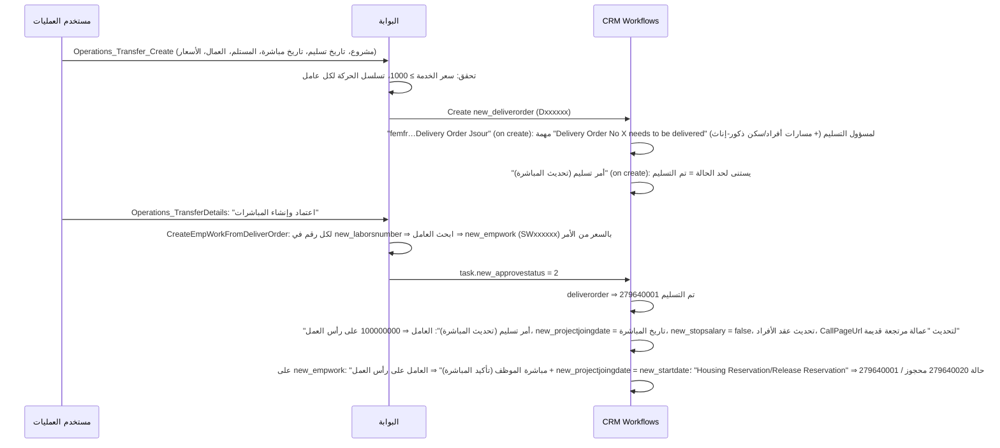

# 04 — العمليات من الأول للآخر، الاعتمادات، والمنطق المخفي في الـ CRM

> المصادر: كود الشاشات والـ Services، و XAML لـ 58 Workflow نشط (`WorkflowBase`, Type=1, StateCode=1) على الكيانات المستخدمة، وخطوات الـ plugins (`SdkMessageProcessingStep`)، وعدادات الترقيم (`xbitz_Counter`).
> **قاعدة مهمة:** البوابة بتنشئ السجل وبس، و**الـ CRM هو اللي بيكمل**: يرقّم، ينشئ مهام الاعتماد، يغيّر الحالات، يحدّث العامل. أي نظام بديل لازم يعيد بناء المنطق ده كله صراحةً.

## 0. آليات مشتركة

### 0.1 إنشاء السجل باسم المستخدم (Impersonation)
`GlobalCode.CreateAsCurrentUser`: البوابة متصلة بحساب خدمة واحد. عند الإنشاء بتحط `CallerId` = المستخدم الحالي (مطابق بـ `DOMAIN\user` على `systemuser.domainname`) والمالك `ownerid` = حساب الخدمة (عشان الـ workflows والصلاحيات). لو فشل:
1. تعيد المحاولة من غير `ownerid`.
2. لو فشلت تاني ⇒ تنشئ بحساب الخدمة وتكتب السبب في `App_Data\logs\create-as-user-yyyyMM.log`.

الموجود في اللوج (2026-10): 6 مرات `mw_lodginorderdetails — Cannot insert duplicate key` ومرة `mw_housing — attribute new_HousingType`. **الاحتمال الأقرب** (محتاج تأكيد على السيرفر): الـ plugin المتزامن `Xbitz.Crm.AdvancedCRMAutoNumber` (Create, Pre-operation stage 20, any entity) أو workflow متزامن بيكتب سجل تابع بمفتاح مكرر وهو شغال بصلاحية المستخدم. الوضع الحالي لـ "المنشئ" (حساب الخدمة اسمه `c it`): أوامر التسكين 18 من 1,013 باسم حساب الخدمة، أوامر التسليم 8 من 1,267، أما **فواتير 2026 فكلها (697) باسم حساب الخدمة** ⇒ مفيش أثر تدقيق (audit) حقيقي لمين أنشأ الفاتورة. (اتعمل قبل كده تصحيح يدوي للمنشئ بسكربتات `fix_*_createdby.sql` في مجلد المشروع.)

### 0.2 الترقيم التلقائي (Autonumber)
Plugin `Xbitz.Crm.AdvancedCRMAutoNumber` (Create, stage 20) + workflows `AutoNumberWF` + جدول `xbitz_Counter`:

| الكيان | الحقل | الصيغة | آخر رقم |
|---|---|---|---|
| `new_deliverorder` | `new_number` | `D{000000}` | 3162 |
| `new_empwork` | `new_number` | `SW{000000}` | 9732 |
| `mw_lodginorderdetails` | `mw_name` | `HO{00000}` | 4329 |
| `new_invoice` | `new_invoicenumber` | `Ninv{00000}` (+ workflow "Project Invoice autonumber WF" بكود حسب القطاع من `businessunit.new_businessinvoiceserial` وجدول `qst_sequence`) | 2439 |
| `hr_vicrequest` | `hr_reqnumber` | `V{0000000}` | 691 |
| `new_laborsback` | `new_processname` | `bk{00000}` | 3547 |
| `new_payments` / `new_paymentreceipt` | `new_name` / `new_number` | `P{00000}` / `PR{00000}` | 3067 / 151 |
| `new_employee` | `new_empidnumber` | العداد `E{00000}` **موقوف**؛ الترقيم الفعلي من workflow "AutoNumber Employee" حسب `new_employeetype` (مثال `BSS002862`) | |
| `new_project`, `new_agent`, `new_leaverequest` | `new_code`… | workflows AutoNumber | |

### 0.3 محرك الاعتماد (Task-based approvals)
- كل مرحلة = `task` (`new_isapprovaltask = true`) مربوطة بالطلب (`regardingobjectid`)، مالكها مستخدم أو Team يتحدد بالـ custom activity `GetWorkFlowUser` (من `new_workflowuser` — 89 سجل إعداد) أو `project.ownerid` (مدير المشروع) أو `systemuser.parentsystemuserid` (المدير المباشر).
- الـ workflow بيستنى (`WaitStep`) لحد ما `task.new_approvestatus` يبقى 2 (موافقة) أو 3 (رفض)، وبعدها يغيّر حالة الطلب وينشئ المرحلة التالية.
- Workflows على `task`:
  - **Approval Task and email** — إيميل للمالك، وقفل المهمة (`statecode=1, statuscode=5`).
  - **Approval Task Close As completed** — يقفل المهمة لما تتعمد.
  - **Task Reminder** — تذكيرات بالإيميل وتصعيد للمدير (`parentsystemuserid`) بعد مهلة (`new_esclationdate`, `new_secondreminder`, `new_reaptedreminder`).
  - **Task Workflow User** / **Task Change Owner** / **Task Update On Behalf** / **Task Update Employee** — تعيين المالك، الاعتماد بالنيابة، وتعبئة رقم العامل على المهمة.
- حقول على المهمة بيستخدمها الـ workflow لإجبار حقول/تحقق قبل الاعتماد: `new_mandatoryfields`, `new_manddesc`, `new_validatefunctions`, `new_validatefunctionalert` — البوابة بتقراها وبتعرضها (`CrmApprovalService.GetOpenTaskForRecord`).
- **قاعدة البوابة** (`CrmApprovalService.CanCurrentUserActOnTask`): مالك المهمة، أو عضو في الـ Team المالك، أو عضو في `TopApproval`. البوابة بتغير `new_approvestatus` بس والـ workflow يكمل؛ عشان كده الشاشات بتعمل refresh لحد 3 مرات (`WorkflowRefreshMaxAttempts = 3`) مستنية المرحلة الجاية تتنشئ (`ApprovalTimelineService`).

### 0.4 التحقق من تسلسل الحركة (Movement validation)
`EmployeeMovementValidationService` — بيقارن **آخر مباشرة** و**آخر تسكين معتمد غير ملغي** (التواريخ +3 ساعات):

| العملية | الشرط | الرسالة |
|---|---|---|
| تسليم/مباشرة | لو آخر حركة مباشرة (مش تسكين) ⇒ مرفوض | "لازم تسكين/رجيع قبل مباشرة جديدة" |
| | تاريخ التسليم أو المباشرة قبل آخر تسكين ⇒ مرفوض | |
| تسكين/رجيع | لو آخر حركة تسكين ⇒ مرفوض | "لازم مباشرة قبل تسكين جديد" |
| | تاريخ التسكين قبل آخر مباشرة ⇒ مرفوض | |
| نفس اليوم | مسموح؛ الأحدث = اللي `createdon` بتاعه أحدث | |

يعني النظام بيفترض **تبادل صارم**: سكن ← شغل ← سكن ← شغل. الإجازة مش جزء من السلسلة (العائد من إجازة بيدخل كتسكين).

---

## 1. إضافة عامل (Onboarding)

| الخطوة | التفاصيل |
|---|---|
| الشاشة | `HR_Employee_Create.aspx` — إدخال واحد أو أكتر: الاسم، الجنسية، المهنة، الجواز، رقم التأشيرة، رقم الحدود، تاريخ الدخول، رقم الرحلة، المشروع، القطاع |
| الإنشاء | `new_candidate` (مش موظف!) |
| CRM: `arrive` / `إنشاء موظف من عامل` | لما `new_arrived = true` ⇒ إنشاء `new_employee` بكل البيانات (الراتب والبدلات من المرشح، الوكيل، المهنة، المشروع، الحالة)، ربط المرشح بالموظف، حالة المرشح ⇒ 100000007 "وصل العامل" |
| CRM على `new_employee` (Create) | `AutoNumber Employee` (رقم حسب النوع + `new_sadadworkpermitno`)، `CreateEmployeeStatues` (17 سجل متابعة إجراءات)، `Employee Visa Expense` (مصروف تأشيرة `new_empexpense`)، `إنشاء إقامة` (`mw_stay`)، `إنشاء عقد موظف عند إضافة موظف` (`new_laborcontract`)، `create candidate from employee` (لو اتنشأ موظف من غير مرشح) |
| CRM على التعديل | `CreateEmployeeAudit` (عند تغير `statuscode` ⇒ `new_employeeaudit`)، `الموظف (عند تغيير الراتب)` ⇒ عقد جديد، `تغيير مركز التكلفة عند تغيير المشروع`، `نقل موظف إلى مشروع` (عند `new_transferedprojectid` ⇒ `new_projtransfer` + تغيير المشروع)، `إزالة الموظف من أجير` (CallPageUrl لخدمة أجير)، `تغيير حالة الموظف تم نقل كفالة` ⇒ يقفل عقد الأفراد |

## 2. تسليم عامل لمشروع (Delivery Order → Work Start)



**التحققات في البوابة:** المشروع، المستلم وصفته، العمال، Total Services Price إجباري و ≥ **1,000** ريال (`MinServicePrice`)، بدل السكن والمواصلات اختياري، صيغ التاريخ (5 صيغ)، تسلسل الحركة.
**ملاحظات:**
- المبالغ بتتنقل من الأمر للمباشرة (وفي سيناريو تاني من الـ Session: `TransferFinancials_{id}`) — المباشرات اللي اتعملت قبل إضافة حقول المبالغ على الأمر مالهاش سعر (87 مباشرة من 2026-09 لحد النهارده `new_serviceprice` = NULL).
- منع التكرار: نفس العامل في نفس الأمر مرة واحدة بس. **مافيش** منع لمباشرتين مفتوحتين لنفس العامل في مشروعين (502 حالة "نفس العامل في نفس اليوم ليه أكتر من مباشرة" على كل البيانات).
- حالات الأمر: 279640009 إرسال لمسؤول التسليم، 279640010 منسق المبيعات، 279640007 إرجاع للمبيعات، 279640003 لم يتم التسليم، 279640001 تم التسليم، 279640011 انتظار مدير العمليات.

## 3. التسكين والرجيع (Housing Order)

| الخطوة | التفاصيل |
|---|---|
| الشاشة | `Operations_Housing_Create.aspx` — البحث عن العامل، نوع الدخول (**إجباري تلقائيًا حسب حالة العامل**: على رأس العمل ⇒ عامل مرتجع، جديد ⇒ حديث الوصول، إجازة ⇒ عائد من إجازة)، سبب الرجيع (للمرتجع)، تاريخ الوصول |
| تأخير | لو تاريخ الوصول أقدم من يومين: البوابة تطلب **سبب التأخير** (`new_delayreason` ≤ 100 حرف، الشرط `> 2` أيام) و `CrmCreateService` يحط `new_delay = نعم` (الشرط `<= اليوم − 2` ⇒ قاعدتين مختلفتين بفرق يوم) |
| التحقق | تسلسل الحركة (§0.4) |
| الإنشاء | `CrmCreateService.CreateHousingOrder` ⇒ `mw_lodginorderdetails` (`HOxxxxx`) باسم المستخدم |
| CRM: `Labor Housing Order WF` | مهمة "Labor Housing Order - HOxxxx" (مشرف المشروع/المبيعات) ⇒ 100000008 / 100000006 … ثم مهمة "wait operation manager approval" (969 مهمة) ⇒ **100000009 approved**. عند الرفض: الحالة 100000004 الغاء + **`new_housingstatus = 5 (أخرى)` و `new_leavedate = mw_arrivedate`** (يعني فترة السكن بتتقفل بنفس يوم الدخول) + `new_stopsalary = true` على العامل. فيه مهمة إجبارية بحقل "برجاء إدخال رغبة العميل في استبدال او الغاء العقد" |
| CRM: `Housing Order Process` | المرشح ⇒ وصل، `new_enterdate = mw_arrivedate`؛ **العامل: `new_projectjoingdate = mw_arrivedate`** (تاريخ الالتحاق بالمشروع بيتكتب بتاريخ السكن!) و `new_passportstatus = 3`؛ ينشئ `new_laborsback` (إرجاع: تاريخ الرجوع، تاريخ وقف العمل، وقف الراتب، الراتب والبدلات)؛ حالة العامل ⇒ 279640001 في السكن / 100000001 إجازة / 279640007 خروج نهائي حسب الفرع؛ وفي فروع معينة `new_housingstatus = 3/5` و `new_leavedate = mw_arrivedate` |
| CRM: `Housing Status Work Flow` / `WF labour Housing change status` | عند تغيير `new_housingstatus`: هروب ⇒ إنشاء بلاغ `mw_reportescape` و `new_employee.new_leftdate = new_leavedate`؛ خروج نهائي ⇒ العامل 279640007 |
| CRM: أخرى | `Labor Housing Order إعادة التسويق` (على `new_finalproposedaction` ⇒ العامل 279640012 جاري تسويقه)، `Labor Housig Order Resume Salary` (على `new_salarystopoption` ⇒ `new_stopsalary`)، `updatelabor` (يملأ تاريخ الوصول/الحدود/السكن من العامل)، `Update Individual Contract…` (قطاع الأفراد: إنشاء أمر تسليم بديل وتغيير حالة عقد الفرد) |
| Business rules (Category 2) | `Enter Type`, `Leave Date Mandatory`, `Passport In Housing Condition`, `SetNotesRequired`, `تعيين المشروع`, `قاعدة أوغندا`, `قاعدة بنجلاديش نسائي` — قواعد على الفورم في الـ CRM (مابتشتغلش من البوابة) |

## 4. إدارة السكن (المباني/الغرف/السراير)
`Operations_HousingManager*` + `HousingManagerService`:
- إنشاء سكن `mw_housing` (رقم، اسم عربي/إنجليزي، نوع: سكن الشركة/تجاري)، غرف `mw_housingapartments` (رقم تلقائي، سعة `mw_apartmentscount`) مع سراير تلقائية بعدد السعة.
- السرير = سجل في `new_ajeercontract` (`new_name` رقم السرير، `new_roomnumber` الغرفة) والتسكين = سجل في `new_thijridate` (`new_bedn` السرير، العامل، المشروع، نوع السكن، نوع السرير، سعر السكن والمواصلات، دخول/خروج). قفل التسكين = `new_exitdate`.
- **مش مربوط** بأمر التسكين ولا بيأثر على حالة العامل.

## 5. التحضير الشهري ← الفاتورة ← التحصيل

### 5.1 حساب أيام العمل (`GlobalCode.GetProjectMonthlyAttendanceExportData`)
لكل مباشرة في المشروع:
```
بداية = DATEADD(HOUR,3,new_startdate)
نهاية = أقل قيمة من:
   new_enddate + 1 يوم (لو موجود)
   أول تسكين "معتمد غير ملغي" لنفس العامل ونفس المشروع بعد البداية (mw_arrivedate)
   أول مباشرة تالية لنفس العامل
الفترة الفعلية = تقاطع [بداية، نهاية) مع [أول الشهر، آخر الشهر]
```
- **وضع 30 يوم ثابت** (`attendanceBaseDays = 30`): لو الشهر 31 يوم بيتحسب لحد يوم 30، والإجمالي مايزيدش عن 30؛ لو فبراير بيتحسب الأيام الفعلية.
- لو للعامل أكتر من مباشرة في الشهر: سطر واحد للعامل وأيام بدون تكرار (`GetUncoveredInclusiveDays`)، والسعر = سعر **آخر مقطع** فيه سعر على المباشرة، وإلا سعر العامل الافتراضي (`new_totalservices`, `new_custhousing`, `new_custtransport`).
- الإجازات (`hr_vicrequest`) **مش داخلة** في الحساب؛ والرجوع للسكن من مشروع تاني مش بيقفل المباشرة.

### 5.2 الملف والفاتورة
1. `Attendance.aspx` يعرض المشاريع اللي فيها مباشرات في الشهر وحالة فاتورتها، وينزّل Excel من قالب (`ExportProjectMonthlyAttendanceWorkbook`) فيه ~50 عمود (أيام، راتب، بدلات، Service Price، غياب، خصومات، سلف، إضافي، VAT، IBAN…).
2. الرفع (`Attendance_CreateInvoice` ⇒ `AttendanceInvoiceImportService`) على 7 مراحل: قراءة ⇒ أعمدة إلزامية ⇒ الفترة ⇒ المشروع `ProjCode` ⇒ العمال ⇒ إنشاء.
   - كل عامل في الملف لازم يكون في "التحضير الموثوق" المحسوب من النظام، ومايتكررش، ومايتشالش؛ المسموح تعديله بس: الغياب، الخصومات، السلف، الإضافات، الإضافي.
   - المعادلات لو الخانة فاضية: الراتب المستحق = WorkingDays/Days × TotalSalary؛ الرسوم = FeesDays/Days × (Service Price − TotalSalary)؛ خصم الغياب = TotalSalary/Days × AbsenceDays؛ VAT = المبلغ × Vat Rate.
   - إنشاء `new_invoice` (`new_invoicetype = Project Invoice`, `new_whowillpay = شركة الاستقدام`, `new_monthdays`, الفترة) + `new_invoicdetail` لكل عامل، ثم تحديث الإجماليات (`new_totalsalary`, `new_nettoemployee`, `new_totalamount`, `new_totalvatamount`, `new_netsalarywithvat`) — وفي حالة الفشل `UPDATE new_invoicdetailBase` مباشر بالـ SQL.
3. CRM: `projectinvoicenewworkflow` — 5 مراحل مهام: **review new invoice** (279640006 مشرف المشروع) ⇒ **review invoice** ⇒ **finance review** (279640001) ⇒ **send invoice to customer** (279640002) ⇒ **wait paid** (279640008)؛ الرفض ⇒ 279640007 ملغية. `Auto Project Invoice Number` / `Project Invoice autonumber WF` للترقيم، و `فاتورة مشروع (خصم السلف)` + `Convert Reject Work To Loans` بيكلموا صفحات خارجية (`CallPageUrl`).
4. التحصيل: إدخال `new_totalpaidamount` ⇒ `Project Invoice Collection Status change WF` يحدّث `new_fullycollect`؛ الحالات 279640003 جزئي / 279640004 كلي. الـ plugin `PrInvDetailsMultiRetriveHO` (RetrieveMultiple على `new_invoicdetail`) بيفلتر سطور HeadOffice في الـ CRM.

## 6. حضور ورواتب HeadOffice
| الخطوة | التفاصيل |
|---|---|
| استيراد البصمة | `HR_Attendance` ⇒ `MonthlyAttendanceService.Import` (Excel/ACE OLEDB): سجل `new_attendance` لكل موظف/يوم (`new_name` = رقم الهوية + التاريخ)، الغياب = غائب ومش عطلة (الجمعة/السبت/عطلة بالنص)، التأخير والخروج المبكر |
| مراجعة | `HR_AttendanceDetails`: تعديل أيام الخصم `new_discountnumber`، اعتماد `new_attstatus = true` (بعد الاعتماد ممنوع التعديل) |
| معاينة المسير | `PayrollService.GetPayrollPreview`: موظفين مشروع HeadOffice اللي حالتهم `%hiring%worker%`، غير مدرجين في مسير آخر متقاطع، الغياب من الحضور المعتمد + الاستئذانات المعتمدة (بالنص "معتمد") |
| الحساب | خصم الغياب = الإجمالي/30 × الأيام؛ الصافي = الإجمالي − خصم الغياب − خصومات + إضافات |
| الإنشاء | `new_invoice` على مشروع HeadOffice (**نفس نوع فاتورة المشروع**) + `new_invoicdetail` لكل موظف |
| الصرف | `HR_PayrollInvoices`: حالات الصرف، تصدير، وإرسال قسائم الراتب بالإيميل (`PayrollPayslipEmailService` — SMTP غير مضبوط) |

## 7. الإجازة / الخروج / التصفية (`hr_vicrequest`)
| الخطوة | التفاصيل |
|---|---|
| الإنشاء | `HR_VacationRequest_Create`: العامل، النوع `new_exist` (خروج نهائي، خروج وعودة، إجازة داخلية، نهاية العقد، تصفية، 640، مسافر مع العميل…)، البداية والنهاية والأيام، مرفق (≤ 2MB) |
| CRM: `Vacation Request Abdal WF` | مسار حتى ~20 حالة: انتظار تعميد المدير المباشر (100000024) ⇒ انتظار موافقة العميل (100000023) ⇒ انتظار مراجعة العمليات (100000025) ⇒ تعميد مدير HR (100000027) ⇒ انتظار التصفية (100000026) ⇒ اعتماد المالية (100000028) ⇒ توقيع العامل على المخالصة (100000035) ⇒ تعميد المدير التنفيذي (100000029) ⇒ انتظار صرف المستحقات (100000030) ⇒ إصدار التأشيرة (100000031) ⇒ تسليم المستندات (100000036) ⇒ تمت الموافقة (100000010)؛ مع فروع: الرواتب (100000006)، العلاقات الحكومية (100000015)، الإرجاع لصاحب الطلب (100000017)، الرفض (100000002/100000034). المالكين من `GetWorkFlowUser` (Operation Manager, Law affairs, Business Accountant, HR manager, مسؤول التصفية). للخروج النهائي بينشئ **طلب ترحيل `mw_requestdeport`** |
| CRM: `طلب أجازة (تعديل حالة الموظف)` | يستنى لحد تاريخ البداية ⇒ العامل 100000001 إجازة / 279640014 إجازة عميل / 279640007 خروج نهائي |
| CRM: `تحديث تاريخ الأجازة 42 يوم قبل نهاية العقد` | يعيد حساب تاريخ البداية/النهاية من `new_enterdate` للعامل |
| Business rules | "إلزامية مرفق الإلتزام الخطي"، "إلزامية choise employee في حالة مرسلة الى التوظيف" |
| التصفية في البوابة | `VacationRequestService.UpdateSettlementInputs`: راتب الأيام = الراتب/30 × يوم بداية الطلب في الشهر؛ بدل الإجازة = الراتب/30 × أيام الإجازة (لغير الخروج النهائي/الاستقالة)؛ **مكافأة نهاية الخدمة** (للخروج النهائي/الاستقالة) = نص شهر عن كل سنة لأول 5 + شهر عن كل سنة بعدها، وللاستقالة: < سنتين 0، < 5 الثلث، < 10 الثلثين؛ الصافي = الإضافات − (سلف + عهد + خصومات). النوع بيتعرف **من النص** |
| الطباعة | `HR_VacationClearancePrint` (المبلغ بالحروف ريال/هللة) |
| رصيد الإجازة | في صفحة العامل: الرصيد = الإجازة السنوية/365 × الأيام من `new_contractstartdate`؛ المتبقي = الرصيد − المستهلك القديم − المستهلك. **بيتكتب بـ SQL `UPDATE new_employee` كل ما الصفحة تفتح** |

## 8. الاستئذان (`new_leaverequest`)
- `HR_LeaveRequest_Create`: النوع (تأخير/خروج/إجازة تخصم من الرصيد/مهمة عمل/مرضي/أخرى)، الأيام، من/إلى، السبب.
- CRM `WF_LeaveOfAbsenceRequest`: 100000005 جديد ⇒ 100000012 للمدير المباشر (مدير القسم `new_department.new_deptmanager` أو `parentsystemuserid`) ⇒ 100000006 Headoffice Timesheet ⇒ 100000000 HR ⇒ 100000007 موافقة ⇒ (حسب النوع) 100000010 CEO؛ رفض 100000002. بيحدّث `new_managerapproval`/`new_managerstatus` وبيكلم صفحة خارجية لإرسال للـ HR.
- الأثر: بيدخل في معاينة الرواتب كغياب لو "معتمد".

## 9. الوكلاء (Agents)
- `HR_Agents` / `HR_AgentDetails` / `AgentService`: إنشاء وكيل (`new_name`)، ربط عمال (`new_employee.new_agent`)، تاريخ إرجاع للوكيل/أجير (`new_ajeerpostdate`)، ملخص حالات عمال الوكيل.
- CRM: `Agents AutoNumber`، ومسار اعتماد الوكيل بالحالات (استقدام ⇒ قانونية ⇒ المدير المالي ⇒ نائب المدير ⇒ المدير العام) — كل الـ 9 وكلاء حاليًا في 100000000 "إرسال إلى قسم الإستقدام".

## 10. المشاريع والمبيعات
- `sales_project_create` ⇒ `CrmCreateService.CreateProject` (الاسم عربي=إنجليزي=نفس النص، السجل التجاري، نوع العقد، البداية والنهاية، مدير المشروع `ownerid`، المسؤول، الجوال، الإيميل، `new_businesstype = قطاع الأعمال`).
- CRM: `AutoNumber Project` (`new_code`)، `Create Customers For Projects` (إنشاء `account` وربطه `new_customerid`)، `عند إضافة مشروع` (تحديث بيانات العميل: مكتب العمل والسجل).
- `Sales_ProjectDetails`: العمالة الحالية، الفواتير، الحركة، تغيير مدير المشروع (Team `ProjectAdmin`).
- `Sales_ProjectServicePrices` / `ProjectServicePriceUpdateService`: تعديل سعر الخدمة على العامل وعلى المباشرات بـ **SQL `UPDATE` مباشر** على `new_employee` و `new_empwork` (Excel import/export، حسب شهر الحركة).

## 11. منطق مخفي يجب نقله صراحةً (Checklist)

| # | المنطق | مكانه الحالي |
|---|---|---|
| 1 | ترقيم كل المستندات (D, SW, HO, Ninv, V, bk, P, PR, BSS…) | Xbitz plugin + AutoNumberWF + `xbitz_Counter` + `qst_sequence` |
| 2 | إنشاء الموظف من المرشح عند الوصول | WF `إنشاء موظف من عامل` |
| 3 | حالة العامل بتتغير مع كل حركة (تسليم ⇒ على رأس العمل، تسكين ⇒ في السكن، إجازة ⇒ إجازة، هروب/خروج ⇒ …) | 8+ workflows |
| 4 | `new_projectjoingdate` بيتكتب من المباشرة **ومن تاريخ السكن** | WFs `مباشرة الموظف`, `أمر تسليم`, `Housing Order Process` |
| 5 | تاريخ الخروج من السكن = تاريخ الدخول عند الإلغاء/بعض الفروع | WFs `Labor Housing Order WF`, `Housing Order Process` |
| 6 | وقف/استئناف الراتب `new_stopsalary` | WFs التسكين والتسليم |
| 7 | إنشاء سجلات تابعة: `new_laborsback`, `mw_reportescape`, `mw_requestdeport`, `new_laborcontract`, `mw_stay`, `new_empexpense`, `new_employeestatues`, `new_employeeaudit`, `new_projtransfer`, `account` | workflows متفرقة |
| 8 | مسارات الاعتماد ومالكي المراحل والتذكير والتصعيد | WFs + `new_workflowuser` + `GetWorkFlowUser` |
| 9 | التكامل مع أجير والصفحات الخارجية (`CallPageUrl` على `:8001`) | custom activities |
| 10 | فلترة سطور فواتير HeadOffice | plugin `PrInvDetailsMultiRetriveHO` |
| 11 | حساب أيام التحضير (30 يوم، تقاطع المقاطع، أولوية السعر) | `GlobalCode` |
| 12 | حساب التصفية ومكافأة نهاية الخدمة ورصيد الإجازة | `VacationRequestService`, `HR_EmployeeDetails` |
| 13 | تسلسل الحركة (سكن ↔ شغل) | `EmployeeMovementValidationService` |
| 14 | قواعد الفورم في الـ CRM (أوغندا، بنجلاديش نسائي، Leave Date Mandatory…) | Business rules (Category 2) |
