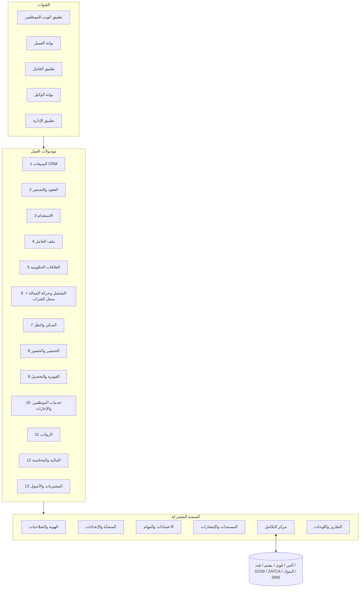
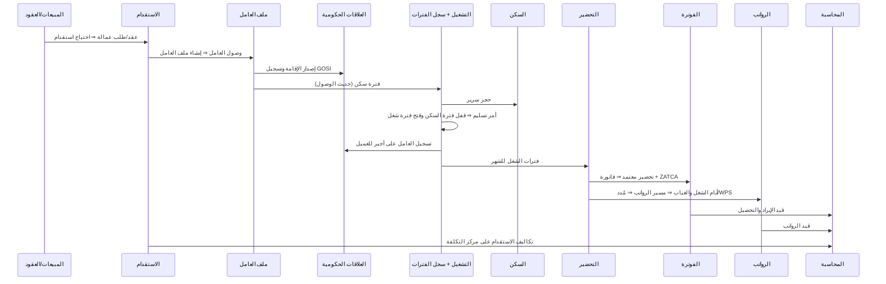

# 01 — هيكل النظام: الموديولات ومكوناتها

> مبني على [00-design-principles](00-design-principles.md): نحافظ على طريقة العمل والتقارير الحالية، بدون الالتزام بتصميم الـ CRM القديم.
> المعمارية: **Modular Monolith** على .NET (ASP.NET Core Web API) — كل موديول ليه بياناته (schema منفصل) وواجهته (API) وأحداثه، والتواصل بين الموديولات بالأحداث (Domain Events / Outbox) مش بالدخول على جداول بعض.

## نظرة عامة

---

## أ. موديولات العمل (13)

### 1. المبيعات وإدارة العملاء (Sales CRM)
| المكون | الوظيفة |
|---|---|
| العملاء والجهات (Accounts & Contacts) | بيانات العميل، السجل التجاري، الرقم الضريبي، العنوان الوطني، جهات الاتصال، مجموعة العميل |
| الفرص المحتملة (Leads / Opportunities) | متابعة العميل المحتمل ومراحل البيع |
| طلبات العمالة من العملاء (Manpower Requests) | عدد × مهنة × جنسية × مدة × موقع |
| عروض الأسعار (Quotations) | تسعير حسب المهنة والجنسية والتكلفة والهامش، واعتماد العرض |
| الأنشطة | مكالمات، زيارات، مهام، شكاوى العميل |

### 2. العقود والتسعير (Contracts & Pricing)
| المكون | الوظيفة |
|---|---|
| العقود | العقد مع العميل: النوع (مبلغ مقطوع / تكلفة + هامش / …)، المدة، التجديد، الضمانات، الدفعات المقدمة |
| المشاريع والمواقع (Projects / Sites) | المشروع أو الموقع اللي العمالة بتشتغل فيه، ومدير المشروع، ومركز التكلفة |
| قوائم الأسعار (Rate Cards) | سعر الخدمة والسكن والمواصلات لكل مهنة/جنسية، بتاريخ سريان |
| سياسة الفوترة | 30 يوم ثابت أو الأيام الفعلية، دورة الفوترة، من يتحمل الرسوم، VAT |
| الحصص والالتزامات | العدد المتعاقد عليه مقابل العدد المسلّم، والاستبدال المطلوب |

### 3. الاستقدام (Recruitment)
| المكون | الوظيفة |
|---|---|
| خطة واحتياج الاستقدام | من طلبات العملاء والعقود ⇒ احتياج بالمهنة والجنسية |
| التأشيرات | التأشيرات الجماعية (Block Visas) وتوزيعها على المهن والجنسيات والوكلاء، وتفويض الوكيل |
| الوكلاء (الموردين الخارجيين) | بيانات الوكيل، عقده، أسعاره، تقييمه، اعتماده |
| المرشحين | السيرة الذاتية، المقابلة، الاختيار، الكشف الطبي، التأشيرة والختم |
| السفر والوصول | الحجز، الرحلة، الاستقبال في المطار، تأكيد الوصول ⇒ **إنشاء ملف العامل تلقائيًا** |
| تكاليف الاستقدام | رسوم الوكيل والتأشيرة والطيران ⇒ تتحمل على العامل/العقد وتظهر في الربحية |

### 4. ملف العامل (Workforce Master)
| المكون | الوظيفة |
|---|---|
| البيانات الشخصية | الاسم عربي/إنجليزي، الجنسية، الديانة، الحالة الاجتماعية، الصورة |
| الهويات والوثائق | الإقامة، الجواز، رقم الحدود، التأشيرة، رخصة العمل، التأمين الطبي — برقم فريد لكل نوع وتواريخ انتهاء وتنبيهات |
| عقد العمل وهيكل الراتب | الأساسي والبدلات بتاريخ سريان (سجل تاريخي لكل تعديل) |
| المهنة والتصنيف | المهنة الفعلية ومهنة الإقامة، المهارات واللغات |
| المنشأة الكفيلة | السجل التجاري اللي العامل عليه (متعدد الشركات) |
| دورة الحياة (Lifecycle) | نشط / إجازة طويلة / هروب / خروج نهائي / منقول الكفالة / متوفى — منفصلة عن "مكانه الحالي" |
| ملف 360 | خط زمني، خريطة أيام، تقييم، ربحية |

### 5. العلاقات الحكومية (Government Relations)
| المكون | الوظيفة |
|---|---|
| الإقامات (مقيم) | الإصدار والتجديد ورسومه |
| رخص العمل وأجير وقوى | تسجيل العامل على أجير/قوى للعميل وإنهاؤه |
| تأشيرات الخروج والعودة والخروج النهائي | إصدار وتمديد وإلغاء |
| التأمينات الاجتماعية (GOSI) | التسجيل والاستبعاد والأجر المسجل |
| نقل الكفالة | إجراءات النقل للداخل والخارج |
| متابعة الانتهاءات والغرامات | لوحة لكل الوثائق اللي قربت تنتهي، والرسوم الحكومية كتكلفة على العامل |

### 6. التشغيل وحركة العمالة (Workforce Operations) — **قلب النظام**
| المكون | الوظيفة |
|---|---|
| أوامر التسليم | تسليم عامل أو مجموعة لمشروع: **سطر لكل عامل بسعره**، المستلم، تاريخ التسليم والمباشرة، والاعتماد |
| أوامر الرجيع / العودة للسكن | رجوع من المشروع مع السبب والتأخير وحالة العامل |
| النقل والاستبدال | من مشروع لمشروع، أو استبدال عامل بعامل |
| **سجل الفترات الموحد (Period Ledger)** | كل يوم في حياة العامل له فترة واحدة: شغل في مشروع / سكن / إجازة / استئذان / هروب / خروج — بدون تداخل، وتتولد تلقائيًا من المستندات |
| قواعد الحركة | تسلسل الحركة (سكن ↔ شغل)، منع التداخل، ترتيب أحداث اليوم الواحد |
| العمالة المتاحة (Bench) | مين في السكن وجاهز للتسليم، بالمهنة والجنسية ومدة الانتظار |
| الحجز والتسويق | حجز عامل لعميل، إعادة التسويق |

### 7. السكن والنقل (Housing & Transport)
| المكون | الوظيفة |
|---|---|
| المساكن | مبنى ⇒ دور ⇒ غرفة ⇒ سرير، نوع السكن (للشركة / لمشروع / تأجيري / تجاري) |
| التسكين على السرير | يتولد من فترة السكن في سجل الفترات، والإشغال لحظي |
| عقود الإيجار وتكاليف السكن | الإيجار والكهرباء والمياه والصيانة ⇒ تكلفة لكل سرير/عامل/مشروع |
| الصيانة والعهد | طلبات صيانة، عهد السكن (مراتب، أجهزة) |
| النقل | الباصات والسائقين وخطوط النقل للمشاريع وتكلفتها |

### 8. التحضير والحضور (Attendance & Timesheets)
| المكون | الوظيفة |
|---|---|
| التحضير الشهري للمشاريع | يتحسب تلقائيًا من سجل الفترات لكل مشروع وشهر (بنفس قاعدة النظام الحالي)، ومراجعة المشرف |
| تعديلات التحضير | غياب، خصومات، إضافي، أيام إضافية — بأسباب واعتماد |
| اعتماد العميل | العميل يراجع ويعتمد التحضير من بوابة العميل (أو رفع Excel بقالب ثابت كبديل) |
| حضور موظفي الإدارة | ربط أجهزة البصمة، الورديات، التأخير والخروج المبكر، العطلات الرسمية |

### 9. الفوترة والتحصيل (Billing & Receivables)
| المكون | الوظيفة |
|---|---|
| توليد الفواتير | من التحضير المعتمد ⇒ فاتورة لكل مشروع وشهر، **وكل سطر مربوط بالفترة** |
| الضريبة و ZATCA | حساب VAT، الفاتورة الإلكترونية (المرحلة الثانية — الربط والـ QR والختم) |
| إشعارات دائن ومدين | تصحيح الفواتير بدل الإلغاء |
| سندات القبض والتوزيع | تحصيل جزئي أو كلي وتوزيعه على الفواتير |
| أعمار الديون والمتابعة | الأعمار، كشف حساب العميل، خطة تحصيل، تنبيهات |
| تغطية الفوترة | كشف أي فترة شغل لم تُفوتر |

### 10. خدمات الموظفين والإجازات (HR Services)
| المكون | الوظيفة |
|---|---|
| الإجازات والخروج | سنوية، خروج وعودة، خروج نهائي، إجازة عميل — بمسارات اعتماد |
| أرصدة الإجازات | استحقاق تلقائي حسب العقد، ومستهلك، ومتبقي |
| الاستئذانات | تأخير، خروج، مهمة عمل، مرضي |
| التصفية ونهاية الخدمة | حساب المستحقات ومكافأة نهاية الخدمة حسب نظام العمل، المخالصة |
| السلف والعهد والجزاءات | سلف بأقساط، عهد، مخالفات وجزاءات |
| طلبات الخدمة الذاتية | تعريف راتب، تعديل بيانات، شكاوى |

### 11. الرواتب (Payroll)
| المكون | الوظيفة |
|---|---|
| عناصر الراتب | الأساسي، البدلات، الإضافي، الخصومات، الأقساط — بقواعد حساب |
| مسير الرواتب | لكل العمالة والموظفين (مش HeadOffice بس)، من سجل الفترات والحضور والإجازات |
| مُدد و WPS | ملف حماية الأجور ورفعه |
| ملفات البنوك | ملف التحويل لكل بنك |
| قسائم الرواتب | بالإيميل وتطبيق العامل |
| GOSI | الاشتراكات الشهرية |
| الترحيل للمحاسبة | قيد الرواتب تلقائيًا على مراكز التكلفة |

### 12. المالية والمحاسبة (Finance & Accounting)
| المكون | الوظيفة |
|---|---|
| الأستاذ العام | دليل الحسابات، القيود، الفترات المحاسبية والإقفال |
| القيود التلقائية | من الفواتير والتحصيل والرواتب والمشتريات والاستقدام |
| مراكز التكلفة | لكل مشروع/عقد/سكن — ربحية لكل مشروع وعامل |
| الذمم الدائنة | فواتير الموردين والوكلاء والدفعات |
| البنوك والخزينة | الحسابات البنكية، التسوية البنكية، العهد النقدية |
| الموازنات | موازنة لكل مركز تكلفة ومقارنتها بالفعلي |
| القوائم المالية | ميزان المراجعة، الأرباح والخسائر، الميزانية، الإقرار الضريبي |

### 13. المشتريات والأصول (Procurement & Assets)
| المكون | الوظيفة |
|---|---|
| طلبات وأوامر الشراء | مستلزمات السكن والمشاريع، باعتماد |
| الموردين | بياناتهم وعقودهم وتقييمهم |
| المخزون | مستودع مستلزمات السكن والعهد |
| الأصول | السيارات، تجهيزات السكن، الإهلاك |

---

## ب. المنصة المشتركة (6)

| الموديول | المكونات |
|---|---|
| **الهوية والصلاحيات (IAM)** | دخول موحد (SSO) بـ Entra ID/AD، تحقق ثنائي، أدوار وصلاحيات على مستوى الشاشة والعملية والبيانات (الشركة/المشروع/الإدارة)، حسابات للعملاء والعمال والوكلاء، **سجل تدقيق (Audit Trail)** لكل عملية |
| **المنشأة والإعدادات** | الشركات والسجلات التجارية، الفروع والإدارات، الهيكل التنظيمي، الترقيم التلقائي، التقويم والعطلات، القوائم المرجعية (المهن، الجنسيات، أسباب الرجيع…) بأكواد ثابتة، السياسات (30 يوم، أقل سعر، مهل التأخير) |
| **الاعتمادات والمهام (Workflow)** | محرك Elsa: تعريف مسار الاعتماد لكل مستند، المالك بالدور أو مدير المشروع أو المدير المباشر، مهامي، SLA وتذكير وتصعيد، الاعتماد بالنيابة، خط زمني للمراحل |
| **المستندات والإشعارات** | تخزين الملفات (Blob)، المرفقات على أي سجل، قوالب الطباعة (فواتير، مخالصات، عقود)، إشعارات داخل النظام وإيميل وSMS وواتساب |
| **مركز التكامل (Integration Hub)** | API موثق (OpenAPI) بإصدارات، OAuth2 للأنظمة الخارجية، Webhooks، Outbox وإعادة المحاولة، موصلات (أجير، قوى، مقيم، مُدد، GOSI، ZATCA، البنوك، SMS)، **مزامنة مؤقتة مع الـ CRM الحالي** أثناء النقل |
| **التقارير واللوحات (BI)** | طبقة تقارير موحدة (كل مؤشر بتعريف واحد)، لوحة الإدارة التنفيذية، لوحات المديرين والتشغيل والسكن والمالية، تقارير قابلة للتصدير، API لتطبيق الإدارة |

## ج. القنوات (5)

| القناة | المستخدم | أهم الوظائف |
|---|---|---|
| تطبيق الويب | موظفي الشركة | كل الموديولات حسب الصلاحية — عربي RTL وإنجليزي |
| بوابة العميل | العملاء | العمالة عندهم، اعتماد التحضير، الفواتير وكشف الحساب، طلب عمالة أو استبدال، الشكاوى |
| تطبيق العامل | العمالة | قسيمة الراتب، طلب إجازة أو استئذان، الوثائق وتواريخ انتهائها، الإشعارات |
| بوابة الوكيل | الوكلاء | رفع المرشحين، متابعة الطلبات، فواتيرهم |
| تطبيق الإدارة | الإدارة العليا | اللوحات والتنبيهات والاعتماد من الموبايل |

---

## د. كيف الموديولات بتتكلم مع بعض (رحلة العامل)

## هـ. الربط بالمراحل

| المرحلة | الموديولات |
|---|---|
| 0 — التأسيس | المنصة المشتركة (الهوية، الإعدادات، الاعتمادات، المستندات، التكامل)، والمزامنة من الـ CRM |
| 1 — البيانات الأساسية وسجل الفترات | ملف العامل، العقود والمشاريع (أساسي)، السكن (المباني والسراير)، سجل الفترات من بيانات الـ CRM |
| 2 — حركة العمالة | التشغيل (التسليم، الرجيع، النقل)، التسكين، الإجازات والاستئذان |
| 3 — التحضير والفوترة | التحضير، الفوترة والتحصيل، ZATCA، بوابة العميل |
| 4 — الرواتب والمالية | الرواتب، مُدد/WPS، GOSI، المحاسبة، الذمم الدائنة، المشتريات |
| 5 — المبيعات والاستقدام | CRM، عروض الأسعار، الاستقدام، العلاقات الحكومية كاملة، بوابة الوكيل، تطبيق العامل |
| 6 — إيقاف الـ CRM | الترحيل النهائي وإيقاف النظام القديم |
