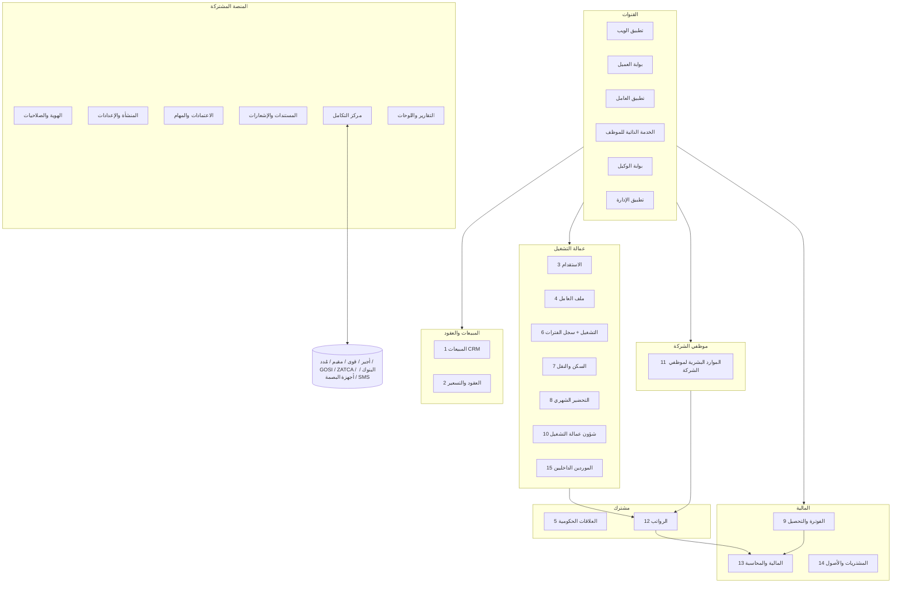
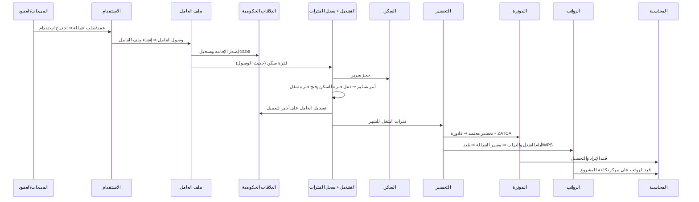
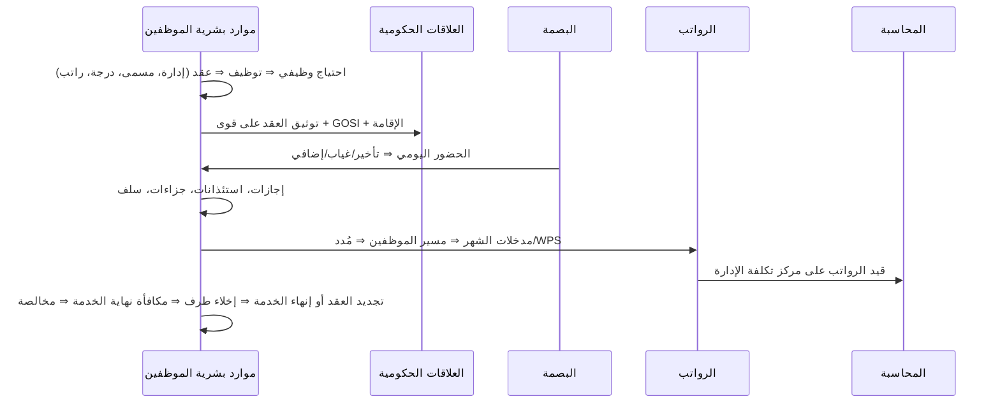

# 01 — هيكل النظام: الموديولات ومكوناتها

> مبني على [00-design-principles](00-design-principles.md): نحافظ على طريقة العمل والتقارير الحالية، بدون الالتزام بتصميم الـ CRM القديم.
> المعمارية: **Modular Monolith** على .NET (ASP.NET Core Web API) — كل موديول ليه بياناته (schema منفصل) وواجهته (API) وأحداثه، والتواصل بين الموديولات بالأحداث (Domain Events / Outbox) مش بالدخول على جداول بعض.

## فئتين مختلفتين من الأفراد

| | **عمالة التشغيل** (Outsourced Workers) | **موظفي الشركة** (Company Staff) |
|---|---|---|
| مين | العامل اللي بيتسلّم لمشروع عميل | موظفي الإدارة والتشغيل الداخلي (HeadOffice، المشرفين، المحاسبين، المناديب…) |
| مكانه | سكن ⇐⇒ مشروع (سجل الفترات) | إدارة وقسم ومسمى وظيفي ومدير مباشر |
| أيامه بتتحسب من | **التحضير الشهري** للمشروع | **بصمة الحضور** والورديات |
| بيولّد | إيراد (فاتورة للعميل) + تكلفة | تكلفة إدارية على مركز تكلفة الإدارة |
| موديولاته | 3، 4، 6، 7، 8، 10، 15 | 11 |
| مصدره | **استقدام خارجي على كفالة الشركة** (الشركة بتصرف الراتب) أو **مورد داخلي** يؤجّره للشركة (المورد بيصرف الراتب والشركة بتدفع للمورد) — التفاصيل في [02-worker-sourcing-billing-payroll](02-worker-sourcing-billing-payroll.md) | — |

**المشترك بينهم** (عشان مانكررش): سجل الشخص والهويات والوثائق الحكومية (5)، محرك الرواتب (12) بمجموعات مسير منفصلة، المحاسبة، الاعتمادات، والصلاحيات. الفرد ممكن ينتقل من فئة للتانية (عامل يتعين موظف مثلًا) بنقل رسمي مع حفظ التاريخ.

## نظرة عامة

---

## أ. موديولات العمل (15)

### 15. الموردين الداخليين — توريد العمالة (Labor Suppliers)
> مكانه في الترتيب بعد الاستقدام؛ اترقم 15 عشان مانغيرش أرقام باقي الموديولات.

| المكون | الوظيفة |
|---|---|
| الموردين | بيانات المورد الداخلي (سجل تجاري، رقم ضريبي، حساب بنكي) — الشركة هنا **عميل** للمورد |
| عقود الموردين | المدة، طريقة الحساب (شهري ثابت / بأيام الشغل)، شروط الدفع، VAT |
| **بطاقة تكلفة لكل عامل** | تفصيل بتاريخ سريان: الراتب والبدلات، رسوم/هامش المورد، الرسوم الحكومية، السكن والمواصلات، التأمين… |
| مسير عمالة المورد | يتحسب من أيام الشغل والخصومات ويتبعت للمورد للصرف |
| كشف/فاتورة المورد الشهرية | مسير عمالته + تكلفة كل عامل المتفق عليها ⇒ مطابقة مع فاتورة المورد ⇒ اعتماد ⇒ الذمم الدائنة ⇒ الدفع |
| ربحية عمالة المورد | تكلفة العامل للمورد شهريًا مقابل فاتورة العميل لنفس العامل |

### 1. المبيعات وإدارة العملاء (Sales CRM)
| المكون | الوظيفة |
|---|---|
| العملاء والجهات | بيانات العميل، السجل التجاري، الرقم الضريبي، العنوان الوطني، جهات الاتصال، مجموعة العميل، **أساس أيام الفوترة** (30 يوم افتراضي / أيام الشهر الفعلية) |
| الفرص المحتملة (Leads / Opportunities) | متابعة العميل المحتمل ومراحل البيع |
| طلبات العمالة من العملاء | عدد × مهنة × جنسية × مدة × موقع |
| عروض الأسعار | تسعير حسب المهنة والجنسية والتكلفة والهامش، واعتماد العرض |
| الأنشطة | مكالمات، زيارات، مهام، شكاوى العميل |

### 2. العقود والتسعير (Contracts & Pricing)
| المكون | الوظيفة |
|---|---|
| العقود | العقد مع العميل: النوع (مبلغ مقطوع / تكلفة + هامش / …)، المدة، التجديد، الضمانات، الدفعات المقدمة |
| المشاريع والمواقع | المشروع أو الموقع اللي العمالة بتشتغل فيه، ومدير المشروع، ومركز التكلفة |
| **الباقات السعرية** | لكل عقد/مشروع × جنسية × مهنة: الراتب + التكلفة + السكن + المواصلات (وهل بيتفوتروا كبنود منفصلة) = إجمالي سعر الخدمة، بتاريخ سريان واعتماد — بتتختار **لكل عامل في أمر التسليم** وتتنسخ على فترة المباشرة |
| سياسة الفوترة | 30 يوم ثابت أو الأيام الفعلية، دورة الفوترة، من يتحمل الرسوم، VAT |
| الحصص والالتزامات | العدد المتعاقد عليه مقابل العدد المسلّم، والاستبدال المطلوب |

### 3. الاستقدام (Recruitment) — لعمالة التشغيل
| المكون | الوظيفة |
|---|---|
| خطة واحتياج الاستقدام | من طلبات العملاء والعقود ⇒ احتياج بالمهنة والجنسية |
| التأشيرات | التأشيرات الجماعية وتوزيعها على المهن والجنسيات والوكلاء، وتفويض الوكيل |
| الوكلاء | بيانات الوكيل، عقده، أسعاره، تقييمه، اعتماده |
| المرشحين | السيرة الذاتية، المقابلة، الاختيار، الكشف الطبي، التأشيرة والختم |
| السفر والوصول | الحجز، الرحلة، الاستقبال، تأكيد الوصول ⇒ **إنشاء ملف العامل تلقائيًا** |
| تكاليف الاستقدام | رسوم الوكيل والتأشيرة والطيران ⇒ على العامل/العقد وتظهر في الربحية |

> توظيف موظفي الشركة له مسار مستقل داخل موديول 11.

### 4. ملف العامل (Outsourced Worker Master)
| المكون | الوظيفة |
|---|---|
| البيانات الشخصية | الاسم عربي/إنجليزي، الجنسية، الديانة، الحالة الاجتماعية، الصورة (من سجل الشخص المشترك) |
| عقد العمل وهيكل الراتب | الأساسي والبدلات بتاريخ سريان وسجل تاريخي |
| المهنة والتصنيف | المهنة الفعلية ومهنة الإقامة، المهارات واللغات |
| المنشأة الكفيلة | السجل التجاري اللي العامل عليه (متعدد الشركات) |
| **مصدر العامل** | استقدام خارجي على كفالة الشركة / مورد داخلي (واسم المورد وبطاقة تكلفته) |
| دورة الحياة | نشط / إجازة طويلة / هروب / خروج نهائي / منقول الكفالة / متوفى — منفصلة عن "مكانه الحالي" |
| ملف 360 | خط زمني، خريطة أيام، تقييم، ربحية |

### 5. العلاقات الحكومية والوثائق (Government Relations) — مشترك للفئتين
| المكون | الوظيفة |
|---|---|
| الهويات والوثائق | الإقامة، الجواز، الحدود، التأشيرة، رخصة العمل، التأمين الطبي — رقم فريد لكل نوع وتنبيهات انتهاء |
| الإقامات (مقيم) | الإصدار والتجديد ورسومه |
| رخص العمل وأجير وقوى | تسجيل العامل على أجير/قوى للعميل وإنهاؤه، وتوثيق عقود الموظفين على قوى |
| تأشيرات الخروج والعودة والخروج النهائي | إصدار وتمديد وإلغاء |
| التأمينات الاجتماعية (GOSI) | التسجيل والاستبعاد والأجر المسجل |
| نقل الكفالة | للداخل والخارج |
| الانتهاءات والغرامات | لوحة بكل الوثائق اللي قربت تنتهي، والرسوم الحكومية كتكلفة |

### 6. التشغيل وحركة العمالة (Workforce Operations) — قلب النظام
| المكون | الوظيفة |
|---|---|
| أوامر التسليم | سطر لكل عامل **بباقته السعرية** (مفلترة بجنسيته ومهنته)، المستلم، تاريخ التسليم والمباشرة (الشغل من تاريخ المباشرة)، والاعتماد |
| أوامر الرجيع / العودة للسكن | رجوع من المشروع مع السبب والتأخير |
| النقل والاستبدال | من مشروع لمشروع، أو استبدال عامل بعامل |
| **سجل الفترات الموحد** | كل يوم للعامل له فترة واحدة: شغل في مشروع / سكن / إجازة / استئذان / هروب / خروج — بدون تداخل، وتتولد تلقائيًا من المستندات |
| قواعد الحركة | تسلسل (سكن ↔ شغل)، منع التداخل، ترتيب أحداث اليوم الواحد |
| العمالة المتاحة | مين في السكن وجاهز للتسليم، بالمهنة والجنسية ومدة الانتظار |
| الحجز والتسويق | حجز عامل لعميل، إعادة التسويق |

### 7. السكن والنقل (Housing & Transport)
| المكون | الوظيفة |
|---|---|
| المساكن | مبنى ⇒ دور ⇒ غرفة ⇒ سرير، نوع السكن (للشركة / لمشروع / تأجيري / تجاري) |
| التسكين على السرير | يتولد من فترة السكن، والإشغال لحظي (ويقبل موظفين لو الشركة بتسكنهم) |
| عقود الإيجار والتكاليف | الإيجار والخدمات والصيانة ⇒ تكلفة لكل سرير/عامل/مشروع |
| الصيانة والعهد | طلبات صيانة، عهد السكن |
| النقل | الباصات والسائقين وخطوط النقل للمشاريع وتكلفتها |

### 8. التحضير الشهري للمشاريع (Project Timesheets)
| المكون | الوظيفة |
|---|---|
| التحضير الشهري | يتحسب من سجل الفترات لكل مشروع وشهر (بنفس قاعدة النظام الحالي)، ومراجعة المشرف |
| التعديلات | غياب، خصومات، إضافي — بأسباب واعتماد |
| اعتماد العميل | من بوابة العميل، أو رفع Excel بقالب ثابت كبديل |

> بصمة حضور موظفي الشركة **مش هنا** — هي في موديول 11.

### 9. الفوترة والتحصيل (Billing & Receivables)
| المكون | الوظيفة |
|---|---|
| توليد الفواتير | من التحضير المعتمد ⇒ فاتورة لكل مشروع وشهر، وكل سطر مربوط بالفترة؛ **الراتب كامل + سعر الخدمة/التكلفة** — سلف العامل وجزاءاته مابتنزلش في الفاتورة |
| الضريبة و ZATCA | VAT والفاتورة الإلكترونية (المرحلة الثانية) |
| إشعارات دائن ومدين | تصحيح الفواتير بدل الإلغاء |
| سندات القبض والتوزيع | تحصيل جزئي أو كلي وتوزيعه على الفواتير |
| أعمار الديون والمتابعة | الأعمار، كشف حساب العميل، خطة تحصيل |
| تغطية الفوترة | كشف أي فترة شغل لم تُفوتر |

### 10. شؤون عمالة التشغيل (Worker HR Services)
| المكون | الوظيفة |
|---|---|
| الإجازات والخروج | سنوية، خروج وعودة، خروج نهائي، إجازة عميل — بمسارات اعتماد (فيها موافقة العميل والعمليات) وأثرها على سجل الفترات |
| أرصدة الإجازات | استحقاق تلقائي حسب العقد |
| الاستئذانات | تأخير، خروج، مرضي |
| السلف والعهد والمخالفات | سلف العامل من الشركة بأقساط، العهد، المخالفات والجزاءات — **بتتخصم من مسير الرواتب بس، ومش من فاتورة العميل** |
| التصفية ونهاية الخدمة | المستحقات ومكافأة نهاية الخدمة حسب نظام العمل، المخالصة، تسليم المستندات |
| البلاغات | الهروب والانقطاع عن العمل |

### 11. الموارد البشرية لموظفي الشركة (Company Staff HR) — **موديول مستقل**
| المكون | الوظيفة |
|---|---|
| **الهيكل التنظيمي** | الشركات ⇒ الإدارات ⇒ الأقسام، المدير المباشر، مراكز التكلفة، رسم الهيكل |
| **الوظائف والمسميات** | المسمى الوظيفي، الدرجة/المستوى، الوصف الوظيفي، سلم الرواتب لكل درجة، الملاك الوظيفي (الشواغر) |
| التوظيف | طلب احتياج ⇒ إعلان ⇒ مرشحين ⇒ مقابلات ⇒ عرض وظيفي ⇒ مباشرة |
| ملف الموظف | البيانات، المؤهلات، الخبرات، الوثائق (من سجل الشخص المشترك)، المعالين، الحساب البنكي |
| **العقود وتجديدها** | عقد محدد/غير محدد المدة، فترة التجربة، تنبيه قبل نهاية العقد، **تجديد العقد** أو عدم التجديد باعتماد، ملاحق العقد (تعديل راتب/مسمى)، توثيق على قوى |
| الحركات الوظيفية | ترقية، نقل بين إدارات، تكليف، تعديل راتب — بتاريخ سريان وسجل تاريخي |
| **الحضور والانصراف (البصمة)** | ربط أجهزة البصمة، الورديات والدوامات، التأخير والخروج المبكر والغياب، العمل الإضافي، العطلات الرسمية، العمل عن بُعد/الميداني، اعتماد الحضور |
| الإجازات والاستئذان | أنواع الإجازات حسب نظام العمل (سنوية، مرضية، زواج، وفاة، مولود…)، الأرصدة، الاستئذانات، بمسار المدير المباشر ⇒ HR |
| **الخصومات والجزاءات** | لائحة الجزاءات المعتمدة (إنذار، خصم أيام، إيقاف…)، التحقيق، قرار الجزاء، الخصم التلقائي في المسير |
| **السلف والقروض** | طلب السلفة، الاعتماد، جدول الأقساط، الخصم من الراتب، السداد المبكر |
| العهد | عهد الموظف (لابتوب، سيارة، موبايل) واستلامها عند الخروج |
| تقييم الأداء | أهداف، تقييم دوري، ربطه بالترقيات والزيادات |
| التدريب | خطط ودورات وشهادات |
| **إنهاء الخدمة** | استقالة / إنهاء / نهاية عقد / تقاعد، إشعار، إخلاء طرف من الإدارات، **مكافأة نهاية الخدمة**، المخالصة النهائية، شهادة الخبرة |
| الخدمة الذاتية | طلبات الإجازة والسلف والتعريف بالراتب وتحديث البيانات، وقسيمة الراتب |

### 12. الرواتب (Payroll) — محرك واحد ومسيرات منفصلة
| المكون | الوظيفة |
|---|---|
| مجموعات المسير | 1) **مسير موظفي الشركة** (من البصمة والإجازات والجزاءات) 2) **مسير عمالة الشركة** (على كفالتها — من التحضير وسجل الفترات، والشركة بتصرفه) 3) **مسير عمالة الموردين** (بيتحسب بنفس المحرك ويتبعت للمورد اللي بيصرفه — مابيتصرفش من الشركة ومابيروحش WPS الشركة) — صلاحيات منفصلة لكل مسير |
| عناصر الراتب | الأساسي، البدلات، الإضافي، الخصومات، الجزاءات، أقساط السلف — بقواعد حساب |
| الحساب والاعتماد | معاينة، مقارنة بالشهر السابق، اعتماد، إقفال |
| مُدد و WPS | ملف حماية الأجور ورفعه |
| ملفات البنوك | ملف التحويل لكل بنك |
| قسائم الرواتب | بالإيميل والتطبيق |
| GOSI | الاشتراكات الشهرية |
| الترحيل للمحاسبة | قيد الرواتب على مراكز التكلفة (المشروع للعامل، الإدارة للموظف) |

### 13. المالية والمحاسبة (Finance & Accounting)
| المكون | الوظيفة |
|---|---|
| الأستاذ العام | دليل الحسابات، القيود، الفترات المحاسبية والإقفال |
| القيود التلقائية | من الفواتير والتحصيل والرواتب والمشتريات والاستقدام |
| مراكز التكلفة | لكل مشروع/عقد/سكن/إدارة — ربحية المشروع والعامل |
| الذمم الدائنة | فواتير الموردين والوكلاء، **فواتير الموردين الداخليين (مسير عمالتهم + تكلفتهم)**، والدفعات |
| البنوك والخزينة | الحسابات البنكية، التسوية، العهد النقدية |
| الموازنات | موازنة لكل مركز تكلفة ومقارنتها بالفعلي |
| القوائم المالية | ميزان المراجعة، الأرباح والخسائر، الميزانية، الإقرار الضريبي |

### 14. المشتريات والأصول (Procurement & Assets)
| المكون | الوظيفة |
|---|---|
| طلبات وأوامر الشراء | مستلزمات السكن والمشاريع والإدارة، باعتماد |
| الموردين | بياناتهم وعقودهم وتقييمهم |
| المخزون | مستودع مستلزمات السكن والعهد |
| الأصول | السيارات، الأجهزة، تجهيزات السكن، الإهلاك |

---

## ب. المنصة المشتركة (6)

| الموديول | المكونات |
|---|---|
| **الهوية والصلاحيات** | دخول موحد (SSO) بـ Entra ID/AD، تحقق ثنائي، أدوار وصلاحيات على مستوى الشاشة والعملية والبيانات (الشركة/الإدارة/المشروع/نوع المسير)، حسابات للعملاء والعمال والوكلاء، **سجل تدقيق** لكل عملية |
| **المنشأة والإعدادات** | الشركات والسجلات التجارية، الفروع، الترقيم التلقائي، التقويم والعطلات، القوائم المرجعية بأكواد ثابتة، السياسات |
| **الاعتمادات والمهام** | محرك Elsa: مسار اعتماد لكل مستند، المالك بالدور أو مدير المشروع أو المدير المباشر (من الهيكل التنظيمي)، مهامي، SLA وتذكير وتصعيد، الاعتماد بالنيابة |
| **المستندات والإشعارات** | تخزين الملفات، المرفقات، قوالب الطباعة (فواتير، عقود، مخالصات، شهادات)، إشعارات داخل النظام وإيميل وSMS وواتساب |
| **مركز التكامل** | API موثق (OpenAPI) بإصدارات، OAuth2، Webhooks، Outbox وإعادة المحاولة، موصلات (أجير، قوى، مقيم، مُدد، GOSI، ZATCA، البنوك، أجهزة البصمة، SMS)، **مزامنة مؤقتة مع الـ CRM الحالي** أثناء النقل |
| **التقارير واللوحات** | طبقة تقارير موحدة، لوحات الإدارة والتشغيل والسكن والمالية والموارد البشرية، تصدير، API لتطبيق الإدارة |

## ج. القنوات (6)

| القناة | المستخدم | أهم الوظائف |
|---|---|---|
| تطبيق الويب | موظفي الشركة | كل الموديولات حسب الصلاحية — عربي RTL وإنجليزي |
| الخدمة الذاتية للموظف | موظفي الشركة | الحضور، الإجازات، السلف، القسائم، الطلبات |
| بوابة العميل | العملاء | العمالة عندهم، اعتماد التحضير، الفواتير وكشف الحساب، طلب عمالة أو استبدال |
| تطبيق العامل | عمالة التشغيل | القسيمة، طلب إجازة، الوثائق، الإشعارات |
| بوابة الوكيل | الوكلاء | رفع المرشحين ومتابعة الطلبات وفواتيرهم |
| تطبيق الإدارة | الإدارة العليا | اللوحات والتنبيهات والاعتماد من الموبايل |

---

## د. رحلة عامل التشغيل بين الموديولات

## هـ. دورة موظف الشركة

## و. الربط بالمراحل

| المرحلة | الموديولات |
|---|---|
| 0 — التأسيس | المنصة المشتركة، والمزامنة من الـ CRM |
| 1 — البيانات الأساسية وسجل الفترات | سجل الشخص والوثائق، ملف العامل، الهيكل التنظيمي والوظائف وملف الموظف، العقود والمشاريع (أساسي)، السكن، سجل الفترات من بيانات الـ CRM |
| 2 — حركة العمالة | التشغيل (التسليم، الرجيع، النقل)، التسكين، شؤون عمالة التشغيل، الموردين الداخليين وبطاقات التكلفة |
| 3 — التحضير والفوترة | التحضير الشهري، الفوترة والتحصيل، ZATCA، بوابة العميل |
| 4 — الموارد البشرية والرواتب والمالية | موارد بشرية الموظفين (البصمة، العقود، الجزاءات، السلف، إنهاء الخدمة)، الرواتب بالمسيرين، مُدد/WPS، GOSI، المحاسبة، المشتريات |
| 5 — المبيعات والاستقدام | CRM، عروض الأسعار، الاستقدام، العلاقات الحكومية كاملة، بوابة الوكيل، تطبيق العامل، الخدمة الذاتية |
| 6 — إيقاف الـ CRM | الترحيل النهائي |
