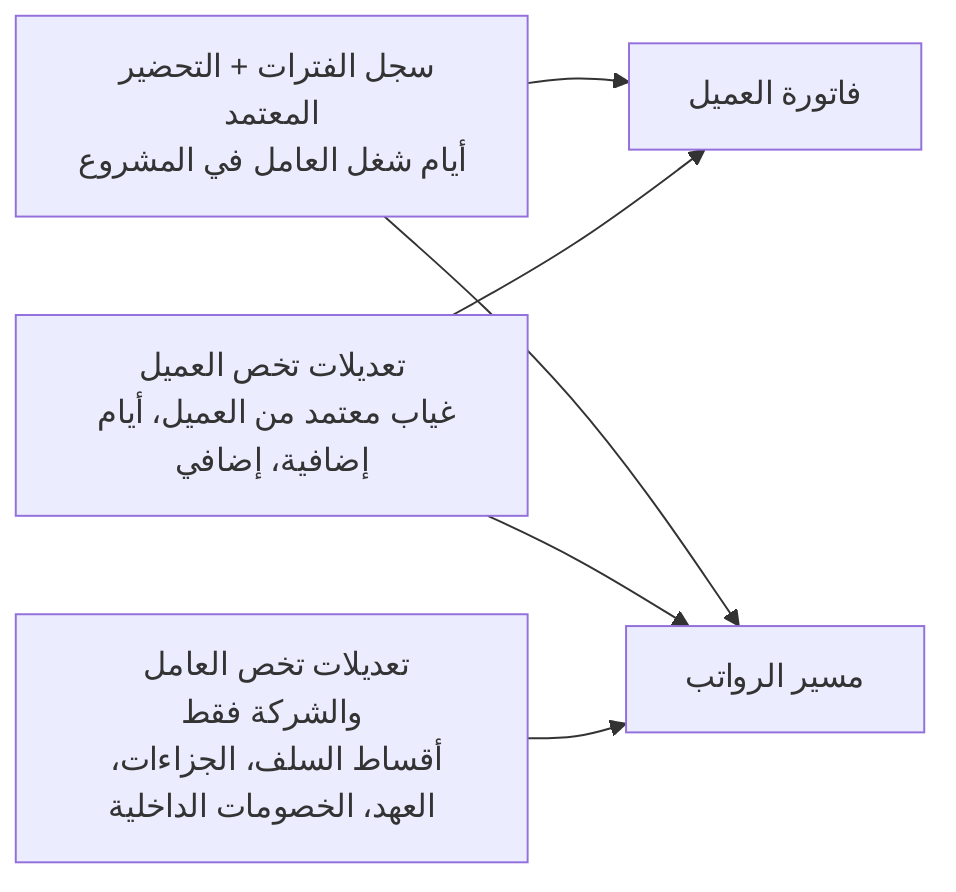

# 02 — مصادر العمالة، والفصل بين فاتورة العميل ومسير الرواتب، وربحية العامل

> قواعد عمل أكدها صاحب المشروع (2026-10-15). مرتبطة بـ [01-system-modules](01-system-modules.md).

## 1. فاتورة العميل ≠ مسير الرواتب

نفس أيام الشغل للعامل (من **سجل الفترات** والتحضير المعتمد) بتغذي مستندين مستقلين، وكل واحد له قواعده:



| البند | فاتورة العميل | مسير الرواتب |
|---|---|---|
| راتب العامل (حسب أيام الشغل) | ✅ **كامل** | ✅ |
| سعر الخدمة / تكلفة الشركة / السكن / المواصلات حسب العقد | ✅ | — |
| **أقساط سلف العامل من الشركة** | ❌ **مابتنزلش** | ✅ تتخصم |
| **الجزاءات والخصومات الداخلية** | ❌ | ✅ تتخصم |
| العهد والمخالفات اللي على العامل | ❌ | ✅ تتخصم |
| الغياب المعتمد في التحضير | ✅ يتخصم **من بند الراتب فقط** (الراتب ÷ 30 × أيام الغياب) — **سعر الخدمة مابيتخصمش منه** | ✅ يتخصم |
| الإضافي المعتمد من العميل | ✅ | ✅ |
| الضريبة VAT | ✅ | — |

**القاعدة في التصميم:** كل نوع "إضافة/خصم" له تعريف فيه علامتين: `يؤثر على الفاتورة` و`يؤثر على المسير`. السلفة والجزاء: (لا / نعم). الغياب: (نعم على بند الراتب فقط / نعم). ده بيضمن إن السلفة عمرها ما تنزل في فاتورة العميل.

**مثال 1 (سلفة وجزاء):** راتب 2,000 + سعر خدمة 1,500، والعامل عليه قسط سلفة 500 وجزاء 100:
- فاتورة العميل = 2,000 + 1,500 = **3,500** + VAT.
- مسير العامل = 2,000 − 500 − 100 = **1,400** صافي.

**مثال 2 (غياب):** راتب 1,000 + سعر خدمة 1,500 = 2,500، والعامل غاب يوم:
- خصم اليوم = 1,000 ÷ 30 = 33.33.
- فاتورة العميل = (1,000 − 33.33) + 1,500 = 966.67 + 1,500 = **2,466.67** + VAT ← سعر الخدمة كامل.
- مسير العامل = 1,000 − 33.33 = **966.67**.

## 2. مصادر العمالة (Sourcing Type)

كل عامل تشغيل له **مصدر** ثابت في ملفه (ويتغير بس بإجراء رسمي زي نقل الكفالة):

| | **استقدام خارجي — على كفالة الشركة** | **مورد داخلي — عمالة مؤجّرة للشركة** |
|---|---|---|
| جاي منين | وكيل خارجي (مكتب استقدام في بلد العامل) عن طريق موديول الاستقدام | شركة محلية (مورد داخلي) بتأجر العمالة للشركة |
| الكفالة | الشركة (أحد سجلاتها التجارية) | المورد |
| علاقة الشركة | الشركة صاحب العمل | **الشركة عميل للمورد** |
| مين بيصرف الراتب | **الشركة** (مسيرها + مُدد/WPS) | **المورد** بيصرف للعامل |
| الشركة بتدفع | الراتب للعامل + تكاليف الاستقدام والحكومة والسكن… | **للمورد: قيمة مسير رواتب عمالته + تكلفة العامل المتفق عليها** |
| تكلفة العامل على الشركة | التكلفة الفعلية (راتب + سكن + مواصلات + GOSI + إقامة ورسوم + تأمين طبي + استهلاك تكلفة الاستقدام) | المبلغ اللي بيتدفع للمورد عن العامل (+ أي تكلفة بتتحملها الشركة مباشرة زي السكن لو عندها) |
| في النظام | ملف العامل + مسير الشركة | ملف العامل + **عقد المورد + كشف/فاتورة المورد الشهرية** |

> **مؤكد:** في حقل "الكفيل" الحالي (`new_sponseredby`): **Care-Pro (05 و 07) = سجلات الشركة** ⇒ عمالة على كفالة الشركة؛ والباقي **موردين داخليين**: Esad 01، IRC 02، JAWA 03، Riadty 09، Watan 12، Ewan 13، Mehan 14، Maharah 15. ده هيستخدم في الترحيل لتحديد مصدر كل عامل والمورد بتاعه.

## 3. الموردين الداخليين — اللي النظام لازم يعرفه

| المكون | التفاصيل |
|---|---|
| بيانات المورد | السجل التجاري، الرقم الضريبي، الحساب البنكي، جهة الاتصال (المورد = طرف في الذمم الدائنة) |
| عقد المورد | المدة، طريقة الحساب (شهري / يومي حسب أيام الشغل)، شروط الدفع، VAT |
| **بطاقة تكلفة لكل عامل** (بتاريخ سريان) | الراتب الأساسي والبدلات (اللي المورد بيصرفها)، رسوم المورد/الهامش، الرسوم الحكومية، السكن والمواصلات لو على المورد، التأمين الطبي، أي بنود تانية — **كل بند منفصل ومعروف** |
| مسير عمالة المورد | الشركة بتحسبه بنفس محرك الرواتب (من نفس الأيام والخصومات) لكن **ماينصرفش** من الشركة — بيتبعت للمورد كمستند يصرف عليه |
| خيارات بطاقة التكلفة | عند إنشاء تكلفة العامل مع المورد: **السكن** (على الشركة / على المورد)، **المواصلات** (على الشركة / على المورد)، **طريقة الحساب** (مبلغ شهري ثابت / بأيام الشغل) — كل خيار بيحدد البند يدخل فاتورة المورد ولا يتحسب كتكلفة مباشرة على الشركة |
| كشف / فاتورة المورد الشهرية | يتولد من أيام شغل عمالة المورد في الشهر = مسير عمالته + تكلفة كل عامل المتفق عليها؛ مطابقته مع فاتورة المورد الفعلية ⇒ اعتماد ⇒ الذمم الدائنة ⇒ الدفع |
| خصومات عمالة المورد | **مؤكد:** أي خصم من راتب عامل المورد (غياب، سلفة من الشركة، جزاء) بيتخصم من بند الراتب في فاتورة المورد، لأن الراتب الداخل في فاتورة المورد هو صافي المسير اللي اتحسب |

## 4. ربحية العامل (Worker Profitability)

لكل عامل ولكل شهر (ولكل مشروع)، من **نفس فترات الشغل**:

```
الإيراد  = سطور فاتورة العميل للعامل (بدون VAT)
التكلفة  =
  • استقدام على كفالة الشركة: الراتب الإجمالي + السكن + المواصلات + GOSI + رسوم الإقامة والحكومة (موزعة شهريًا)
                               + التأمين الطبي + استهلاك تكلفة الاستقدام + تكاليف مباشرة أخرى
  • مورد داخلي:               المدفوع للمورد عن العامل (مسيره + تكلفته المتفق عليها) + أي تكلفة مباشرة على الشركة
الربح    = الإيراد − التكلفة        هامش الربح = الربح ÷ الإيراد
```

- السلف **مش تكلفة** (أصل مستحق على العامل)، والجزاء **مش إيراد من العميل** — فالاتنين خارج حساب الربحية، وبيظهروا في رصيد العامل.
- أيام السكن من غير شغل (Bench) = **تكلفة بدون إيراد** وتظهر في التحليل.
- نفس الحساب يتجمع على مستوى المشروع، والعميل، والمورد، والمهنة، والجنسية.
- المقارنة اللي طلبتها: **تكلفة عامل المورد شهريًا مقابل فاتورة العميل لنفس العامل** ⇒ تقرير "ربحية عمالة الموردين" لكل مورد ولكل عامل.

## 5. أثرها على الموديولات

| الموديول | التعديل |
|---|---|
| 3 الاستقدام | للمصدر الخارجي بس (الوكلاء الخارجيين) |
| 4 ملف العامل | **مصدر العامل** (كفالة الشركة / مورد داخلي + اسم المورد)، والمنشأة الكفيلة |
| **15 الموردين الداخليين (جديد)** | الموردين، العقود، بطاقة تكلفة العامل، مسير عمالة المورد، كشف/فاتورة المورد ومطابقتها |
| 9 الفوترة | الفاتورة بالراتب كامل + سعر الخدمة؛ أنواع التعديلات بعلامة "يؤثر على الفاتورة" |
| 10 شؤون عمالة التشغيل | سلف العامل وجزاءاته ⇒ بتروح للمسير بس |
| 12 الرواتب | 3 مسيرات: موظفي الشركة / عمالة الشركة (صرف + WPS) / **عمالة الموردين (حساب وإرسال للمورد بدون صرف)** |
| 13 المالية | الذمم الدائنة للموردين، تكلفة العامل على مركز تكلفة المشروع، سلف العمالة كذمم مدينة على العامل |
| التقارير | ربحية العامل/المشروع/العميل/المورد |

## 6. قرارات مؤكدة (2026-10-15)
1. الغياب بيتخصم من فاتورة العميل من **بند الراتب فقط**، وسعر الخدمة كامل.
2. أي خصم من راتب عامل المورد بيتخصم من فاتورة المورد.
3. السكن والمواصلات وطريقة الحساب = **خيارات** في بطاقة تكلفة العامل مع المورد.
4. Care-Pro = سجل الشركة، والباقي موردين داخليين.

## 7. سؤال مفتوح
- العامل اللي اشتغل **جزء من الشهر** (باشر في نصه أو رجع السكن): النظام الحالي بيحسب سعر الخدمة بنسبة الأيام (أيام الشغل ÷ 30). هل ده يفضل كده؟ (يعني الغياب مابيخصمش سعر الخدمة، لكن أيام ماكانش فيها في المشروع أصلًا بتخصمه.)
