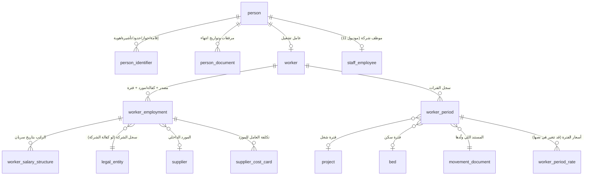
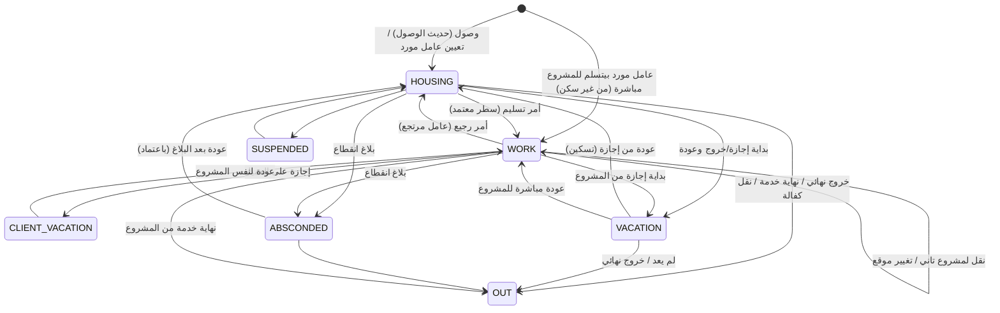

# 04 — سجل الشخص، ملف العامل، وسجل الفترات الموحد (Period Ledger)

> الأساس اللي التحضير والفوترة والرواتب وتكلفة الموردين والسكن والتقارير كلها مبنية عليه.
> مرتبط بـ: [01-system-modules](01-system-modules.md) (موديولات 4، 5، 6)، [02-worker-sourcing](02-worker-sourcing-billing-payroll.md)، [03-billing-spec](03-billing-calculation-spec.md).
> الأسماء هنا مقترحة (schema/جداول بالإنجليزي)؛ كل جدول فيه أعمدة التدقيق `created_at/by, updated_at/by, row_version` و`legal_entity_id` لما ينطبق.

## 1. الطبقات

## 2. سجل الشخص (مشترك للعامل والموظف) — موديول 5

| الجدول | أهم الأعمدة | القواعد |
|---|---|---|
| `person` | `id`, الاسم عربي/إنجليزي (أول/أب/عائلة)، `nationality_id`, `gender`, `birth_date`, `religion`, `marital_status`, `photo_file_id`, `mobile`, `email` | شخص واحد حتى لو اتنقل من عامل لموظف |
| `person_identifier` | `person_id`, `type` (IQAMA, PASSPORT, BORDER_NO, VISA, NATIONAL_ID, WORK_PERMIT, GOSI_NO, MUQEEM…), `number`, `issue_date`, `expiry_date`, `issuer_country_id`, `is_current` | **unique (type, number)** للأرقام الحالية ⇒ يمنع تكرار الجواز (7 مكررين حاليًا)؛ البحث بأي رقم بيرجّع شخص واحد بس |
| `person_document` | `person_id`, `doc_type`, `file_id`, `expiry_date`, `status` | تنبيهات الانتهاء (60 يوم افتراضي — إعداد) |

> بدل البحث على 7 أعمدة بـ `TOP 1` في النظام الحالي: بحث موحد في `person_identifier`، ولو الرقم مش فريد ⇒ رسالة صريحة بدل اختيار عشوائي.

## 3. ملف العامل — موديول 4

| الجدول | أهم الأعمدة | القواعد |
|---|---|---|
| `worker` | `id`, `person_id`, `worker_no` (ترقيم آلي `BSS…` قابل للإعداد)، `profession_id`, `iqama_profession_id`, `skills`, `lifecycle_status` | الحالة هنا **دورة حياة فقط**: `NEW`, `ACTIVE`, `ABSCONDED`, `FINAL_EXIT`, `END_OF_SERVICE`, `SPONSORSHIP_TRANSFERRED_OUT`, `DECEASED`, `SUSPENDED` — "هو فين" مش هنا |
| `worker_employment` | `worker_id`, `sourcing_type` (`COMPANY_SPONSORED` / `INTERNAL_SUPPLIER`), `legal_entity_id` (لو كفالة الشركة)، `supplier_id` (لو مورد)، `recruitment_agent_id`, `start_date`, `end_date`, `contract_no` | فترة توظيف واحدة مفتوحة في وقت واحد؛ تغيير المصدر (نقل كفالة) = قفل وفتح جديد |
| `worker_salary_structure` | `employment_id`, `effective_from`, `basic`, `housing_allw`, `food_allw`, `transport_allw`, `other_allw`, (`total` محسوب) | سجل تاريخي؛ الفاتورة والمسير بياخدوا الهيكل الساري في كل يوم |
| `supplier_cost_card` | `employment_id`, `effective_from`, `calc_method` (`MONTHLY_FIXED` / `BY_WORKING_DAYS`)، `housing_on` (`COMPANY` / `SUPPLIER`)، `transport_on` (…)، بنود: `supplier_fee`, `gov_fees`, `medical`, `housing_cost`, `transport_cost`, `other` | للعمالة اللي مصدرها مورد داخلي بس (موديول 15) |

**مصدر الترحيل:** `new_sponseredby`: Care-Pro 05/07 ⇒ `COMPANY_SPONSORED` على السجل المقابل؛ الباقي ⇒ `INTERNAL_SUPPLIER` بالمورد المقابل.

## 4. سجل الفترات الموحد — موديول 6

### 4.1 الفكرة
لكل عامل **خط زمني واحد متصل**: كل يوم من أول دخوله لحد خروجه النهائي بيقع في **فترة واحدة بالظبط**. الفترات **مابتتكتبش يدويًا** — بتتولد من مستندات الحركة لما تتعمد.

### 4.2 الجدول `worker_period`

| العمود | المعنى |
|---|---|
| `id`, `worker_id`, `employment_id` | |
| `type` | `HOUSING` (في السكن/متاح)، `WORK` (في مشروع)، `VACATION` (إجازة خارج العمل)، `CLIENT_VACATION` (إجازة على العميل)، `ABSCONDED` (منقطع/هارب)، `SUSPENDED` (موقوف/مريض بدون شغل)، `OUT` (خرج نهائي/انتهت الخدمة — فترة ختامية) |
| `start_date` | **date** (مش datetime) — توقيت السعودية |
| `end_date` | **date حصري (exclusive)**، `NULL` = مفتوحة |
| `project_id` | إجباري لـ WORK (و CLIENT_VACATION) |
| `bed_id` / `housing_id` | لـ HOUSING (السرير ممكن يتحدد بعد الدخول) |
| `source_doc_type`, `source_doc_id`, `source_line_id` | المستند اللي فتح الفترة (أمر تسليم/رجيع/نقل/إجازة/بلاغ…) |
| `closed_by_doc_type`, `closed_by_doc_id` | المستند اللي قفلها |
| `sequence` | ترتيب صريح للأحداث في نفس اليوم |
| `status` | `ACTIVE`, `CANCELLED` (اتلغى مستندها قبل أي فوترة) |
| `reason_code` | سبب الرجيع / نوع الإجازة … بأكواد ثابتة |

### 4.3 الباقة السعرية وسعر فترة الشغل

**القرار (2026-10-15):** كل فترة مباشرة بيتسجل عليها **السعر الكامل بتفصيله** وقت التسليم، لأن العامل ممكن يكون له مباشرتين في نفس الشهر في مشروعين بسعرين مختلفين، وبعض المشاريع بتتفوتر **بلس سكن ومواصلات** كبنود ظاهرة في فاتورة العميل.

#### الباقة السعرية `price_package` (في موديول العقود — 2)
| العمود | المعنى |
|---|---|
| `contract_id` / `project_id` | الباقة تخص عقد/مشروع (أو باقة عامة للشركة) |
| `nationality_id`, `profession_id` | الباقة بتنطبق على الجنسية والمهنة دي (ممكن "أي جنسية") |
| `salary_amount` | **بند الراتب** في السعر |
| `service_fee` | **التكلفة / رسوم الخدمة** |
| `housing_amount`, `housing_billable` | السكن: مبلغه، وهل بيظهر كبند منفصل في فاتورة العميل |
| `transport_amount`, `transport_billable` | المواصلات: مبلغها، وهل بتظهر كبند منفصل |
| `total_price` | **إجمالي سعر الخدمة** = الراتب + التكلفة + السكن + المواصلات (لو موجودين) |
| `overtime_rule_id` | قاعدة الإضافي (لو مختلفة عن المشروع) |
| `valid_from`, `valid_to`, `status` | سريان واعتماد الباقة |

#### اختيارها في أمر التسليم
- كل **سطر عامل** في أمر التسليم بيختار له باقة. القائمة بتتفلتر تلقائيًا بـ **جنسية ومهنة العامل** وعقد المشروع.
- أمر تسليم فيه عمال بمهن وجنسيات مختلفة ⇒ **باقة لكل عامل**.
- تعديل أي مبلغ عن الباقة = "سعر خاص" بيحتاج اعتماد، وبيتسجل السبب.
- مايتعمدش أمر تسليم وفيه عامل من غير باقة/سعر (القاعدة L5).

#### سعر الفترة `worker_period_rate` — نسخة (snapshot) من الباقة على فترة المباشرة
| العمود | المعنى |
|---|---|
| `period_id`, `effective_from`, `effective_to` | يغطي فترة المباشرة؛ أي تغيير سعر معتمد في نصها ⇒ سطر جديد من تاريخ السريان |
| `price_package_id`, `is_special_price`, `approval_id` | مصدر السعر |
| `salary_amount`, `service_fee`, `housing_amount`, `housing_billable`, `transport_amount`, `transport_billable`, `total_price` | **الأرقام نفسها متخزنة** — تعديل الباقة بعدين مابيغيرش فترات قديمة |

**استخدامها:**
- **فاتورة العميل** بتاخد البنود من سعر الفترة × (أيام الفترة في الشهر ÷ 30): الراتب، التكلفة، والسكن والمواصلات (كبنود منفصلة لو `billable`، أو داخل التكلفة لو لأ) — وأي مباشرتين في نفس الشهر = سطرين كل واحد بسعره.
- **مسير الرواتب** بياخد راتب العامل **الفعلي** من `worker_salary_structure` (اللي بيتصرف للعامل)، مش من الباقة.
- **ربحية العامل** = فاتورة الفترة − تكلفته الفعلية (أو تكلفة المورد).

### 4.4 القواعد الثابتة (Invariants) — بتتطبق في الـ database والـ domain

| # | القاعدة | بدل إيه في النظام الحالي |
|---|---|---|
| L1 | فترات العامل (غير الملغية) **مابتتداخلش** (exclusion constraint على `[start, end)`) | 502 مباشرة مكررة نفس اليوم و384 مباشرة مفتوحة مكررة |
| L2 | **مفيش فجوات** من أول فترة لحد `OUT`: قفل فترة = فتح التالية في نفس اللحظة | تواريخ خروج ناقصة (70) أو قبل الدخول (24) |
| L3 | فترة مفتوحة واحدة بس لكل عامل = **مكانه الحالي** | 3 أرقام مختلفة لـ"في السكن" (34/73/135) |
| L4 | `OUT` فترة ختامية؛ مفيش بعدها حاجة إلا بمستند "إعادة تفعيل" معتمد | |
| L5 | `WORK` لازم مشروع و**سعر فترة من باقة** (أو سعر خاص معتمد)؛ مستند تسليم فيه عامل من غير باقة مايتعمدش | 87 مباشرة من غير سعر |
| L6 | يوم الانتقال **بيتحسب للفترة الجديدة** (end حصري): تسكين يوم 10 ⇒ الشغل لحد 9 والسكن من 10 | نفس قاعدة التحضير الحالية |
| L7 | انتقالات مسموحة بس (جدول تحت) — غيرها مرفوض برسالة واضحة | `EmployeeMovementValidationService` |
| L8 | الفترات في شهر **اتقفل** (فاتورة معتمدة أو مسير معتمد) مابتتعدلش؛ أي تصحيح ⇒ مستند تصحيح يولّد فرق في الفاتورة/المسير الجاي (إشعار دائن/مدين) | الإلغاء والتعديل اليدوي في الـ Excel |

### 4.5 الانتقالات المسموحة (State machine)

### 4.6 المستندات اللي بتولّد الفترات

| المستند | عند الاعتماد | ملاحظات |
|---|---|---|
| تأكيد وصول (من الاستقدام) | يفتح `HOUSING` بنوع دخول "حديث الوصول" | ينشئ ملف العامل لو مش موجود |
| أمر تسليم — **سطر لكل عامل بباقته السعرية** | يقفل الفترة الحالية في **تاريخ المباشرة** ويفتح `WORK` بالمشروع ونسخة سعر الباقة | **الشغل بيتحسب من تاريخ المباشرة مش التسليم**: الفاصل بينهم بيفضل `HOUSING` |
| أمر رجيع / عودة للسكن | يقفل `WORK` ويفتح `HOUSING` بسبب الرجيع وسبب التأخير لو التسجيل متأخر | التأخير (> يومين) = إعداد واحد |
| نقل بين مشاريع | يقفل `WORK` ويفتح `WORK` جديد بسعر المشروع الجديد | بدون المرور بالسكن |
| تغيير سعر | سطر جديد في `worker_period_rate` من تاريخ السريان | مش فترة جديدة |
| طلب إجازة (لما تبدأ فعليًا) | يقفل الحالية ويفتح `VACATION` / `CLIENT_VACATION` | الإجازة بقت **جزء من السلسلة** (الحالي بيتجاهلها في التحضير) |
| عودة من إجازة | `HOUSING` أو `WORK` | |
| بلاغ انقطاع/هروب | `ABSCONDED` من تاريخ الانقطاع | |
| خروج نهائي / نهاية خدمة / نقل كفالة للخارج | `OUT` + `lifecycle_status` | يطلق التصفية والعلاقات الحكومية |
| **إلغاء مستند** | لو أيامه مافيهاش فاتورة/مسير معتمد: الفترات `CANCELLED` والسابقة ترجع مفتوحة. غير كده: مستند تصحيح | بدل "تاريخ الخروج = تاريخ الدخول" اللي بيعمله الـ workflow الحالي |

### 4.7 حاجات بتتحسب من السجل (ومش بتتخزن)

| المعلومة | الحساب |
|---|---|
| مكان العامل الحالي | الفترة المفتوحة |
| "على رأس العمل" / "في السكن" / "في إجازة" | نوع الفترة المفتوحة |
| تاريخ الالتحاق بالمشروع الحالي | `start_date` لفترة WORK المفتوحة |
| أيام الشغل للتحضير `R` | تقاطع فترات WORK للمشروع مع الشهر + قاعدة الـ 30 يوم ([03 §5](03-billing-calculation-spec.md)) |
| العمالة المتاحة (Bench) ومدة الانتظار | فترات HOUSING المفتوحة |
| الإشغال اليومي/الشهري للسكن | فترات HOUSING حسب السرير |
| نسبة التشغيل، الاستقرار، تكلفة الأيام بدون إيراد | من الفترات بالأيام |
| "الوضع في يوم معيّن" لأي عامل | الفترة اللي فيها اليوم |

> الحساب ده هيتعمل في **view/دالة واحدة** (`fn_worker_days(worker, from, to)`) وكل التقارير والتحضير والمسير يستخدموها.

### 4.8 الاستئذان مش فترة
الاستئذان (ساعات أو يوم جوه فترة شغل) = **حدث داخل الفترة** في جدول منفصل، وبيأثر على التحضير/المسير كتعديل (غياب/تأخير)، مش بيقطع الفترة.

## 5. بناء السجل من بيانات الـ CRM الحالية (للمرحلة 1)

1. **المصادر:** `new_empwork` (WORK)، `mw_lodginorderdetails` المعتمدة 100000009 (HOUSING)، `hr_vicrequest` المعتمدة (VACATION)، `new_employee.statuscode` و `new_employeeaudit` (OUT/ABSCONDED وتواريخها)، `new_deliverorder` (الأسعار والمستندات).
2. **الترتيب:** لكل عامل، كل الأحداث مرتبة بالتاريخ (+3 ساعات ⇒ date) ثم `createdon`.
3. **التوليد:** كل حدث يقفل اللي قبله ويفتح جديد، بنفس قواعد النظام الحالي (رجوع للسكن يقفل الشغل، مباشرة تالية تقفل اللي قبلها).
4. **تقرير الاستثناءات** (مايتعدلش أوتوماتيك): مباشرتين نفس اليوم، تسكين بعد تسكين، خروج قبل دخول، مباشرة من غير سعر، عامل له حركة بعد "خروج نهائي"… ⇒ تتراجع مع العمليات.
5. **التحقق بالأرقام:** مقارنة نتائج السجل مع النظام الحالي: أيام التحضير لشهر سبتمبر 2026 لكل مشروع مقابل سطور الفواتير، وعدد "في السكن" مقابل الـ 3 تعريفات الحالية.
6. **المزامنة المؤقتة:** طول فترة التشغيل المتوازي، أي مستند جديد في الـ CRM يتنقل ويولّد فترات (one-way sync) لحد ما الحركة تنتقل بالكامل للنظام الجديد (المرحلة 2).

## 6. قرارات مؤكدة (2026-10-15)
1. **بين التسليم والمباشرة = سكن.** الشغل والفوترة من **تاريخ المباشرة**.
2. **الإجازة على العميل (`CLIENT_VACATION`) بتتفوتر**: العميل بيدفع عن أيامها بسعر فترة المباشرة.
3. **الموقوف/المريض (`SUSPENDED`)**: لا راتب ولا فوترة.
4. **عامل المورد:** ممكن يبدأ بـ `HOUSING` (يدخل سكن الشركة) أو بـ `WORK` مباشرة.
5. **السعر على فترة المباشرة** = نسخة من **باقة سعرية** بتتختار لكل عامل في أمر التسليم حسب جنسيته ومهنته: الراتب + التكلفة + السكن + المواصلات (لو موجودين) = إجمالي سعر الخدمة.

## 7. سؤال مفتوح
- لو راتب العامل **اتزاد** وهو شغال في المشروع: بند الراتب في فاتورة العميل يتغير معاه (ويتعمل سعر فترة جديد باعتماد)، ولا يفضل زي الباقة لحد ما العقد يتعدل؟
