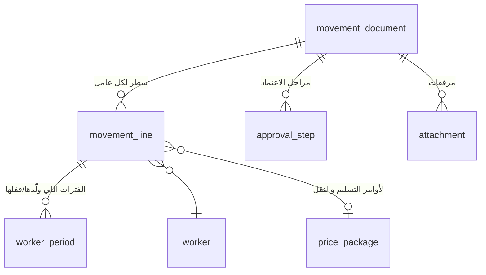
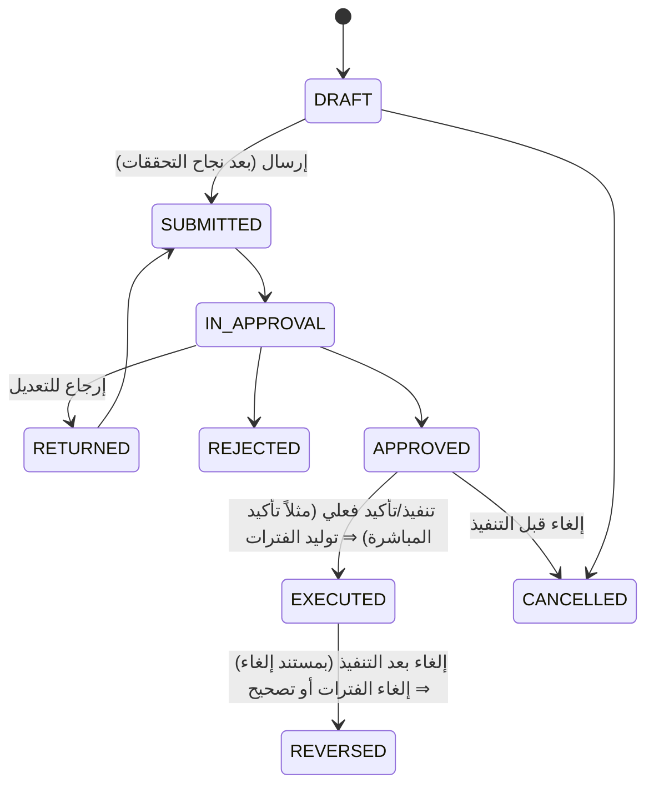

# 05 — مستندات الحركة (Movement Documents)

> المستندات اللي بتحرّك العامل وبتولّد سجل الفترات ([04](04-person-worker-period-ledger.md)). مبنية على العمليات الحالية ([تحليل 04](../01-current-system-analysis/04-processes-and-approvals.md)) مع تصحيح مشاكلها ([تحليل 06](../01-current-system-analysis/06-data-quality-issues.md)).
> مسارات الاعتماد هنا **افتراضية** (مأخوذة من النظام الحالي) وكلها قابلة للتعديل من إعدادات محرك الاعتماد (Elsa) بدون برمجة.

## 1. هيكل موحد لكل مستند

| الجزء | المحتوى |
|---|---|
| **الرأس** | رقم المستند (ترقيم آلي لكل نوع: `DO-`, `RT-`, `TR-`…)، النوع، السجل التجاري، المشروع، التواريخ، الطالب، الملاحظات، الحالة |
| **السطور** | سطر لكل عامل (بالـ `worker_id` — مش نص)، وبيانات السطر الخاصة بنوع المستند، وحالة السطر |
| **الاعتماد** | مراحل الاعتماد بالمالك والقرار والوقت والتعليق (خط زمني) |
| **الأثر** | الفترات اللي اتفتحت/اتقفلت، المهام الحكومية اللي اتولدت، الإشعارات |
| **المرفقات** | تفويض الاستلام، محضر التسليم، بلاغات… |

### دورة حياة المستند

- **الفترات بتتولد عند `EXECUTED` بس** — مش عند الإنشاء ولا عند الاعتماد (عشان المعتمد اللي ماتنفذش مايأثرش على التحضير).
- **مفيش تنفيذ جزئي (قرار مؤكد):** المستند بيتنفذ **بكل سطوره مرة واحدة** أو مايتنفذش. لو عامل مش هيتسلم، السطر بتاعه لازم يتشال (المستند يرجع للتعديل `RETURNED` ويتعاد اعتماده) قبل التنفيذ. ده بيمنع الحالة الحالية: أوامر "لم يتم التسليم" واتعمل لها مباشرات.
- **الإلغاء بعد التنفيذ:** لو أيام الفترات مالهاش فاتورة/مسير معتمد ⇒ الفترات `CANCELLED` واللي قبلها ترجع مفتوحة. لو فيه ⇒ لازم **مستند تصحيح** يولّد فرق في الفاتورة/المسير الجاي.

### تحققات مشتركة (على كل سطر)
| التحقق | النوع |
|---|---|
| العامل `lifecycle_status` = نشط (أو حسب نوع المستند) | منع |
| الانتقال مسموح من الفترة الحالية (state machine في [04 §4.5](04-person-worker-period-ledger.md)) | منع |
| التاريخ مش قبل بداية الفترة الحالية | منع |
| مفيش مستند تاني مفتوح (مش منفذ) لنفس العامل من نوع حركة | منع |
| التاريخ أقدم من **يومين** (إعداد) ⇒ **سبب التأخير** إجباري | منع لو فاضي |
| التاريخ أقدم من **X يوم** (إعداد) أو في شهر مقفول ⇒ اعتماد إضافي / مستند تصحيح | تحويل |
| وثائق العامل (إقامة/تأمين) منتهية أو قربت | تحذير (أو منع حسب الإعداد) |

---

## 2. المستندات

### 2.1 تأكيد الوصول / تسجيل عامل (Arrival)
| | |
|---|---|
| **الغرض** | دخول العامل لأول مرة: عامل استقدام وصل، أو عامل مورد اتسجل |
| **السطور** | العامل (أو بيانات المرشح ⇒ ينشئ ملف العامل)، تاريخ الوصول، الرحلة، السكن/السرير (اختياري)، **إيقاف الراتب أثناء السكن** (خيار — الافتراضي: إيقاف) |
| **الاعتماد الافتراضي** | مسؤول الاستقبال/الاستقدام ⇒ مشرف السكن |
| **الأثر** | `HOUSING` (نوع الدخول: حديث الوصول) من تاريخ الوصول؛ ملف العامل وتوظيفه (`worker_employment`) لو جديد؛ مهام حكومية: إصدار الإقامة، الكشف الطبي، GOSI؛ حجز سرير |
| **بديل** | عامل مورد بيتسلم للمشروع مباشرة ⇒ بيتسجل وبيتعمل له **أمر تسليم** على طول من غير فترة سكن |

### 2.2 أمر التسليم (Delivery Order) — الأهم
| | |
|---|---|
| **الغرض** | تسليم عامل أو أكتر لمشروع |
| **الرأس** | المشروع (⇒ العقد والعميل)، تاريخ التسليم، اسم المستلم وصفته، طريقة التسليم، المرفقات (تفويض) |
| **السطور** | العامل (اختيار من **العمالة المتاحة** بالبحث بأي رقم هوية)، **الباقة السعرية** (مفلترة بجنسيته ومهنته وعقد المشروع)، الأرقام المنسوخة من الباقة (الراتب، التكلفة، السكن، المواصلات، الإجمالي)، **تاريخ المباشرة** (افتراضيًا من الرأس، وممكن يختلف لكل عامل)، سعر خاص (لو اتغير ⇒ سبب) |
| **التحققات الخاصة** | العامل فترته الحالية `HOUSING` (أو تسجيل جديد لعامل مورد)؛ تاريخ المباشرة ≥ تاريخ التسليم ≥ بداية فترة السكن؛ **باقة لكل سطر** (L5)؛ عدد العمال مقابل حصة العقد (تحذير)؛ الحد الأدنى للسعر من إعدادات العقد |
| **الاعتماد الافتراضي** | المنشئ (مبيعات/عمليات) ⇒ **مدير المبيعات** (لو فيه سعر خاص فقط) ⇒ **مدير العمليات** ⇒ **مسؤول التسليم** (تنفيذ) |
| **التنفيذ** | مسؤول التسليم يأكد التسليم **للأمر كله** وتاريخ المباشرة الفعلي لكل عامل؛ لو فيه عامل ماتسلمش ⇒ إرجاع الأمر للتعديل وشيل السطر (مفيش تنفيذ جزئي) |
| **الأثر لكل سطر منفذ** | قفل `HOUSING` في تاريخ المباشرة وفتح `WORK` بالمشروع + نسخة سعر الباقة؛ تحرير السرير (لو العامل هيتسكن عند العميل) أو إبقاؤه (سكن الشركة)؛ مهمة حكومية: **تسجيل العامل على أجير/قوى للعميل** لعمالة كفالة الشركة (مسؤولية العلاقات الحكومية)؛ **عمالة المورد: التسجيل مسؤولية المورد** (مفيش مهمة، وممكن تسجيل تأكيد المورد كمرفق)؛ إشعار للعميل |
| **الفترة بين التسليم والمباشرة** | بتفضل `HOUSING` (قرار مؤكد) |

### 2.3 أمر الرجيع / العودة للسكن (Return to Housing)
| | |
|---|---|
| **الغرض** | رجوع العامل من المشروع للسكن |
| **السطور** | العامل، تاريخ الوصول للسكن، **إيقاف الراتب أثناء السكن** (خيار — **الافتراضي: إيقاف**)، **سبب الرجيع** (قائمة بأكواد: العميل أرجعه بدون سبب، العامل رافض للعمل، مريض، إساءة للعامل، انتهاء/إلغاء العقد مع العميل، أخرى…)، **رغبة العميل** (استبدال / إلغاء / لا شيء)، سبب التأخير (لو التسجيل متأخر)، السكن/السرير، ملاحظات |
| **نوع الدخول** | **تلقائي من سجل الفترات** (الفترة الحالية `WORK` ⇒ عامل مرتجع) — مش اختيار يدوي |
| **التحققات الخاصة** | الفترة الحالية `WORK`؛ التاريخ ≥ بداية فترة الشغل |
| **الاعتماد الافتراضي** | **مشرف المشروع** ⇒ **المبيعات** (لتسجيل رغبة العميل: استبدال/إلغاء) ⇒ **مدير العمليات** |
| **فرع التحقيق** | أسباب معينة (رفض العمل، إساءة، شكوى) ⇒ مرحلة **تحقيق الموارد البشرية** قبل الاعتماد النهائي |
| **الأثر** | قفل `WORK` وفتح `HOUSING` من تاريخ الوصول (يوم الوصول سكن)؛ حجز سرير؛ مهمة حكومية: إنهاء تسجيل أجير؛ لو رغبة العميل "استبدال" ⇒ ينشئ **طلب استبدال** مفتوح للمبيعات |
| **الإلغاء/الرفض** | الرفض = مفيش أثر (بدل النظام الحالي اللي بيكتب تاريخ خروج = تاريخ دخول) |

### 2.4 النقل بين المشاريع (Transfer)
| | |
|---|---|
| **السطور** | العامل، المشروع الجديد، **الباقة السعرية الجديدة**، تاريخ النقل |
| **الاعتماد الافتراضي** | مدير العمليات (+ مدير المبيعات لو سعر خاص) |
| **الأثر** | قفل `WORK` (المشروع القديم) وفتح `WORK` (الجديد) في نفس التاريخ — بدون المرور بالسكن؛ تحديث أجير |

### 2.5 الاستبدال (Replacement)
مستند مركّب: **رجيع عامل + تسليم بديل** لنفس المشروع، بيربط الاتنين ويتابع مدة توفير البديل (مؤشر للعميل).

### 2.6 تغيير سعر (Price Change)
| | |
|---|---|
| **الاستخدام** | تعديل سعر عامل أو مجموعة عمال على مشروع (تجديد عقد، اتفاق جديد)، أو تطبيق زيادة راتب على الفاتورة ([04 §7](04-person-worker-period-ledger.md)) |
| **السطور** | العامل، الباقة الجديدة أو الأرقام الجديدة، تاريخ السريان |
| **الاعتماد** | مدير المبيعات ⇒ المالية |
| **الأثر** | سطر جديد في `worker_period_rate` من تاريخ السريان — **مش فترة جديدة**؛ لو التاريخ في شهر مقفول ⇒ فرق في الفاتورة الجاية |

### 2.7 بداية الإجازة والعودة منها (Vacation Departure / Return)
| | |
|---|---|
| **العلاقة بطلب الإجازة** | طلب الإجازة واعتمادات (المدير، العميل، العمليات، HR، المالية، التصفية…) في موديول 10. لما الطلب يتعمد بيتولد **أمر مغادرة** |
| **أمر المغادرة** | تأكيد تاريخ السفر الفعلي ⇒ قفل الفترة الحالية وفتح `VACATION` أو `CLIENT_VACATION` (إجازة على العميل — **بتتفوتر**) |
| **أمر العودة** | تأكيد تاريخ العودة ⇒ `HOUSING` (عائد من إجازة) أو `WORK` لنفس المشروع مباشرة |
| **لم يعد** | بعد انتهاء الإجازة + مهلة (إعداد) ⇒ تنبيه ⇒ بلاغ انقطاع أو خروج نهائي |

### 2.8 بلاغ انقطاع / هروب (Absconding Report)
| | |
|---|---|
| **السطور** | العامل، تاريخ الانقطاع، المشروع، آخر مكان، بيانات البلاغ الرسمي |
| **الاعتماد الافتراضي** | مشرف المشروع ⇒ HR ⇒ العلاقات الحكومية (تقديم البلاغ) |
| **الأثر** | `ABSCONDED` من تاريخ الانقطاع (مفيش فوترة ولا راتب)؛ `lifecycle_status = ABSCONDED` بعد تقديم البلاغ؛ تحرير السرير؛ إشعار للعميل |
| **العودة** | مستند "عودة بعد بلاغ" باعتماد HR ⇒ `HOUSING` |

### 2.9 الإيقاف (Suspension)
| | |
|---|---|
| **الأسباب** | مرض، تحقيق، سجن، أخرى |
| **الأثر** | `SUSPENDED` (لا راتب ولا فوترة — قرار مؤكد)، وإنهاؤه بمستند رفع إيقاف ⇒ `HOUSING` |

### 2.10 الخروج النهائي / نهاية الخدمة / نقل الكفالة للخارج (Exit)
| | |
|---|---|
| **المصدر** | طلب من موديول 10 (خروج نهائي، نهاية عقد، استقالة، إنهاء) أو العلاقات الحكومية (نقل كفالة) |
| **التنفيذ** | تأكيد تاريخ الخروج الفعلي |
| **الأثر** | `OUT` (فترة ختامية) + `lifecycle_status`؛ تحرير السرير؛ التصفية ومكافأة نهاية الخدمة؛ مهام حكومية (تأشيرة خروج نهائي، إلغاء الإقامة، استبعاد GOSI)؛ قفل `worker_employment` |

### 2.11 مستند تصحيح (Correction)
| | |
|---|---|
| **الاستخدام** | تعديل تاريخ أو مشروع أو سعر أو إلغاء حركة **بعد** التنفيذ، خصوصًا في شهر مقفول |
| **الاعتماد** | مدير العمليات ⇒ المالية |
| **الأثر** | يعيد بناء فترات العامل المتأثرة، ويحسب الفرق في أيام/مبالغ الشهور المقفولة ⇒ سطور تسوية في الفاتورة الجاية (إشعار دائن/مدين) والمسير الجاي |

---

## 3. ملخص الأثر

| المستند | الفترة | السرير | أجير/قوى | فاتورة | مسير |
|---|---|---|---|---|---|
| تأكيد الوصول | ⇒ HOUSING | حجز | إقامة/طبي/GOSI | — | ❌ افتراضيًا (خيار إيقاف الراتب) |
| أمر التسليم | HOUSING ⇒ WORK | تحرير/إبقاء | تسجيل | من تاريخ المباشرة | ✅ |
| الرجيع | WORK ⇒ HOUSING | حجز | إنهاء | لحد يوم قبل الوصول | ❌ افتراضيًا (خيار إيقاف الراتب) |
| النقل | WORK ⇒ WORK | — | تحديث | سطرين بسعرين | ✅ |
| تغيير سعر | سعر جديد في نفس الفترة | — | — | من تاريخ السريان | — |
| المغادرة / العودة | ⇒ VACATION / CLIENT_VACATION ⇒ … | حسب السياسة | تأشيرة خروج وعودة | CLIENT_VACATION بس | حسب نوع الإجازة |
| بلاغ انقطاع | ⇒ ABSCONDED | تحرير | بلاغ | ❌ | ❌ |
| إيقاف | ⇒ SUSPENDED | — | — | ❌ | ❌ |
| خروج | ⇒ OUT | تحرير | خروج نهائي/إلغاء | — | تصفية |

> **الراتب أثناء السكن (قرار مؤكد):** كل مستند بيفتح فترة `HOUSING` (وصول، رجيع، عودة من إجازة) فيه خيار **إيقاف الراتب** — الافتراضي **إيقاف**. الخيار بيتسجل على فترة السكن (`salary_during_housing = false/true`)، والمسير بيصرف أيام السكن بس لو الخيار "صرف". الراتب بيرجع تلقائيًا من تاريخ المباشرة في أمر التسليم الجاي. تغيير الخيار بعد كده بمستند باعتماد.

## 4. مسارات الاعتماد — قابلة للتعديل والإضافة (قرار مؤكد)

المسارات في الجداول فوق هي **البداية الافتراضية** بس. النظام لازم يسمح لمدير النظام (أو صاحب الصلاحية) من شاشة إعدادات، **بدون برمجة**:

| الخاصية | التفاصيل |
|---|---|
| إضافة/تعديل مسار | لكل نوع مستند (تسليم، رجيع، نقل، إجازة، تعديل راتب، فاتورة، سلفة…) مسار أو أكتر |
| **شروط اختيار المسار** | حسب السجل التجاري، المشروع/العميل، القطاع، وجود سعر خاص، سبب الرجيع، نوع الإجازة، المبلغ، عدد العمال… (مثال: رجيع بسبب "إساءة للعامل" ⇒ مسار فيه تحقيق) |
| **المراحل** | ترتيب المراحل، وإضافة/حذف/تبديل مرحلة، ومراحل متوازية لو محتاج |
| **المسؤول عن كل مرحلة** | مستخدم محدد، أو دور/فريق، أو **مدير المشروع**، أو **المدير المباشر** للطالب، أو مدير الإدارة، أو مسؤول من بيانات المستند (مثلاً مسؤول السكن بتاع المبنى) |
| قاعدة القرار | يكفي موافقة واحد من الفريق، أو لازم الكل |
| الإجراءات المسموحة في المرحلة | موافقة، رفض، إرجاع للتعديل، تحويل لشخص تاني |
| **حقول إجبارية في المرحلة** | مثلاً "رغبة العميل" في مرحلة المبيعات، "نتيجة التحقيق" في مرحلة HR (بدل `new_mandatoryfields` في الـ CRM) |
| مدة المرحلة (SLA) | تذكير، ثم تصعيد للمدير بعد مدة محددة |
| التفويض/النيابة | موظف يفوّض غيره في الاعتماد فترة إجازته |
| مرحلة التنفيذ | زي "تأكيد التسليم" — المرحلة اللي بعدها بيحصل الأثر |
| **الإصدارات (Versions)** | تعديل المسار بيطبق على المستندات الجديدة بس؛ المستندات اللي في النص بتكمل على النسخة اللي بدأت بيها |
| السجل | مين عدّل المسار وإمتى (Audit) |

المحرك: Elsa Workflows (موديول "الاعتمادات والمهام" في المنصة المشتركة) — نفس المحرك لكل مستندات النظام (حركة، HR، فواتير، مشتريات…).

## 5. الصلاحيات الافتراضية
| الدور | ينشئ | يعتمد |
|---|---|---|
| المبيعات / منسق المبيعات | تسليم، استبدال، تغيير سعر | السعر الخاص (مدير المبيعات) |
| مشرف المشروع | رجيع، بلاغ انقطاع | أول مرحلة في الرجيع |
| مدير العمليات | كل المستندات | التسليم، الرجيع، النقل، التصحيح |
| مسؤول التسليم | — | **تنفيذ** التسليم (تأكيد المباشرة) |
| مشرف السكن | تأكيد الوصول، تخصيص السرير | — |
| الموارد البشرية | إيقاف، عودة بعد بلاغ | التحقيق، البلاغ |
| المالية | — | التصحيح، تغيير السعر |
| العلاقات الحكومية | — | تنفيذ المهام الحكومية |

## 6. قرارات مؤكدة (2026-10-15)
1. **إيقاف الراتب أثناء السكن** = خيار على المستند، **الافتراضي إيقاف**.
2. **لا تنفيذ جزئي** لأمر التسليم.
3. **أجير/قوى:** عمالة كفالة الشركة ⇒ الشركة تسجّلها عند التسليم؛ عمالة المورد ⇒ مسؤولية المورد.
4. **مسارات الاعتماد** الافتراضية مناسبة كبداية، مع **إمكانية تعديل وإضافة المسارات وتحديد كل مرحلة والمسؤول عن الاعتماد فيها**.
