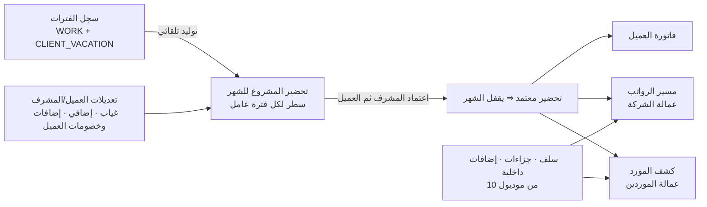
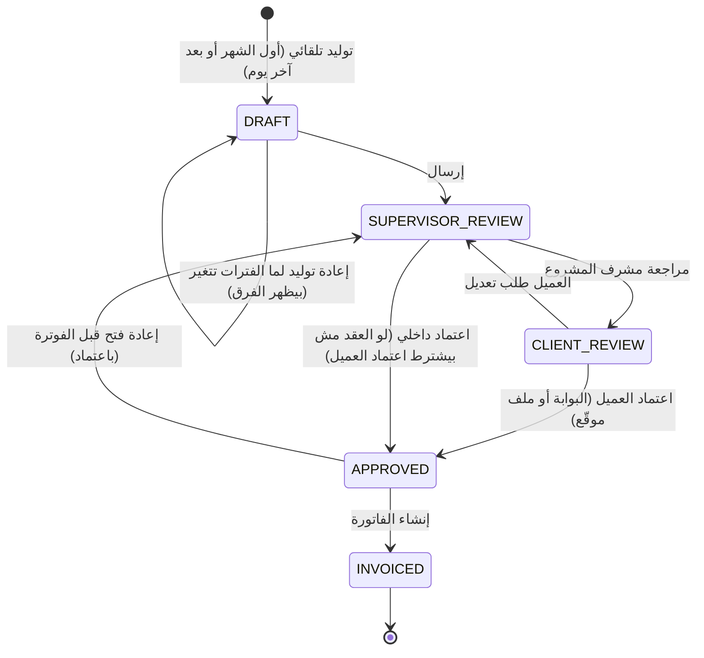

# 06 — التحضير الشهري للمشاريع (Project Timesheets)

> الجسر بين **سجل الفترات** ([04](04-person-worker-period-ledger.md)) وبين **فاتورة العميل** و**مسير الرواتب** و**كشف المورد**.
> مبني على طريقة العمل الحالية (`Attendance.aspx` + قالب `NewTS.xlsx` + `AttendanceInvoiceImportService`) — بس الحساب جوه النظام بدل الـ Excel.

## 1. الفكرة

- **التحضير بيتولد لوحده** من الفترات — مفيش حد بيكتب أيام شغل.
- **التحضير فيه البنود اللي تخص العميل بس.** السلف والجزاءات والإضافات الداخلية **مش في التحضير** — بتيجي من موديول شؤون العمالة للمسير مباشرة (في النظام الحالي كانت في نفس ملف الـ Excel وده كان بيخلط).

## 2. المستند

### 2.1 رأس التحضير `timesheet`
| العمود | المعنى |
|---|---|
| `project_id` (⇒ العقد والعميل والسجل التجاري) | تحضير لكل مشروع |
| `period_month`, `from_date`, `to_date` | الشهر (دورة الفوترة من العقد — الافتراضي الشهر الميلادي) |
| `base_days` | أيام الأساس من العقد — الافتراضي **30** |
| `entry_mode` | `SUMMARY` (أيام غياب إجمالي — زي الحالي) أو `DAILY` (حضور يومي للعميل اللي محتاجه) |
| `status`, `version` | الحالة ورقم النسخة |
| `client_approved_by/at`, `approval_channel` | مين اعتمد من العميل وإزاي (البوابة / ملف موقّع مرفوع) |

### 2.2 السطور `timesheet_line` — سطر لكل **فترة عامل** في الشهر
| العمود | المعنى | المصدر |
|---|---|---|
| `worker_id`, `period_id`, `period_rate_id` | العامل والفترة وسعرها | سجل الفترات |
| `line_from`, `line_to` | تقاطع الفترة مع الشهر | محسوب |
| `work_days` (R) | أيام الشغل بقاعدة الـ 30 يوم | محسوب |
| `fee_days` (S) | = `work_days` (مايختلفش إلا بتعديل معتمد) | محسوب |
| `period_type` | `WORK` أو `CLIENT_VACATION` (الاتنين بيتفوتروا) | الفترة |
| الأرقام المنسوخة | الراتب، التكلفة، السكن، المواصلات (+ billable)، الإجمالي | سعر الفترة |
| `absence_days`, `overtime_hours` | مجاميع التعديلات | التعديلات |
| `calc_*` | الراتب المستحق، الغياب، الإضافي، التكلفة المستحقة، السكن، المواصلات، GOSI، إجمالي قبل الضريبة | المعادلات ([03](03-billing-calculation-spec.md)) |

- عامل اشتغل فترتين في **نفس المشروع** في الشهر (تغيير سعر مثلًا) ⇒ **سطرين** كل واحد بسعره.
- فترتين في **مشروعين** ⇒ كل سطر في تحضير مشروعه.

### 2.3 التعديلات `timesheet_adjustment` (بأنواع ثابتة)
| النوع | الكمية/المبلغ | الفاتورة | المسير/المورد | مين يسجله |
|---|---|---|---|---|
| `ABSENCE` | أيام | − من بند الراتب فقط | − | العميل / مشرف المشروع |
| `OVERTIME` | ساعات (أو مبلغ حسب قاعدة المشروع) | + | + | العميل / المشرف |
| `CLIENT_ADDITION` | مبلغ (مكافأة/بدل من العميل) | + | + | المشرف باعتماد |
| `CLIENT_DEDUCTION` | مبلغ (خصم يطلبه العميل) | − | − | المشرف باعتماد |
| `CUSTOMER_LOAN` | مبلغ (سلفة صرفها العميل للعامل) | − | − | المشرف باعتماد |
| `FEE_DAYS_ADJUST` | أيام (لما الرسوم تختلف عن أيام الشغل) | ± على التكلفة | — | مدير العمليات |
| `OTHER_COST` | مبلغ على العميل | + | — | المالية |

كل تعديل: **سبب إجباري**، مين سجله، ومرفق لو لزم — **مفيش تعديل حر على أي مبلغ** (في النظام الحالي 277 سطر اتعدلت يدويًا في الـ Excel).

**تحققات:** أيام الغياب ≤ أيام الشغل؛ الإضافي ≤ حد شهري (إعداد المشروع)؛ عامل مش في التحضير مايتعملوش تعديل.

### 2.4 الحضور اليومي (للمشاريع بنظام `DAILY` بس)
`timesheet_day (line_id, date, status: P/A/OFF/OT_HOURS)` — والمجاميع بتتحسب منه للتعديلات.

## 3. دورة الحياة

- مسار الاعتماد نفسه **قابل للتعديل** من محرك الاعتماد ([05 §4](05-movement-documents.md)).
- **بعد `APPROVED`:** فترات الشهر ده للمشروع **بتتقفل** (القاعدة L8) — أي حركة متأخرة تخص الشهر ⇒ مستند تصحيح ⇒ **سطر تسوية في تحضير الشهر الجاي** (وإشعار دائن/مدين في الفاتورة).
- **قبل الاعتماد:** أي مستند حركة اتنفذ بتاريخ في الشهر بيعيد توليد السطور تلقائيًا، والتعديلات المسجلة بتفضل على العامل.

## 4. القنوات

| القناة | الاستخدام |
|---|---|
| شاشة التحضير الداخلية | المشرف والعمليات: مراجعة، تسجيل التعديلات، مقارنة بالشهر اللي فات، الإرسال |
| **بوابة العميل** | العميل بيشوف عماله وأيامهم، يسجل غياب/إضافي (أو يعترض)، ويعتمد |
| **Excel (بديل)** | تصدير بقالب **ثابت بإصدار** (الأعمدة المحسوبة مقفولة)، والعميل يعدّل الأعمدة المسموحة بس، والرفع بنفس تحققات النظام الحالي: كل عامل لازم يكون في التحضير، ممنوع التكرار، ممنوع حذف عامل، وأي عمود محسوب اتغير ⇒ يترفض |
| PDF للتوقيع | نسخة للطباعة والتوقيع لما العميل يعتمد ورقي، وترفع كمرفق |

## 5. شاشة متابعة التحضير (بدل `Attendance.aspx`)

لكل شهر، كل المشاريع اللي فيها فترات شغل:

| العمود | |
|---|---|
| المشروع، العميل، مدير المشروع | |
| عدد العمال، إجمالي أيام الشغل، الإجمالي المتوقع | من التحضير |
| حالة التحضير | مسودة / عند المشرف / عند العميل / معتمد / مفوتر |
| حالة الفاتورة والتحصيل | |
| **تنبيهات** | مشروع فيه شغل ومالوش تحضير (تغطية الفوترة)، تحضير متأخر عن موعد (إعداد)، عامل في الشهر من غير سعر، فرق كبير عن الشهر اللي فات |

## 6. المخرجات

| لمين | اللي بيروح |
|---|---|
| **الفوترة (موديول 9)** | سطر فاتورة لكل سطر تحضير ببنوده (راتب، غياب، تكلفة، سكن، مواصلات، إضافي، إضافات/خصومات العميل، GOSI) + الضريبة |
| **مسير عمالة الشركة (12)** | لكل عامل: أيام الشغل، الغياب، الإضافي، إضافات/خصومات العميل — والمسير بيضيف السلف والجزاءات وأيام السكن (لو الراتب مش موقوف) |
| **كشف المورد (15)** | نفس بيانات العامل لعمالة الموردين ⇒ مسير عمالة المورد + تكلفته حسب بطاقة التكلفة |
| **التقارير** | تغطية الفوترة، أيام الشغل لكل مشروع، الغياب والإضافي |

## 7. مثال

مشروع "أ" — أكتوبر — أساس 30 يوم:

| العامل | الفترة | أيام | الراتب | التكلفة | سكن (billable) | تعديلات | الإجمالي قبل الضريبة |
|---|---|---|---|---|---|---|---|
| عامل 1 | 1–31 | 30 | 1,000 | 1,500 | — | غياب يوم | 966.67 + 1,500 = **2,466.67** |
| عامل 2 | 1–14 (سعر قديم) | 14 | 1,200 | 1,300 | 200 | — | 560 + 606.67 + 93.33 = **1,260.00** |
| عامل 2 | 15–31 (سعر جديد) | 16 | 1,200 | 1,500 | 200 | إضافي 10 ساعات (أساسي 900) | 640 + 800 + 106.67 + 56.25 = **1,602.92** |
| عامل 3 | 20–31 | 11 | 1,500 | 1,000 | — | — | 550 + 366.67 = **916.67** |

> عامل 3 باشر يوم 20: الشهر 31 يوم بيتحسب لحد 30 ⇒ 11 يوم. عامل 2 = 14 + 16 = 30 يوم (السطر التاني اتقص لحد يوم 30).

## 8. أسئلة للتأكيد
1. **دورة الفوترة** دايمًا الشهر الميلادي (1 لآخر الشهر)؟ ولا فيه عملاء بيقفلوا مثلًا من 21 لـ 20؟
2. **اعتماد العميل** شرط قبل الفاتورة لكل العملاء، ولا حسب العميل (خيار في العقد)؟ ولو العميل مارّدش خلال مدة معينة، يتعتمد تلقائي؟
3. مين يسجل **الغياب**: العميل بس، ولا مشرف المشروع كمان؟
4. فيه عملاء محتاجين **حضور يومي** (مين حضر كل يوم)، ولا الإجمالي الشهري كفاية للكل؟
