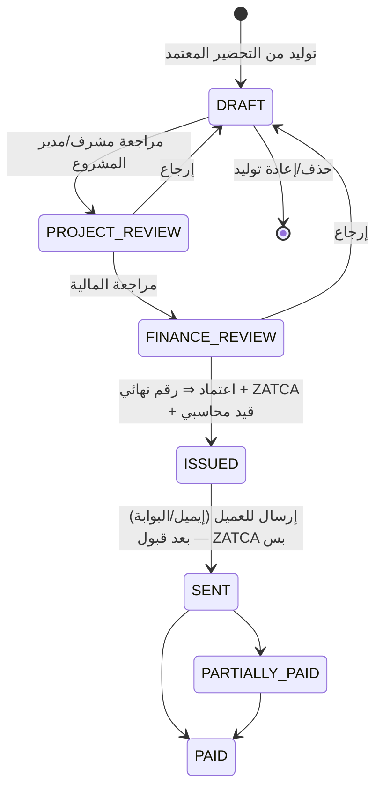

# 07 — الفوترة والتحصيل (Billing & Receivables)

> بتبدأ من **التحضير المعتمد** ([06](06-monthly-timesheet.md)) وبتطبق معادلات [03](03-billing-calculation-spec.md).
> بتغطي اللي موجود حاليًا (مراحل الفاتورة، التحصيل الجزئي/الكلي، أعمار الديون، أكبر المديونيات، التحصيل حسب المدير، تغطية الفوترة، كشف حساب المشروع) + الناقص: **ZATCA**، إشعارات دائن/مدين، سندات قبض وتوزيعها، والقيود المحاسبية.

## 1. أنواع المستندات

| المستند | المصدر | ملاحظات |
|---|---|---|
| **فاتورة العمالة الشهرية** | تحضير معتمد (مشروع + دورة) | الأساسي — بيتولد بضغطة من التحضير |
| **إشعار مدين** (Debit Note) | تسويات بتزود: حركة متأخرة في دورة مقفولة، زيادة راتب معتمدة بأثر رجعي، أيام ماكانتش متفوترة | مربوط بالفاتورة الأصلية + سبب |
| **إشعار دائن** (Credit Note) | تسويات بتقلل: حركة اتلغت بعد الفوترة، غياب متأخر، خصم اتفقنا عليه، تصحيح خطأ | **بديل الإلغاء** — الفاتورة الصادرة مابتتلغيش |
| **فاتورة خدمات أخرى** | يدوي من **كتالوج بنود** (كل بند: الاسم، فئة الضريبة، حساب الإيراد، سعر افتراضي) | رسوم استقدام، تأشيرة، نقل كفالة، تكاليف على العميل، غرامات تعاقدية… — **مطلوبة (قرار مؤكد)** |
| **فاتورة دفعة مقدمة** (Advance) | العقد | الدفعات المقدمة وخصمها من الفواتير الجاية |

> النظام الحالي فيه 193 فاتورة **ملغية** — في النظام الجديد الفاتورة قبل الإصدار بتتحذف/تتولد تاني عادي، وبعد الإصدار التصحيح بإشعار دائن/مدين بس (متطلب ZATCA كمان).

## 2. الفاتورة الشهرية

### 2.1 الرأس `invoice`
السجل التجاري (البائع ورقمه الضريبي)، العميل (الرقم الضريبي، العنوان الوطني، السجل)، المشروع، الدورة (من–إلى)، التحضير المصدر، تاريخ الفاتورة، **مدة السداد / تاريخ الاستحقاق** (خيار بيتحدد على الفاتورة — ممكن يتقترح من إعداد العميل لو موجود؛ لو فاضي ⇒ الاستحقاق = تاريخ الفاتورة)، العملة، الإجماليات (قبل الضريبة، الضريبة، الإجمالي، المحصل، المتبقي)، حالة الفاتورة، حالة ZATCA، الرقم (تسلسلي **لكل سجل تجاري** بدون فجوات).

### 2.2 السطور `invoice_line` — سطر لكل سطر تحضير (عامل × فترة)
| العمود | |
|---|---|
| العامل (الاسم، الرقم، الإقامة، المهنة، الجنسية)، الفترة، الأيام | |
| **مكونات السطر** `invoice_line_component` | `SALARY` (الراتب المستحق)، `ABSENCE` (−)، `SERVICE_FEE`، `HOUSING`، `TRANSPORT` (منفصلين لو billable)، `OVERTIME`، `CLIENT_ADDITION`، `CLIENT_DEDUCTION` (−)، `CUSTOMER_LOAN` (−)، `GOSI` (Cost Plus) |
| الإجمالي قبل الضريبة، فئة الضريبة ونسبتها، الضريبة، الإجمالي | |
| المرجع: `timesheet_line_id`, `period_id`, `period_rate_id` | تتبع كامل للمصدر |

**شكل الفاتورة للعميل (قرار مؤكد): الفاتورة الضريبية بالإجماليات بس** — سطر لكل بند:
| سطر الفاتورة الضريبية | المبلغ |
|---|---|
| رواتب العمالة (بعد خصم الغياب) | Σ (`SALARY` − `ABSENCE`) |
| رسوم الخدمة | Σ `SERVICE_FEE` |
| السكن (لو بيتفوتر منفصل) | Σ `HOUSING` |
| المواصلات (لو بتتفوتر منفصل) | Σ `TRANSPORT` |
| العمل الإضافي | Σ `OVERTIME` |
| إضافات العميل | Σ `CLIENT_ADDITION` |
| التأمينات (Cost Plus) | Σ `GOSI` |
| خصومات العميل وسلف العميل | خصم على مستوى الفاتورة (Allowance في ZATCA — مش سطر بالسالب) |

والعمال وأيامهم ومكوناتهم في **مرفق تفصيلي** (PDF و Excel) مرتبط بالفاتورة — السطور التفصيلية (`invoice_line` + المكونات) متخزنة في النظام للتتبع والتقارير، والإجماليات بتتولد منها.

### 2.3 التحققات قبل الإصدار
- العميل ليه رقم ضريبي وعنوان وطني صحيح (لفاتورة ضريبية B2B).
- مفيش سطر بدون سعر أو بأيام صفر.
- مجموع السطور = مجموع التحضير.
- مفيش فاتورة تانية لنفس المشروع والدورة (إلا إشعارات).

### 2.4 دورة الحياة (المسار قابل للتعديل — [05 §4](05-movement-documents.md))

| مرحلة حالية (CRM) | المقابل الجديد |
|---|---|
| review new invoice (مشرف المشروع) | `PROJECT_REVIEW` |
| review invoice / finance review | `FINANCE_REVIEW` |
| send invoice to customer | `ISSUED` ⇒ `SENT` |
| wait paid / تحصيل جزئي / تحصيل كلي | `SENT` / `PARTIALLY_PAID` / `PAID` (**تلقائي من التوزيع**، مش تغيير حالة يدوي) |
| Cancelled | مفيش — إشعار دائن |

## 3. الضريبة و ZATCA (الفوترة الإلكترونية — المرحلة الثانية)

| البند | التصميم |
|---|---|
| جدول الضريبة | فئات (`S` قياسي 15%، `Z` صفري، `E` معفى، `O` خارج النطاق) بنسب وتاريخ سريان؛ الفئة الافتراضية على العميل/البند |
| نوع الفاتورة | **ضريبية قياسية B2B** (Clearance — لازم قبول ZATCA قبل إرسالها للعميل)؛ مبسطة B2C (Reporting خلال 24 ساعة) لو فيه أفراد |
| وحدة الإصدار (EGS) | **لكل سجل تجاري ورقم ضريبي**: تسجيل (CSR ⇒ CSID)، شهادة إنتاج، تجديد |
| المستند | UBL 2.1 XML، UUID، عداد الفواتير (ICV)، **هاش الفاتورة السابقة (PIH)**، التوقيع، QR |
| الإشعارات | الدائن/المدين لازم يشيروا للفاتورة الأصلية + سبب الإصدار |
| التكامل | خدمة في مركز التكامل: طابور (queue)، إعادة محاولة، حالة لكل فاتورة (`PENDING`, `CLEARED`, `CLEARED_WITH_WARNINGS`, `REJECTED` + الأخطاء)، أرشفة XML و PDF/A-3 |
| الحماية | الشهادات والمفاتيح في Key Vault، وسجل لكل إرسال |

## 4. التحصيل (Receivables)

### 4.1 حساب العميل
كل عميل له **حساب ذمم** (subledger) بالحركات: فواتير، إشعارات، سندات قبض، دفعات مقدمة، أرصدة افتتاحية. الرصيد = مجموع الحركات (مش رقم على الفاتورة زي `new_totalpaidamount` الحالي).

### 4.2 سند القبض `receipt`
| | |
|---|---|
| البيانات | العميل، التاريخ، المبلغ، الطريقة (تحويل بنكي، شيك، نقدي، شبكة)، الحساب البنكي المستلم، المرجع، المرفق |
| الشيكات | تحت التحصيل ⇒ محصل / مرتجع |
| الاعتماد | المحاسب ⇒ المالية (قابل للتعديل) |
| الأثر | قيد (بنك مدين / ذمم دائن) |

### 4.3 التوزيع على الفواتير `receipt_allocation`
- يدوي (المحاسب يختار الفواتير والمبالغ) أو **تلقائي** (الأقدم استحقاقًا أولًا).
- جزء من فاتورة ⇒ `PARTIALLY_PAID`؛ كاملة ⇒ `PAID` — تلقائي.
- الزيادة ⇒ **رصيد دائن للعميل** (دفعة مقدمة) يتوزع بعدين.
- **العميل دفع أقل وخصم حاجة** (غرامة/فرق): المتبقي يا إما يفضل مستحق، يا إما يتعمل له **إشعار دائن** بسبب، يا إما **شطب** باعتماد.

### 4.4 المتابعة والتحصيل
| المكون | التفاصيل |
|---|---|
| **أعمار الديون** | حسب **تاريخ الاستحقاق** المحدد على الفاتورة (ولو مفيش مدة سداد ⇒ من تاريخ الفاتورة): جاري، 1–30، 31–60، 61–90، 91–180، أكتر من 180 |
| مسؤول التحصيل | لكل عميل/مشروع (افتراضيًا مدير المشروع — زي تقرير "التحصيل حسب المدير" الحالي) |
| التذكيرات | قبل/بعد الاستحقاق تلقائي (إيميل/واتساب) بقوالب |
| متابعات التحصيل | ملاحظات، وعد بالسداد وتاريخه، مهام للمحصل |
| **كشف حساب العميل** | لأي فترة: رصيد افتتاحي، الحركات، الرصيد — PDF والبوابة (بدل `Sales_ProjectStatement`) |
| حد الائتمان والتأخير | حد لكل عميل؛ لما العميل يتعدى الحد أو عنده متأخرات ⇒ **تنبيه بس** (في أمر التسليم وفي لوحة التحصيل) — **مفيش منع** (قرار مؤكد) |

## 5. القيود المحاسبية (تلقائي في موديول 13)

| الحدث | مدين | دائن |
|---|---|---|
| إصدار فاتورة | ذمم العميل | إيراد الرواتب المعاد تحميلها، إيراد رسوم الخدمة، إيراد السكن، إيراد المواصلات، إيراد الإضافي…(حساب لكل مكون) + ضريبة المخرجات — **مركز التكلفة = المشروع** |
| إشعار دائن | الإيرادات + ضريبة المخرجات | ذمم العميل |
| إشعار مدين | ذمم العميل | الإيرادات + الضريبة |
| سند قبض | البنك / شيكات تحت التحصيل | ذمم العميل |
| شطب | مصروف ديون معدومة | ذمم العميل |

## 6. التقارير (اللي موجود + الجديد)

| التقرير | الحالة |
|---|---|
| ملخص الفواتير، الحالات، اتجاه الفواتير الشهري | موجود — هيتحسب من القيود والتوزيع |
| ذمم المشاريع، أكبر المديونيات، التحصيل حسب مدير المشروع | موجود |
| أعمار الديون | موجود — بالاستحقاق بدل نهاية الفترة |
| **تغطية الفوترة** | موجود — + **إيراد غير مفوتر**: أيام شغل مالهاش تحضير معتمد، وتحضير معتمد مالوش فاتورة |
| كشف حساب العميل / المشروع | موجود — بقى من الحساب الفعلي |
| فواتير العامل (`EmployeeInvoices.ashx`) | موجود — من سطور الفواتير بالفترة |
| **جديد:** متوسط أيام التحصيل (DSO)، نسبة التحصيل، الإيراد حسب العميل/المشروع/المهنة/الجنسية، تقرير ZATCA (المرفوض/المعلق)، الشيكات تحت التحصيل | |

## 7. بوابة العميل
الفواتير و PDF و XML، المرفق التفصيلي، كشف الحساب، رفع إثبات التحويل (بيعمل سند قبض مسودة للمحاسب)، والاعتراض على فاتورة.

## 8. الترحيل من النظام الحالي
- الفواتير التاريخية ⇒ أرشيف للقراءة (بسطورها) بدون إعادة إصدار.
- الفواتير المفتوحة ⇒ **أرصدة افتتاحية** لكل فاتورة (الإجمالي − `new_totalpaidamount`) في حساب العميل، بتاريخها الأصلي عشان أعمار الديون.
- مراجعة الـ 193 فاتورة الملغية والـ 277 سطر المعدّل يدويًا قبل الاعتماد.

## 9. قرارات مؤكدة (2026-10-15)
1. **فاتورة لكل مشروع** (مفيش تجميع مشاريع).
2. **مدة السداد خيار على الفاتورة**، وأعمار الديون من تاريخ الاستحقاق.
3. **حد الائتمان والمتأخرات ⇒ تنبيه بس.**
4. **فيه أنواع فواتير تانية** (خدمات أخرى من كتالوج بنود، ودفعات مقدمة، وإشعارات).
5. **الفاتورة الضريبية بالإجماليات بس** والتفاصيل في المرفق.
