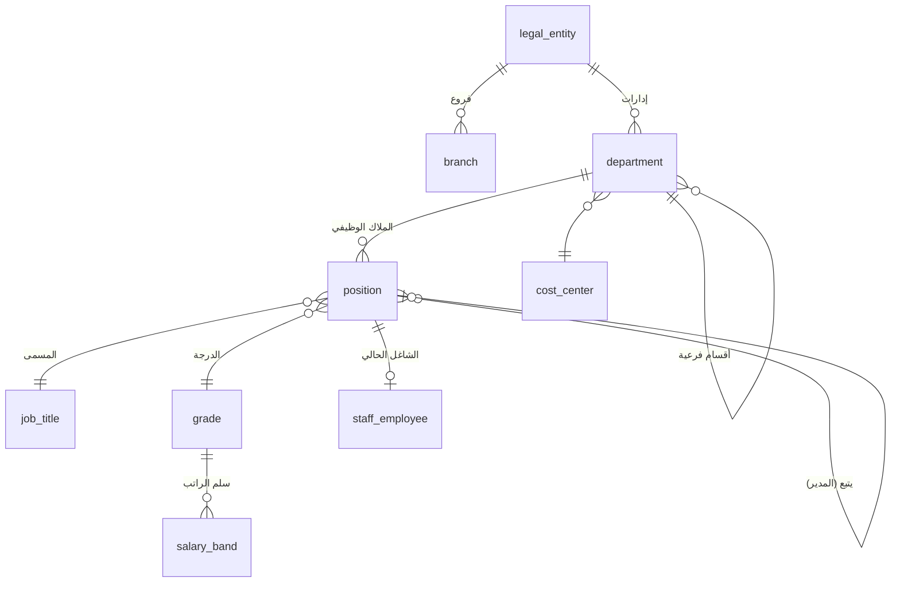
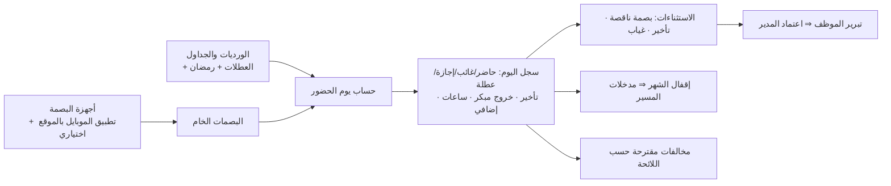

# 08 — الموارد البشرية لموظفي الشركة (Company Staff HR) — موديول 11

> موظفي الشركة (الإدارة، المشرفين، المحاسبين، المناديب…) **مش عمالة تشغيل**: مالهمش سجل فترات ولا تحضير ولا فاتورة عميل؛ أيامهم من **البصمة**، ومكانهم في **الهيكل التنظيمي**.
> **الوضع الحالي:** 357 موظف متسجلين في نفس كيان العمالة (`new_employee`) على "مشروع" اسمه `HeadOffice`، والتفريق بينهم بالاسم؛ الحضور ملف Excel اتستورد مرة واحدة (239 سجل)؛ المسير فاتورة على مشروع HeadOffice؛ الاستئذان (6 طلبات) والإجازات من نفس كيانات العمالة. ⇒ النظام الجديد بيفصلهم في موديول كامل.
> المشترك مع العمالة: **سجل الشخص والوثائق** ([04 §2](04-person-worker-period-ledger.md))، العلاقات الحكومية، محرك الرواتب، الاعتمادات، الصلاحيات.
> كل الأرقام النظامية (أيام الإجازات، نسب نهاية الخدمة، حدود الخصم، نسب التأمينات) **إعدادات بتاريخ سريان** مش ثوابت في الكود — القيم المكتوبة هنا افتراضية حسب نظام العمل السعودي وبتتراجع مع HR.

## 1. الهيكل التنظيمي والوظائف



| المكون | التفاصيل |
|---|---|
| السجلات التجارية والفروع | الموظف تابع لسجل تجاري (الكفالة/قوى/GOSI) وفرع (موقع العمل) |
| **الإدارات والأقسام** | شجرة بمستويات مفتوحة، مدير لكل إدارة، مركز تكلفة لكل إدارة |
| **المسميات الوظيفية** | كتالوج المسميات (عربي/إنجليزي) + الوصف الوظيفي + المهنة في قوى/الإقامة |
| **الدرجات وسلم الرواتب** | لكل درجة: الحد الأدنى والأعلى للأساسي والبدلات والمزايا (تذاكر، فئة التأمين الطبي…) |
| **الملاك الوظيفي (Positions)** | كل وظيفة = مكان في الهيكل (إدارة + مسمى + درجة + يتبع لمين) — شاغرة أو مشغولة |
| **المدير المباشر** | بيتجاب تلقائيًا من الهيكل (الوظيفة اللي فوق) — ويُستخدم في كل مسارات الاعتماد ([05 §4](05-movement-documents.md)) |
| رسم الهيكل | عرض شجري بالموظفين والشواغر |

## 2. ملف الموظف

| الجزء | المحتوى |
|---|---|
| الشخص | من سجل الشخص المشترك: البيانات، الهويات، الوثائق وتواريخ انتهائها |
| التوظيف `staff_employment` | رقم الموظف، تاريخ التعيين، نهاية التجربة، السجل التجاري، الفرع، الإدارة، الوظيفة/المسمى/الدرجة، المدير، الوردية، سعودي/غير سعودي، رقم GOSI |
| الراتب | الأساسي والبدلات بتاريخ سريان (سجل تاريخي)، الحساب البنكي/IBAN، طريقة الصرف |
| المزايا | التذاكر، فئة التأمين الطبي، سكن/مواصلات من الشركة، استحقاق الإجازة السنوية |
| المؤهلات والخبرات والتدريب | |
| المعالين وجهات الطوارئ | |
| السجل | كل الحركات الوظيفية والعقود والإجازات والجزاءات والسلف والتقييمات |

## 3. التوظيف (Staff Recruitment)
احتياج وظيفي (على وظيفة شاغرة في الملاك) ⇒ اعتماد ⇒ إعلان ⇒ المتقدمين ⇒ مقابلات وتقييم ⇒ **عرض وظيفي** باعتماد ⇒ قبول ⇒ **قائمة مهام المباشرة** (العقد، الإقامة/نقل الكفالة، GOSI، البنك، العهد، حساب الدخول للنظام، البصمة) ⇒ مباشرة.

## 4. العقود وتجديدها

| المكون | التفاصيل |
|---|---|
| **العقد** `staff_contract` | النوع (محدد/غير محدد المدة)، البداية والنهاية، **فترة التجربة** (افتراضي 90 يوم قابلة للتمديد)، فترة الإشعار، الراتب والبدلات، المزايا، ساعات العمل، استحقاق الإجازة، الشروط الخاصة، نسخة موقّعة |
| **ملحق عقد** | أي تعديل (راتب، مسمى، درجة، مزايا) = ملحق بتاريخ سريان واعتماد — نسخة جديدة من العقد |
| **التوثيق في قوى** | مهمة للعلاقات الحكومية عند كل عقد/ملحق/تجديد، وحالة التوثيق على العقد |
| **تنبيه نهاية العقد** | قبل النهاية بـ 90/60/30 يوم (إعداد) للمدير وHR |
| **قرار التجديد** | المدير يقترح: تجديد كما هو / تجديد بتعديلات / عدم تجديد — بمسار اعتماد (المدير ⇒ HR ⇒ الإدارة) |
| النتيجة | تجديد ⇒ عقد جديد مربوط بالقديم؛ عدم تجديد ⇒ إشعار رسمي ⇒ **إنهاء خدمة** بسبب "انتهاء العقد" (§10) |
| تقييم نهاية التجربة | قبل نهاية التجربة: تثبيت / تمديد / إنهاء |

## 5. الحركات الوظيفية
ترقية، نقل بين إدارات/فروع، تكليف مؤقت (Acting) ببدل، تعديل راتب، تغيير مسمى/درجة — **كل حركة بطلب واعتماد وتاريخ سريان**، وبتحدّث الوظيفة والراتب والمدير، وبتولّد ملحق عقد ومهمة قوى لو لازم.

## 6. الحضور والانصراف (البصمة)



| المكون | التفاصيل |
|---|---|
| **مصدر البصمات — المرحلة الأولى: ملف Excel** (قرار مؤكد) | استيراد ملف التصدير من نظام البصمة (أجهزة **FingerTec** ونظام البصمة الأونلاين الحالي): صف لكل موظف/يوم بالدخول والخروج (أو كل البصمات). **قالب ثابت + شاشة ربط الأعمدة** (لو شكل التصدير اختلف)، وربط رقم الموظف في الجهاز برقمه في النظام. التحققات: موظف غير معروف، تاريخ خارج الشهر، تكرار نفس اليوم، شهر مقفول ⇒ رفض السطر مع تقرير أخطاء. إعادة الاستيراد لنفس الفترة بتستبدل البصمات الخام وتعيد الحساب (قبل الإقفال بس) |
| التكامل المباشر (مرحلة لاحقة) | سحب البصمات تلقائيًا من FingerTec/النظام الأونلاين بالـ API — التصميم جاهز له لأن الحساب شغال على "البصمات الخام" مهما كان مصدرها |
| **الورديات والجداول** (قرار مؤكد: **ورديات**) | تعريف الورديات (البداية، النهاية، الاستراحة، السماحية)، جداول بالتناوب، إسناد وردية لموظف/إدارة بتاريخ سريان؛ **أيام الراحة: الجمعة والسبت** (افتراضي قابل للتغيير لكل وردية)؛ **جدول رمضان منفصل** بيتفعل تلقائيًا بتواريخ رمضان في التقويم |
| **التقويم والعطلات** | العطلات الرسمية والأعياد لكل سنة |
| **قواعد الحضور** | سماحية التأخير (دقائق)، شرائح التأخير، الخروج المبكر، البصمة الناقصة، الغياب، **الإضافي** (بموافقة مسبقة أو تلقائي، ومعامل 1.5 على الأجر الأساسي للساعة افتراضيًا) |
| **سجل اليوم** | بيتحسب لكل موظف ولكل يوم: الحالة، أول دخول/آخر خروج، ساعات العمل، دقائق التأخير والخروج المبكر، الإضافي |
| **الاستثناءات** | الموظف يبرر (أو يطلب "بصمة منسية"/مهمة عمل) ⇒ المدير يعتمد/يرفض |
| **إقفال الشهر** | HR تقفل حضور الشهر ⇒ مدخلات المسير: أيام الغياب بدون أجر، التأخير المخصوم، الإضافي، الإجازات بدون راتب |
| الحضور الميداني | للمناديب/المشرفين: تسجيل من التطبيق بالموقع (اختياري) |

## 7. الإجازات والاستئذان

| المكون | التفاصيل |
|---|---|
| **أنواع الإجازات** (إعداد) | سنوية (افتراضي 21 يوم، 30 بعد 5 سنين)، مرضية (بالشرائح: كاملة/75%/بدون أجر)، زواج، وفاة، مولود، أمومة، حج، امتحانات، بدون راتب، أخرى — لكل نوع: مدفوعة/نسبة، الرصيد، التراكم، الترحيل، المرفقات المطلوبة |
| **الرصيد** | استحقاق تلقائي (يومي/شهري) من تاريخ التعيين أو العقد — نفس فكرة الحالي (السنوية ÷ 365 × الأيام) بس متخزن كحركات (استحقاق، استهلاك، ترحيل، تسوية) بدل ما يتحسب ويتكتب كل ما الصفحة تتفتح |
| **الطلب** | الموظف (أو المدير نيابة عنه) ⇒ مسار الاعتماد الافتراضي: **المدير المباشر ⇒ HR ⇒ الإدارة العليا** — والمسار **configurable** بالكامل لكل نوع طلب ([05 §4](05-movement-documents.md)) |
| الأثر | أيام الإجازة بتظهر في الحضور (مش غياب)، وبتأثر على المسير حسب نوعها؛ صرف راتب الإجازة مقدم (خيار)؛ التذاكر |
| **العودة من الإجازة** | تأكيد المباشرة بعد الإجازة؛ التأخير عن العودة ⇒ غياب |
| **الاستئذان** | ساعات (خروج، تأخير، مهمة عمل) برصيد شهري (إعداد) وباعتماد المدير؛ بيلغي التأخير/الخروج المبكر من حساب الحضور |

## 8. الجزاءات والخصومات

| المكون | التفاصيل |
|---|---|
| **لائحة الجزاءات** (إعداد) | **مفيش لائحة حاليًا (قرار مؤكد)**: النظام فيه شاشة لبناء اللائحة (كتالوج المخالفات، والجزاء حسب مرات التكرار، وفترة احتساب التكرار) تتملى لما الشركة تعتمد لائحتها — ممكن نبدأ من النموذج الاسترشادي للائحة تنظيم العمل. لحد ما تتعمل: **الجزاءات يدوية** بقرار واعتماد |
| **مصدر المخالفة** | يدوي (المدير/HR)؛ والاقتراح التلقائي من الحضور (تأخير، غياب، خروج مبكر) **مقفول افتراضيًا** ويتفعل بعد اعتماد اللائحة |
| **الإجراء** | تسجيل المخالفة ⇒ إخطار الموظف ⇒ **التحقيق وأقوال الموظف** ⇒ قرار الجزاء ⇒ اعتماد ⇒ تنفيذ |
| **الحدود النظامية** (إعداد) | حد أقصى للخصم في المخالفة الواحدة وفي الشهر، وأيام الإيقاف — النظام بيمنع تجاوزها |
| التنفيذ | الخصم بيروح لمسير الشهر كبند "جزاء"؛ الإنذارات في ملف الموظف |
| خصومات أخرى | تلفيات، عهد مفقودة، … باعتماد |
| التظلم | الموظف يتظلم من القرار ⇒ مراجعة |

## 9. السلف والقروض

| المكون | التفاصيل |
|---|---|
| الأنواع | سلفة راتب (تتخصم من الشهر الجاي)، قرض بأقساط |
| **شروط الاستحقاق** (إعدادات — قرار مؤكد) | كلها بتتحدد من شاشة الإعدادات (ممكن لكل سجل تجاري/درجة): السقف (مبلغ أو مضاعف من الراتب)، أقصى نسبة قسط من الراتب، أقصى عدد أقساط، الاستحقاق بعد التجربة، مدة الخدمة الأدنى، منع سلفة جديدة قبل سداد القديمة |
| الإجراء | الطلب ⇒ اعتماد (المدير ⇒ HR ⇒ المالية) ⇒ **الصرف** (من المالية — دفعة/تحويل) ⇒ **جدول الأقساط** |
| الخصم | القسط بيتخصم تلقائيًا في المسير؛ تأجيل قسط أو إعادة جدولة أو سداد مبكر باعتماد |
| نهاية الخدمة | الرصيد المتبقي بيتخصم من المخالصة |
| المحاسبة | السلفة = ذمة مدينة على الموظف، والأقساط بتقفلها |

## 10. العهد
تسليم واستلام عهد (لابتوب، موبايل، سيارة، مفاتيح، …) مربوطة بموديول الأصول، بتوقيع الموظف؛ وبتظهر في إخلاء الطرف.

## 11. تقييم الأداء والتدريب
دورات تقييم (سنوي/نصف سنوي)، أهداف ومعايير لكل مسمى، تقييم المدير والذاتي، النتيجة بتأثر على الترقيات والزيادات؛ خطط التدريب والدورات والشهادات وتكلفتها.

## 12. إنهاء الخدمة


**المخالصة النهائية:**
```text
+ الراتب حتى آخر يوم عمل
+ بدل رصيد الإجازات المتبقي
+ مكافأة نهاية الخدمة:  نصف شهر عن كل سنة من أول 5 سنين + شهر عن كل سنة بعدها (على آخر أجر — المكونات من الإعداد)
     الاستقالة: أقل من سنتين = 0 ، من 2 لأقل من 5 = الثلث ، من 5 لأقل من 10 = الثلثين ، 10 فأكتر = كاملة
     الفسخ وفق المادة 80 = 0
+ أي مستحقات أخرى (إضافي، بدلات متأخرة)
− رصيد السلف − العهد غير المسلّمة − خصومات معتمدة
= الصافي
```
(نفس منطق `VacationRequestService.CalculateEndOfService` الحالي، بس النوع بكود ثابت مش من النص، والنسب إعدادات.)

**مخصص نهاية الخدمة:** بيتحسب شهريًا لكل موظف ويتقيد محاسبيًا (التزام على الشركة).

## 12.1 الموظفين السعوديين (قرار مؤكد: موجودين)
| البند | التصميم |
|---|---|
| **GOSI** | اشتراكات حسب الجنسية: السعودي (المعاشات + ساند — حصة الموظف وحصة الشركة) وغير السعودي (الأخطار المهنية على الشركة) — **النسب والأجر الخاضع (الأساسي + السكن) وسقفه إعدادات بتاريخ سريان** (عشان تغييرات النسب للمشتركين الجدد) |
| المسير | خصم حصة الموظف في المسير، وقيد حصة الشركة كتكلفة |
| **السعودة (نطاقات)** | تقرير نسبة السعودة لكل سجل تجاري (الموظفين + العمالة على نفس السجل)، وتنبيه لو النسبة نزلت عن الحد اللي بيتحدد في الإعدادات |
| مزايا خاصة | أي بدلات/إجازات خاصة بالسعوديين بتتعرف كإعداد |

## 13. الخدمة الذاتية
| للموظف | للمدير |
|---|---|
| الحضور وسجله، طلب إجازة/استئذان/سلفة/بصمة منسية، قسيمة الراتب، خطاب تعريف بالراتب، تحديث البيانات، العهد، رصيد الإجازات | اعتماد طلبات فريقه، حضور الفريق اليومي، رصيد إجازات الفريق، المخالفات، التقييم |

## 14. المخرجات لمسير موظفي الشركة (موديول 12)
لكل موظف ولكل شهر بعد إقفال الحضور: الأيام المستحقة، الغياب بدون أجر، خصم التأخير، الإضافي، الإجازات (مدفوعة/جزئية/بدون راتب)، **الجزاءات**، **أقساط السلف**، البدلات وتغييراتها، والمستحقات الاستثنائية — والمسير بيتحسب ويروح مُدد/WPS وGOSI والبنك، والقيد على **مركز تكلفة الإدارة**.

## 15. الصلاحيات والخصوصية
- رؤية الرواتب والبيانات الحساسة **بالدور ونطاق الإدارة** (بدل فرق `HeadEmp`/`HeadSalary` الحالية): الموظف يشوف بياناته، المدير يشوف فريقه (من غير رواتب إلا لو مسموح)، HR والرواتب حسب صلاحيتهم.
- كل اطلاع/تعديل على راتب متسجل في سجل التدقيق.

## 16. التقارير
عدد الموظفين حسب الإدارة/الفرع/الجنسية/الدرجة، **نسبة السعودة (نطاقات)**، الدوران الوظيفي، مؤشرات الحضور (التأخير، الغياب، الإضافي)، أرصدة الإجازات والتزامها المالي، **مخصص نهاية الخدمة**، أرصدة السلف، العقود اللي قربت تنتهي، الوثائق اللي قربت تنتهي، الشواغر، الجزاءات.

## 17. الترحيل
- موظفي `HeadOffice` الـ 357 من `new_employee` ⇒ `person` + `staff_employee` (الإدارة/المسمى/المدير محتاجين يتكملوا يدويًا لأنهم مش موجودين في النظام الحالي).
- الرواتب والبدلات، بداية العقد، الإجازة السنوية، الرصيد المستهلك (`new_consumedblalnce`, `new_oldconsumedbalance`) ⇒ رصيد افتتاحي للإجازات.
- السلف المفتوحة ⇒ أرصدة افتتاحية بجدول الأقساط المتبقي.

## 18. قرارات مؤكدة (2026-10-15)
1. **البصمة:** أجهزة FingerTec + نظام بصمة أونلاين — **المرحلة الأولى استيراد ملف Excel**، والتكامل المباشر بعدين.
2. **ورديات**، والراحة **الجمعة والسبت**، و**جدول رمضان مختلف**.
3. **مفيش لائحة جزاءات حاليًا** ⇒ الجزاءات يدوية، وشاشة لبناء اللائحة لما تتعتمد.
4. **فيه مرحلة إدارة عليا**، وكل مسارات الطلبات **configurable**.
5. **شروط السلف إعدادات.**
6. **فيه موظفين سعوديين** ⇒ GOSI بالجنسية + تقرير السعودة.
