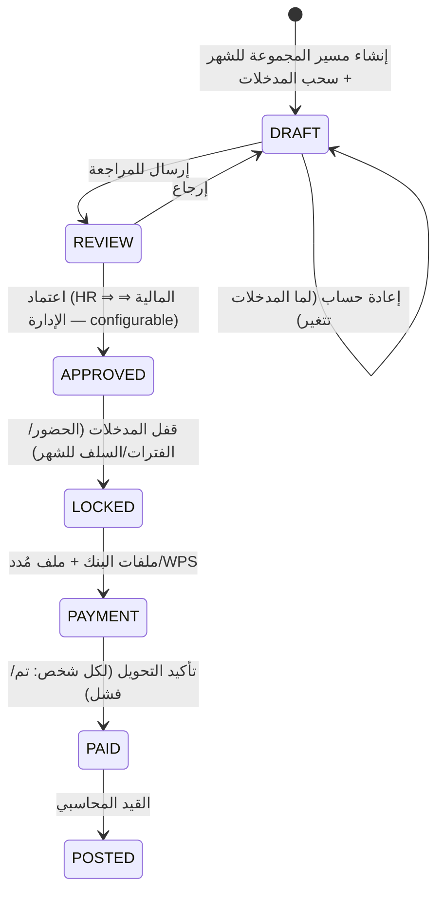

# 09 — الرواتب (Payroll) — موديول 12

> **محرك حساب واحد** و**3 مجموعات مسير** ([01](01-system-modules.md)، [02](02-worker-sourcing-billing-payroll.md)).
> **الوضع الحالي:** مسير HeadOffice بس (`HR_Payroll`): الإجمالي − (الإجمالي ÷ 30 × الغياب) − خصومات + إضافات، ومتخزن كـ **فاتورة مشروع** على مشروع HeadOffice؛ مفيش مُدد/WPS ولا GOSI ولا ملفات بنوك؛ القسائم بالإيميل (SMTP مش مضبوط). صافي العامل كان بيتحسب جوه ملف التحضير (`Net salary`) بس مكانش فيه مسير عمالة فعلي.

## 1. مجموعات المسير

| المجموعة | مين | مدخلات الأيام | بيتصرف من | المخرجات |
|---|---|---|---|---|
| **موظفي الشركة** (لكل سجل تجاري) | موديول 11 | **الحضور المقفول** (البصمة) + الإجازات | الشركة | تحويلات بنكية + **مُدد/WPS** + GOSI + قيد على مركز تكلفة الإدارة |
| **عمالة الشركة** (لكل سجل تجاري) | عمالة كفالة الشركة | **سجل الفترات** + التحضير المعتمد | الشركة | تحويلات + **مُدد/WPS** + GOSI + قيد على مركز تكلفة المشروع |
| **عمالة الموردين** (لكل مورد) | عمالة مصدرها مورد داخلي | **سجل الفترات** + التحضير المعتمد | **المورد** | **مسير المورد** ⇒ كشف/فاتورة المورد (موديول 15) — مش بيروح WPS الشركة ولا بيتحول من الشركة |

- كل مجموعة ليها **صلاحيات منفصلة** (اللي بيشوف/يحسب مسير الموظفين غير اللي بيشوف مسير العمالة).
- الشخص بيبقى في مجموعة واحدة في الشهر (حسب توظيفه الحالي)، ولو اتنقل في نص الشهر ⇒ جزء في كل مجموعة.

## 2. عناصر الراتب (Pay Elements) — كتالوج إعدادات

| الخاصية | الأمثلة |
|---|---|
| النوع | استحقاق / استقطاع / حصة الشركة (مش في الصافي) / معلومة |
| المصدر | ثابت من هيكل الراتب، من الحضور، من التحضير، من أحداث HR (جزاء، سلفة، إجازة)، إدخال يدوي لمرة واحدة، فرق بأثر رجعي |
| التناسب | بالأيام المستحقة ÷ 30 (افتراضي) أو ثابت |
| خاضع لـ GOSI | الأساسي + السكن (افتراضي — إعداد) |
| تصنيف WPS | أساسي / سكن / بدلات أخرى / استقطاعات (للملف) |
| الحساب المحاسبي | حساب مصروف/التزام لكل عنصر |

**العناصر الافتراضية:** الأساسي، بدل السكن، بدل الطعام، بدل المواصلات، بدلات أخرى، الإضافي، إضافات العميل، إضافات داخلية، فرق راتب بأثر رجعي، راتب إجازة مقدم — **و** خصم الغياب، خصم التأخير، الإجازة بدون راتب، الجزاءات، أقساط السلف، خصومات العميل، سلفة العميل، حصة الموظف في GOSI، خصومات أخرى.

## 3. الحساب

### 3.1 الأيام المستحقة (قاعدة 30 يوم)
| المجموعة | الحساب |
|---|---|
| موظفي الشركة | 30 − (غياب بدون أجر + إجازة بدون راتب + إيقاف) ؛ المعيّن/المنتهي خدمته في نص الشهر ⇒ أيامه الفعلية (بحد أقصى 30)؛ الإجازة المرضية بنسبة الشريحة |
| عمالة الشركة والموردين | من **سجل الفترات** في شهر المسير: `WORK` + `CLIENT_VACATION` + `HOUSING` (لو `salary_during_housing = true` — الافتراضي لأ) + الإجازات المدفوعة حسب نوعها؛ و`SUSPENDED`/`ABSCONDED`/`OUT` بدون أجر؛ ثم خصم الغياب من التحضير |

### 3.2 المعادلة
```text
لكل عنصر استحقاق ثابت:   القيمة × الأيام المستحقة ÷ 30
+ الإضافي:     الموظفين ⇒ ساعات الإضافي المعتمدة من الحضور × (الأساسي ÷ 240) × 1.5
               العمالة  ⇒ من التحضير حسب قاعدة المشروع
+ إضافات العميل (عمالة) + إضافات داخلية + فروقات بأثر رجعي
− خصم الغياب:  الراتب ÷ 30 × أيام الغياب   (للعمالة: نفس رقم الغياب اللي اتخصم من فاتورة العميل)
− خصم التأخير (موظفين — حسب قاعدة الحضور)
− الجزاءات المعتمدة − أقساط السلف − خصومات العميل − سلفة العميل
− حصة الموظف في GOSI (السعوديين)
= الصافي
حصة الشركة في GOSI ⇒ تكلفة (مش في الصافي)
```

### 3.3 قواعد الحماية
| القاعدة | التصرف |
|---|---|
| **حد أقصى للاستقطاعات** من الأجر في الشهر (إعداد نظامي) | لو اتعدّى: الأقساط والجزاءات الزايدة **بتترحل للشهر الجاي** تلقائيًا (والسلفة بيتعاد جدولة قسطها) |
| صافي سالب أو صفر | تحذير ومنع اعتماد السطر لحد المراجعة |
| عامل `ABSCONDED` أو عليه إيقاف صرف | السطر بيتحسب لكن **الصرف موقوف** (Hold) |
| موظف/عامل من غير IBAN | تحذير — طريقة صرف بديلة (نقدي بسند) |

## 4. دورة المسير



| مرحلة المراجعة | اللي بيظهر |
|---|---|
| مقارنة بالشهر اللي فات | فرق الإجمالي والصافي لكل شخص، ونسبته |
| تنبيهات | معيّنين جدد، منتهي خدمتهم، صافي سالب/صفر، بدون IBAN، تغيير راتب، أقساط مترحلة، عمال من غير تحضير معتمد |
| ملخص | لكل إدارة/مشروع/سجل تجاري: العدد، الإجمالي، الاستقطاعات، الصافي، حصة الشركة GOSI |

- **بعد الاعتماد مفيش تعديل** على المسير: أي تصحيح ⇒ **مسير إضافي (Off-cycle)** أو فرق في الشهر الجاي.
- **مسيرات خارج الدورة:** المخالصة النهائية، راتب الإجازة المقدم، التصحيحات، المكافآت.

## 5. الصرف

| المكون | التفاصيل |
|---|---|
| **ملفات البنوك** | ملف تحويل لكل بنك بقالب قابل للإعداد (الأعمدة والصيغة لكل بنك)، من حساب الشركة لكل سجل تجاري |
| **مُدد / WPS** | ملف حماية الأجور لكل سجل تجاري بالصيغة المعتمدة (الأساسي، السكن، البدلات، الاستقطاعات، الصافي، IBAN، رقم الهوية)، ومتابعة حالة الرفع والرفض، وتقرير الامتثال |
| الصرف النقدي | سند صرف بتوقيع المستلم |
| تأكيد الصرف | استيراد نتيجة التحويل أو تأكيد يدوي لكل شخص؛ الفاشل يرجع "غير مصروف" ويتعاد |
| إيقاف الصرف | لأشخاص معينين (هروب، تحقيق) لحد ما يترفع |

## 6. قسائم الرواتب
PDF عربي/إنجليزي لكل شخص (الاستحقاقات، الاستقطاعات، الأيام، الصافي، رصيد السلفة، رصيد الإجازات)، بتتبعت بالإيميل والـ SMS ومتاحة في تطبيق العامل والخدمة الذاتية — بعد الاعتماد بس.

## 7. التأمينات الاجتماعية (GOSI)
- حساب الاشتراك الشهري لكل شخص حسب الجنسية والنسب السارية (إعدادات بتاريخ سريان) على الأجر الخاضع وسقفه.
- حصة الموظف ⇒ استقطاع في المسير؛ حصة الشركة ⇒ تكلفة والتزام.
- تقرير مطابقة شهري مع فاتورة GOSI، ومهام تحديث الأجر في GOSI لما الراتب يتغير.

## 8. مسير عمالة الموردين
- نفس الحساب بالظبط (أيام، غياب، إضافي، خصومات العميل) **+ خصومات الشركة على العامل** (سلفة من الشركة، جزاء) — قرار مؤكد: أي خصم من راتب عامل المورد بيتخصم من فاتورة المورد.
- **مابيتصرفش ومابيروحش WPS الشركة**: بيطلع **كشف مسير للمورد** (PDF/Excel) يصرف عليه.
- صافي المسير لكل عامل + بنود بطاقة التكلفة ⇒ **كشف المورد الشهري** ⇒ مطابقة مع فاتورة المورد ⇒ الذمم الدائنة (موديول 15).

## 9. القيود المحاسبية
| الحدث | مدين | دائن |
|---|---|---|
| اعتماد مسير الموظفين | مصروف رواتب (بالعنصر) — **مركز تكلفة الإدارة**؛ مصروف GOSI (حصة الشركة) | رواتب مستحقة، سلف الموظفين (الأقساط)، GOSI مستحقة، استقطاعات أخرى |
| اعتماد مسير عمالة الشركة | تكلفة الإيراد — رواتب العمالة — **مركز تكلفة المشروع** (حسب أيام كل مشروع) | رواتب مستحقة، سلف العمالة، … |
| الصرف | رواتب مستحقة | البنك |
| سداد GOSI | GOSI مستحقة | البنك |
| كشف المورد (موديول 15) | تكلفة الإيراد — عمالة موردين — مركز تكلفة المشروع | المورد (ذمم دائنة) |
| مخصص نهاية الخدمة الشهري | مصروف مكافأة نهاية الخدمة | مخصص نهاية الخدمة |

## 10. التقارير
سجل الرواتب (Payroll Register)، تقرير الفروقات بين الشهور، التكلفة حسب الإدارة/المشروع/السجل التجاري، GOSI، امتثال مُدد/WPS، حالة التحويلات، أرصدة السلف، **راتب العامل المفوتر مقابل المصروف** (من الفاتورة والمسير لنفس العامل — جزء من الربحية)، مخصص نهاية الخدمة، وتكلفة عمالة الموردين لكل مورد.

## 11. الضوابط والأمان
فصل المهام (اللي يحسب غير اللي يعتمد غير اللي يصرف)، صلاحيات لكل مجموعة مسير، تدقيق كامل على أي تعديل في الراتب أو الحساب البنكي، وتنبيه لما IBAN يتغير قبل الصرف.

## 12. التشغيل المتوازي
أول شهرين: حساب المسير في النظام الجديد ومقارنته بالمسير الحالي (HeadOffice) وبصافي العامل في فواتير التحضير الحالية، وتحليل الفروقات قبل الاعتماد الفعلي.

## 13. أسئلة للتأكيد
1. **فترة مسير العمالة:** الشهر الميلادي (من 1 لآخر الشهر) لكل العمالة، ولا بتمشي مع دورة فوترة المشروع (زي 21→20)؟
2. **عمالة الشركة بتتصرف رواتبها حاليًا إزاي** (تحويل بنكي/مُدد/نقدي)؟ ومن أنهي بنوك؟
3. **مسار اعتماد المسير الافتراضي:** الموارد البشرية ⇒ المالية ⇒ الإدارة العليا مناسب كبداية؟
4. **موعد الصرف:** يوم ثابت في الشهر؟ وهل فيه صرف قبل اعتماد التحضير (مثلًا راتب العمالة بيتصرف قبل ما فاتورة العميل تتعمل)؟
