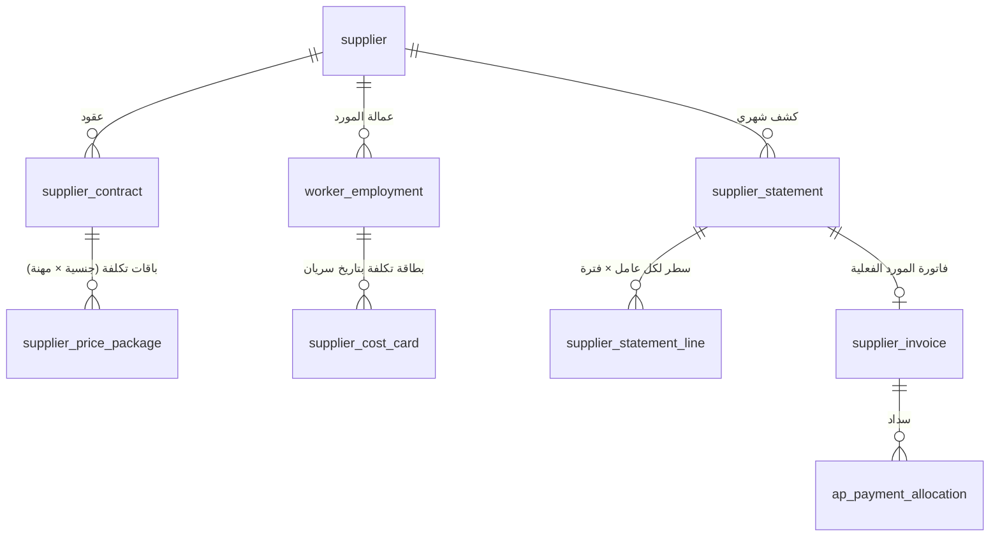
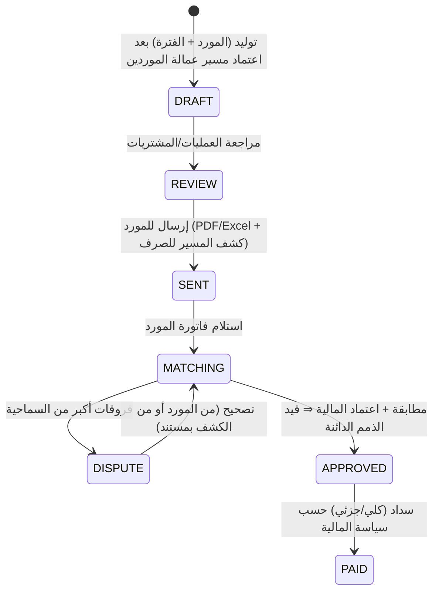

# 10 — الموردين الداخليين — توريد العمالة (Labor Suppliers) — موديول 15

> المورد الداخلي شركة محلية **بتأجّر عمالتها للشركة**: العامل على كفالة المورد، والمورد بيصرف راتبه، والشركة بتدفع للمورد **مسير عمالته + تكلفة العامل المتفق عليها**. الشركة هنا **عميل** للمورد ([02](02-worker-sourcing-billing-payroll.md)).
> **الوضع الحالي:** مفيش أي بيانات تكلفة موردين في النظام — بس اسم الكفيل في `new_sponseredby` (إسعاد، IRC، جوى، ريادتي، وطن، إيوان، مهن، مهارة). ⇒ بطاقات التكلفة **لازم تتجمع من العقود الفعلية** وقت الترحيل.

## 1. المكونات



## 2. بيانات المورد `supplier`
السجل التجاري وتاريخ انتهائه، الرقم الضريبي، العنوان الوطني، الحساب البنكي/IBAN، جهات الاتصال، الحساب في الذمم الدائنة، شروط الدفع الافتراضية، السجل التجاري بتاعنا اللي بيتعامل معاه، الحالة (نشط/موقوف)، المرفقات (العقد، السجل، الشهادات). نفس جدول الموردين بتاع موديول المشتريات بنوع "مورد عمالة".

## 3. عقد المورد `supplier_contract`
| البند | التفاصيل |
|---|---|
| المدة والتجديد | البداية، النهاية، تنبيه قبل الانتهاء |
| **طريقة الحساب الافتراضية** | `MONTHLY_FIXED` (مبلغ شهري ثابت) / `BY_WORKING_DAYS` (بأيام الشغل) — بتتورث في بطاقة كل عامل وممكن تتغير له |
| **السكن والمواصلات الافتراضي** | على الشركة / على المورد — بيتورث في البطاقة |
| سياسة الخصومات | **أي خصم من راتب العامل بيتخصم من فاتورة المورد** (قرار مؤكد): الغياب، سلف الشركة للعامل، الجزاءات، خصومات العميل |
| الضريبة | خاضع للضريبة ونسبتها |
| شروط الدفع | مدة السداد |
| الحد الأقصى للعمالة | اختياري |
| **باقات التكلفة** (اختياري) | زي باقات العملاء: لكل جنسية × مهنة: الراتب، رسوم المورد، الرسوم الحكومية، التأمين، السكن، المواصلات ⇒ بتسرّع إنشاء بطاقة العامل |

## 4. بطاقة تكلفة العامل `supplier_cost_card` (بتاريخ سريان)

| البند | المعنى |
|---|---|
| الراتب ومكوناته | الأساسي والبدلات اللي المورد بيصرفها للعامل (= أساس مسير عمالة المورد) |
| رسوم المورد / الهامش | المبلغ الشهري للمورد عن العامل |
| الرسوم الحكومية | إقامة، رخصة عمل… لو المورد بيحمّلها |
| التأمين الطبي | لو على المورد |
| السكن | **على الشركة / على المورد** + المبلغ |
| المواصلات | **على الشركة / على المورد** + المبلغ |
| بنود أخرى | |
| **طريقة الحساب** | `MONTHLY_FIXED` / `BY_WORKING_DAYS` |
| المصدر والاعتماد | من باقة تكلفة أو اتفاق خاص — باعتماد (المشتريات/العمليات ⇒ المالية) |

- **إجبارية قبل أول فترة `WORK`** للعامل: أمر التسليم مايتعمدش لعامل مورد من غير بطاقة سارية.
- أي تغيير (زيادة راتب، رسوم جديدة) = **مستند تعديل تكلفة** باعتماد وتاريخ سريان؛ زيادة راتب عامل المورد بتمشي بنفس إجراء [04 §7](04-person-worker-period-ledger.md) (تعميد منفصل لتطبيقها على فاتورة العميل).
- البند "على الشركة" مابيدخلش كشف المورد، وبيتحسب **تكلفة مباشرة على الشركة** في الربحية.

## 5. تسجيل عامل المورد
مستند "تسجيل عامل مورد" ([05 §2.1](05-movement-documents.md)): المورد، بيانات العامل والإقامة (على كفالة المورد)، بطاقة التكلفة ⇒ يبدأ بفترة `HOUSING` (لو دخل سكن الشركة) أو بأمر تسليم مباشر لـ `WORK`. **تسجيل أجير مسؤولية المورد.** إنهاء التعامل مع العامل (رجوع للمورد) = مستند خروج بسبب "إرجاع للمورد" ⇒ `OUT` + قفل `worker_employment`.

## 6. كشف المورد الشهري `supplier_statement`

### 6.1 السطور — لكل عامل × فترة جوه فترة الكشف
| العمود | الحساب |
|---|---|
| الأيام | من **سجل الفترات** جوه فترة الكشف بقاعدة الـ 30 يوم (الأنواع اللي بتتحسب للمورد — سؤال 2) |
| **صافي راتب العامل** | من **مسير عمالة الموردين** ([09 §8](09-payroll.md)): الراتب بالأيام − الغياب − سلف الشركة − الجزاءات − خصومات العميل ± الإضافي وإضافات العميل |
| رسوم المورد | `MONTHLY_FIXED` ⇒ كاملة (لو العامل كان مع الشركة الفترة كلها، وبالتناسب لو دخل/خرج في نصها) ؛ `BY_WORKING_DAYS` ⇒ × الأيام ÷ 30 |
| السكن / المواصلات | لو **على المورد** ⇒ بتتضاف (بنفس طريقة الحساب)؛ لو على الشركة ⇒ صفر |
| الرسوم الحكومية / التأمين / أخرى | حسب البطاقة |
| الإجمالي قبل الضريبة ⇒ الضريبة ⇒ الإجمالي | |

### 6.2 دورة الكشف


### 6.3 مطابقة فاتورة المورد
- المورد بيبعت فاتورته (رقمها، تاريخها، رقمه الضريبي، الإجماليات، الـ PDF و QR الفاتورة الإلكترونية) + اختياري ملف تفصيلي بالعمال (استيراد Excel).
- **مطابقة على الإجمالي** (وعلى مستوى العامل لو بعت التفاصيل): الأيام، الصافي، الرسوم، البنود.
- **سماحية** فروقات (مبلغ/نسبة — إعداد)؛ الأكبر منها ⇒ نزاع بسطور الفرق.
- الفاتورة بتتسجل بأرقام **فاتورة المورد الفعلية** (هي المستند الضريبي للمشتريات وضريبة المدخلات).

## 7. السداد والذمم الدائنة
سند صرف/تحويل بنكي للمورد، سداد جزئي، توزيع على فواتيره، أعمار الذمم الدائنة، كشف حساب المورد، والدفعات المقدمة للمورد (لو فيه).

## 8. القيود المحاسبية
| الحدث | مدين | دائن |
|---|---|---|
| اعتماد كشف/فاتورة المورد | تكلفة الإيراد — عمالة موردين (رواتب، رسوم، سكن، نقل… حساب لكل بند) — **مركز تكلفة المشروع** حسب أيام العامل في كل مشروع؛ ضريبة المدخلات | المورد (ذمم دائنة) |
| خصم سلفة الشركة لعامل المورد | — (جزء من صافي الكشف) | سلف العمالة (ذمة على العامل) — يعني الخصم بيقفل السلفة بدل ما يقلل التكلفة |
| خصم جزاء/خصم عميل | — | بيقلل التكلفة (أو إيراد جزاءات — إعداد) |
| سداد المورد | المورد | البنك |

## 9. الربحية (الهدف الأساسي من الموديول)
لكل عامل مورد في الشهر/الفترة:
```text
الإيراد  = سطور فاتورة العميل للعامل (بدون ضريبة)
التكلفة  = سطر كشف المورد للعامل (بدون ضريبة، وقبل خصم سلف الشركة لأنها مش تكلفة)
         + البنود اللي "على الشركة" (سكن/مواصلات) + أي تكلفة مباشرة
الربح    = الإيراد − التكلفة     الهامش = الربح ÷ الإيراد
```

| التقرير | المحتوى |
|---|---|
| **ربحية عامل المورد** | تكلفته الشهرية للمورد مقابل فاتورة العميل لنفس العامل (المقارنة المطلوبة) |
| ربحية المورد | لكل مورد: عدد العمال، الإيراد من عماله، التكلفة، الهامش، متوسط الهامش للعامل، أيام بدون شغل (تكلفة بدون إيراد لو `MONTHLY_FIXED`) |
| مقارنة المصادر | عامل استقدام مقابل عامل مورد لنفس المهنة/الجنسية: التكلفة والهامش |
| أداء المورد | الاستبدالات، الانقطاع/الهروب، الوثائق المنتهية، نسبة النزاعات في الفواتير |

## 10. بوابة المورد (اختياري — مرحلة لاحقة)
قائمة عماله ووثائقهم، الكشوفات الشهرية وكشف المسير للصرف، رفع الفواتير، والنزاعات.

## 11. أسئلة للتأكيد
1. **فترة كشف المورد:** بتتحدد عند الإنشاء زي المسير، ولا شهرية ثابتة لكل مورد؟
2. **الأيام اللي بتتدفع للمورد:** أيام الشغل بس (شغل + إجازة على العميل)؟ ولا كمان أيام السكن (العامل مستني تسليم) — خصوصًا في `MONTHLY_FIXED`؟
3. **الضريبة على فاتورة المورد:** على المبلغ كله (راتب + رسوم)، ولا على الرسوم بس؟
4. **فاتورة المورد:** الموردين بيبعتوا تفاصيل بالعمال، ولا إجمالي بس؟
5. **أسعار الموردين:** فيه أسعار ثابتة لكل جنسية/مهنة مع كل مورد (باقات)، ولا كل عامل باتفاق لوحده؟
