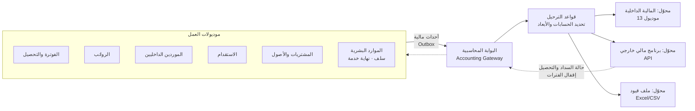

# 11 — المالية والمحاسبة (Finance & Accounting) — موديول 13 **قابل للاستبدال**

> **مبدأ إلزامي (2026-10-15):** النظام مبني على **موديولات مستقلة**. موديول المالية والحسابات ممكن **يتلغي تفعيله** ويتعتمد برنامج مالي تاني، أو يشتغل **مربوط ببرنامج مالي خارجي** — من غير ما أي موديول تاني يتأثر.
> ⇒ ولا موديول بيكتب قيود بنفسه. كل الموديولات بتطلع **أحداث مالية** (Financial Events)، و**بوابة محاسبية** (Accounting Gateway) هي اللي بتوديها للمالية الداخلية أو للبرنامج الخارجي.

## 1. المعمارية: Ports & Adapters

| المكون | الدور |
|---|---|
| **الحدث المالي** | مستند ثابت (immutable) بيطلعه الموديول وقت حدث مالي: نوعه، السجل التجاري، التاريخ، العميل/المورد/الموظف، المبالغ **مفصّلة بالمكونات**، الضريبة، الأبعاد (مشروع، إدارة، سكن)، المرجع، ومفتاح منع التكرار (idempotency) |
| **Outbox** | الحدث بيتسجل في نفس عملية حفظ المستند ⇒ مستحيل يضيع أو يتكرر |
| **البوابة المحاسبية** | بتستلم الأحداث، وتطبق قواعد الترحيل، وتبعت للوجهة المفعّلة، وتتابع الحالة لكل حدث (`PENDING`, `SENT`, `ACKNOWLEDGED`, `FAILED`) مع إعادة المحاولة |
| **قواعد الترحيل** | إعداد: لكل نوع حدث × مكون × سجل تجاري × (نوع عقد/فئة…) ⇒ الحساب المدين/الدائن والأبعاد |
| **المحوّلات (Adapters)** | داخلي / خارجي (لكل برنامج محوّل) / ملف — **الوجهة بتتحدد في الإعدادات لكل سجل تجاري** |
| **التسوية (Reconciliation)** | تقرير يومي: كل الأحداث، اللي اتبعتت واتقبلت، والفاشلة وسببها، ومطابقة الإجماليات مع الوجهة |

> الموديولات **مابتعرفش** مين بيستقبل. لو اتغير البرنامج المالي ⇒ بنغير المحوّل والإعدادات بس.

## 2. أوضاع التشغيل (بتتحدد لكل سجل تجاري)

| الوضع | المالية في النظام | البرنامج الخارجي | مين بيسجل التحصيل/السداد |
|---|---|---|---|
| **A — مالية داخلية كاملة** | الأستاذ العام + الذمم + البنوك + القوائم | — | النظام |
| **B — ذمم داخلية + أستاذ عام خارجي** | الفواتير، سندات القبض، كشوف الموردين وسدادها (الذمم) | القيود (من الأحداث) والقوائم المالية | النظام |
| **C — مالية خارجية كاملة** | الفواتير وكشوف الموردين بس (مستندات تشغيلية) | الذمم المدينة والدائنة والتحصيل والسداد والقيود | البرنامج الخارجي ⇒ **حالة السداد بترجع للنظام** (API/Webhook/استيراد) عشان أعمار الديون والتنبيهات والربحية تفضل شغالة |

- **التقارير التشغيلية** (ربحية العامل/المشروع/المورد، أعمار الديون، تغطية الفوترة) **بتفضل في النظام في كل الأوضاع** لأنها مبنية على بيانات التشغيل (الفترات، الفواتير، المسير، كشوف الموردين) مش على الأستاذ العام.
- القوائم المالية الرسمية: من النظام في الوضع A، ومن البرنامج الخارجي في B و C.

### 2.1 ZATCA في الأوضاع المختلفة
**مُصدِر واحد بس لكل فاتورة** (إعداد لكل سجل تجاري):
- **النظام هو المُصدِر** (افتراضي): بيعمل الـ XML والختم والإرسال لـ ZATCA، ويبعت للبرنامج الخارجي الفاتورة **بعد** قبولها مع رقمها و UUID.
- **البرنامج الخارجي هو المُصدِر**: النظام بيبعت بيانات الفاتورة، والخارجي بيصدرها ويرجّع الرقم و UUID و QR والحالة.

### 2.2 مزامنة البيانات الأساسية
| البيانات | الاتجاه |
|---|---|
| العملاء، الموردين، الموظفين (كذمم) | النظام ⇒ الخارجي (إنشاء/تحديث) مع جدول ربط الأكواد |
| مراكز التكلفة (المشاريع، الإدارات، المساكن) | النظام ⇒ الخارجي |
| دليل الحسابات | الخارجي ⇒ النظام (للربط في قواعد الترحيل) أو ربط يدوي |
| الفترات المحاسبية المقفولة | الخارجي ⇒ النظام (عشان مايتبعتش حدث بتاريخ فترة مقفولة — يتحول لتاريخ أول فترة مفتوحة باعتماد) |

## 3. كتالوج الأحداث المالية (العقد الثابت بين الموديولات والمالية)

| الحدث | الموديول | المحتوى الأساسي |
|---|---|---|
| `CustomerInvoiceIssued` | الفوترة | العميل، المشروع، المكونات (رواتب، رسوم، سكن، نقل، إضافي، GOSI…)، الخصومات، الضريبة |
| `CustomerCreditNoteIssued` / `DebitNoteIssued` | الفوترة | مرجع الفاتورة + المكونات + السبب |
| `CustomerReceiptPosted` / `ReceiptAllocated` / `ReceiptBounced` | التحصيل | البنك، المبلغ، التوزيع |
| `CustomerBalanceWrittenOff` | التحصيل | |
| `PayrollApproved` | الرواتب | لكل مجموعة: العناصر × مركز التكلفة، الاستقطاعات (سلف، GOSI، جزاءات)، حصة الشركة GOSI |
| `PayrollPaid` | الرواتب | البنك، المبالغ المصروفة/الفاشلة |
| `SupplierStatementApproved` | الموردين | المورد، البنود × مركز التكلفة، ضريبة المدخلات، سلف العمالة المستردة |
| `SupplierPaymentPosted` | الموردين/المشتريات | |
| `EmployeeLoanDisbursed` / `LoanInstallmentRecovered` | HR / الرواتب | |
| `EndOfServiceProvisionAccrued` / `FinalSettlementApproved` | HR | |
| `RecruitmentCostIncurred` | الاستقدام | الوكيل، التأشيرة، الطيران… على العامل/العقد (أصل يُستهلك أو مصروف — إعداد) |
| `GovernmentFeePaid` | العلاقات الحكومية | الإقامة، رخصة العمل… (مصروف مقدم يُستهلك على السنة — إعداد) |
| `PurchaseInvoiceApproved` / `GoodsReceived` / `AssetCapitalized` | المشتريات والأصول | |
| `HousingCostIncurred` | السكن | إيجار، خدمات، صيانة × السكن |

كل حدث ليه **إصدار (version)** وتوثيق (schema) — أي محوّل خارجي بيتبني على الكتالوج ده.

## 4. موديول المالية الداخلي (لما يكون مفعّل)

| المكون | التفاصيل |
|---|---|
| **دليل الحسابات** | شجري عربي/إنجليزي، أنواع الحسابات، حسابات رقابة (ذمم مدينة/دائنة/رواتب مستحقة)، لكل سجل تجاري أو مشترك |
| **الأبعاد** | السجل التجاري، الفرع، **مركز التكلفة** (مشروع / إدارة / سكن)، العميل، المورد، الموظف/العامل |
| **القيود** | تلقائية من الأحداث، يدوية باعتماد، متكررة، عكسية؛ مرفقات؛ ترقيم لكل سجل تجاري |
| **السنوات والفترات** | فتح/إقفال الفترة، منع الترحيل في فترة مقفولة، قيود الإقفال السنوي |
| **الذمم المدينة** | من موديول الفوترة والتحصيل ([07](07-billing-and-receivables.md)) |
| **الذمم الدائنة** | فواتير الموردين بكل أنواعهم (موردين العمالة، وكلاء الاستقدام، المشتريات، الخدمات)، السداد، الأعمار، كشف حساب المورد |
| **البنوك والخزينة** | الحسابات البنكية لكل سجل، سندات القبض والصرف، التحويلات الداخلية، **التسوية البنكية** (استيراد كشف البنك ومطابقته)، الشيكات |
| **العهد النقدية والمصروفات** | عهد الموظفين، مطالبات المصروفات، التسوية |
| **المصروفات المقدمة والاستهلاك** | رسوم الإقامات وتكلفة الاستقدام تتوزع شهريًا على العامل/المشروع (إعداد) |
| **المخصصات** | مخصص نهاية الخدمة، مخصص الديون المشكوك فيها |
| **الأصول الثابتة** | من المشتريات: الإضافة، الإهلاك، الاستبعاد |
| **الموازنات** | لكل مركز تكلفة وحساب، والمقارنة بالفعلي |
| **الضريبة** | إقرار ضريبة القيمة المضافة من ضريبة المخرجات (الفواتير) والمدخلات (الموردين والمشتريات) |
| **تعدد السجلات** | قوائم لكل سجل تجاري + **توحيد**، والمعاملات بين السجلات (Inter-company) |
| **العملات** | الريال أساسي + عملات أجنبية (وكلاء الاستقدام في الخارج) بسعر صرف وفروقات |
| **القوائم والتقارير** | ميزان المراجعة، الأرباح والخسائر (للشركة ولكل مشروع/إدارة)، الميزانية، التدفقات النقدية، دفتر الأستاذ، كشوف الحسابات |

## 5. نفس المبدأ لكل الموديولات (مش المالية بس)
- كل موديول = **Bounded Context** بقاعدة بيانات (schema) خاصة بيه، وواجهة API موثقة، وأحداث منشورة — **ممنوع** موديول يقرا جداول موديول تاني مباشرة (بدل الوضع الحالي اللي كل الشاشات بتقرا جداول الـ CRM بـ SQL).
- **سجل تفعيل الموديولات** (Module Registry / Feature Flags) لكل سجل تجاري: مفعّل داخلي / متكامل مع خارجي / مقفول — والقوائم والصلاحيات والشاشات بتتبع التفعيل.
- نفس النمط ممكن يتطبق بعدين على **الرواتب** (برنامج رواتب خارجي) أو **الموارد البشرية** أو **المشتريات** — كل واحد ليه "منفذ" (Port) وأحداث.
- التكامل الخارجي كله من **مركز التكامل** (OAuth2، توقيع الطلبات، تشفير، سجل كامل، إعادة المحاولة، تنبيهات الفشل).

## 6. الترحيل
- الوضع المبدئي بيتحدد مع المالية (A أو B أو C).
- الأرصدة الافتتاحية: العملاء (فواتير مفتوحة — [07 §8](07-billing-and-receivables.md))، الموردين، السلف، مخصص نهاية الخدمة.
- ربط دليل الحسابات الحالي (لو موجود في برنامج مالي حاليًا) بقواعد الترحيل.

## 7. أسئلة للتأكيد
1. **فيه برنامج مالي شغال حاليًا؟** (اسمه — عشان نحدد أول محوّل خارجي) ولا المالية كلها هتبدأ في النظام الجديد؟
2. **الوضع المبدئي:** A (مالية داخلية كاملة)، B (ذمم عندنا + أستاذ عام خارجي)، ولا C (مالية خارجية كاملة)؟
3. **ZATCA:** النظام الجديد هو اللي يصدر الفواتير الإلكترونية (المقترح)، ولا البرنامج المالي؟
4. **التوحيد بين السجلات:** محتاجين قوائم موحدة لـ Care-Pro 05 و 07؟
5. **العملات الأجنبية:** فيه مدفوعات لوكلاء استقدام بره المملكة بعملات تانية؟
