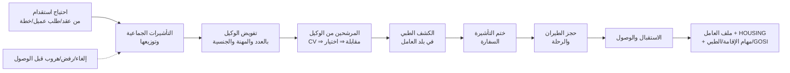

# 12 — الاستقدام والعلاقات الحكومية (موديولات 3 و 5)

> **الاستقدام** = بداية رحلة عامل **كفالة الشركة** (من وكيل خارجي) لحد وصوله ⇒ ملف العامل وفترة سكن ([04](04-person-worker-period-ledger.md)، [05 §2.1](05-movement-documents.md)).
> **العلاقات الحكومية** = كل إجراء حكومي على أي شخص (عامل أو موظف) طول مدة وجوده.
> **الموجود حاليًا في الـ CRM** (مش مستخدم من البوابة): التأشيرات الجماعية `new_VisaHeader` (86) وسطورها `new_Visa` (79) بعدادات (مفوض، موزع، محجوز، مؤشر، وصل، منتهي، هروب، خروج نهائي)، المرشحين `new_candidate` (3,228) بمراحل (اختيار ⇒ مقابلة ⇒ كشف طبي ⇒ تأشيرة ⇒ حجز ⇒ وصول)، قالب تكاليف الاستقدام `new_iseqdamFees` (58)، خطط الرحلات `new_flightplan`، الإقامات `mw_Stay`، طلبات الخدمات الحكومية `new_govservices`، طلبات الترحيل/الخروج `mw_RequestDeport` (بتوزيع التكلفة: العميل / الموظف / المكتب)، وتكامل أجير (`new_ageerlog` 2,403، `new_ajeerfault` 13,888). ⇒ التصميم الجديد بيغطي كل ده كمسار واحد متصل.

---

# أ. الاستقدام (Recruitment)

## 1. الرحلة

## 2. احتياج الاستقدام `recruitment_demand`
| | |
|---|---|
| المصدر | عقد عميل (حصة لم تُغطى)، طلب عمالة من عميل، أو خطة داخلية (تكوين مخزون عمالة) |
| السطور | المهنة × الجنسية × الجنس × العدد × التاريخ المطلوب، والمشروع/العميل لو مخصص |
| الاعتماد | المبيعات/العمليات ⇒ الإدارة (configurable) |
| المتابعة | العدد المطلوب مقابل: مفوض، مختار، وصل — ونسبة الإنجاز والتأخير |

## 3. التأشيرات الجماعية
| الجدول | المحتوى |
|---|---|
| `block_visa` | رقم الصادر/الطلب، السجل التجاري (صاحب العمل/رقم المنشأة)، تاريخ الإصدار والانتهاء (ميلادي وهجري)، النوع، القطاع، المرفقات |
| `block_visa_line` | المهنة × الجنسية × الجنس × جهة القدوم × **العدد** |
| **عدادات بتتحسب** (مش بتتكتب) | مفوض، غير مفوض، محجوز لمرشح، مؤشر (مختوم) بدون وصول، وصل، منتهي بدون استخدام، ملغي، **الرصيد المتاح** |
| التنبيهات | تأشيرات قربت تنتهي وعليها رصيد، تأشيرات مختومة ومافيش وصول |

## 4. الوكلاء الخارجيين وتفويضهم
| | |
|---|---|
| **الوكيل** `recruitment_agent` | مكتب الاستقدام في بلد العامل: الدولة، العملة، الحساب البنكي، العقد، الأسعار، التقييم — (مورد في الذمم الدائنة **بعملة أجنبية**) |
| **عقد/أسعار الوكيل** | لكل مهنة × جنسية × جنس: رسوم الوكيل، والبنود اللي عليه أو على الشركة (تذكرة، كشف طبي…)، مدة التوريد، **ضمان** (فترة استبدال لو العامل رجع/هرب/رفض خلال مدة) |
| **التفويض** `agent_authorization` | ربط عدد من سطر تأشيرة بوكيل (التوكيل في إنجاز/مساند) ⇒ بيقلل "غير المفوض" |
| أداء الوكيل | مدة التوريد، نسبة الرفض، الهروب/الرجيع خلال الضمان، المطالبات |

## 5. المرشح ومراحله `candidate`
| المرحلة | التفاصيل |
|---|---|
| ترشيح | بيانات من الوكيل (أو بوابة الوكيل): السيرة، الجواز، الصور، الخبرة، اللغات، المهارات |
| مقابلة واختيار | موعد، مقيّم، النتيجة؛ الاختيار بيحجز مكان من التأشيرة (`محجوز`) |
| الكشف الطبي | المركز، التاريخ، النتيجة (لائق/غير لائق) |
| التأشيرة | إصدار/ختم التأشيرة في السفارة، الرقم، التاريخ |
| السفر | الحجز (الرحلة، شركة الطيران، المدينة، تاريخ ووقت الوصول) — من **خطة رحلة** لمجموعة أو فردي |
| الوصول | الاستقبال ⇒ **مستند تأكيد الوصول** ⇒ ملف العامل + `HOUSING` + الراتب من عرض التوظيف |
| حالات استثنائية | رفض السفر، رفض في المطار، فقد الرحلة، تأجيل، تأشيرة مسروقة/ملغية، هروب قبل الوصول ⇒ رجوع رصيد التأشيرة + مطالبة الوكيل بالضمان |

> حالة المرشح = **مرحلته** بأكواد ثابتة (بدل الـ 20 حالة المخلوطة الحالية)، والمرشح بيتحول **لنفس سجل الشخص** وقت الوصول (مش نسخة تانية زي الحالي: 3,228 مرشح و3,228 موظف متزامنين بـ workflows).

## 6. تكاليف الاستقدام
| | |
|---|---|
| **قالب التكلفة** (بدل `new_iseqdamFees`) | لكل مهنة × جنسية × جنس: رسوم الوكيل، التأشيرة الحكومية، إنجاز/السفارة، الكشف الطبي، الطيران، رسوم الإقامة والرخصة الأولى، التأمين الطبي (بالفئة)، صندوق الموارد البشرية، تصديق العقد، … ⇒ **تكلفة متوقعة** للعامل |
| **التكلفة الفعلية** | فواتير الوكيل (بعملته + المقابل بالريال)، المدفوعات الحكومية، الطيران — كل بند مربوط بالمرشح/العامل |
| المحاسبة | حدث `RecruitmentCostIncurred` ⇒ **أصل (تكلفة استقدام مؤجلة) يُستهلك على مدة العقد** أو مصروف — إعداد ([11](11-finance-and-accounting.md)) |
| الربحية | الاستهلاك الشهري بيدخل تكلفة العامل في الربحية ([02 §4](02-worker-sourcing-billing-payroll.md)) |
| الاسترداد | لو العامل رجع/هرب خلال الضمان ⇒ مطالبة الوكيل (إشعار مدين على الوكيل) |

## 7. بوابة الوكيل (مرحلة لاحقة)
رفع المرشحين ووثائقهم، متابعة الطلبات والمقابلات والسفر، فواتير الوكيل وكشف حسابه.

---

# ب. العلاقات الحكومية (Government Relations)

## 8. الفكرة
كل إجراء حكومي = **مهمة حكومية** (`gov_task`) بنوع ثابت، بتتولد **تلقائيًا من أحداث النظام** أو يدوي، ولها: الشخص، السجل التجاري، الجهة (مقيم/الجوازات، قوى، أجير، GOSI، الصحة، السفارة…)، الحالة، المسؤول، المواعيد، **الرسوم ومين بيتحملها**، المرفقات، والنتيجة (الرقم/التاريخ الجديد اللي بيتحدث في الوثيقة).

## 9. أنواع المهام ومصدرها

| المهمة | بتتولد من | النتيجة |
|---|---|---|
| **إصدار إقامة** | تأكيد الوصول | رقم الإقامة وتاريخ الانتهاء ⇒ `person_identifier` + تسليم الإقامة للعامل |
| **تجديد إقامة** | تنبيه انتهاء (قبل X يوم — إعداد) | تاريخ انتهاء جديد + الرسوم (مقدمة تُستهلك على السنة) |
| رخصة العمل / المقابل المالي | الإصدار والتجديد | |
| **تسجيل/إنهاء أجير** للعميل | أمر تسليم / رجيع / نقل لعمالة كفالة الشركة (عمالة المورد مسؤولية المورد) | رقم عقد أجير وحالته |
| **توثيق عقد في قوى** | عقد/ملحق/تجديد موظف | حالة التوثيق |
| **تسجيل/استبعاد GOSI** | التعيين/الوصول، نهاية الخدمة، تعديل الأجر | |
| **تأشيرة خروج وعودة** (إصدار/تمديد/إلغاء) | طلب إجازة معتمد | رقم التأشيرة، المدة، تاريخ السفر/العودة |
| **خروج نهائي** | مستند الخروج | التأشيرة وتاريخ المغادرة ⇒ إلغاء الإقامة |
| **نقل كفالة** (داخل/خارج) | طلب نقل | |
| **بلاغ انقطاع عن العمل** (وإلغاؤه) | بلاغ الانقطاع / العودة | رقم البلاغ |
| تعديل مهنة / بيانات | طلب | |
| الكشف الطبي والتأمين الطبي | الوصول، التجديد | الفئة وتاريخ الانتهاء |
| تصاريح أخرى | يدوي | |

## 10. دورة المهمة
`NEW` ⇒ `IN_PROGRESS` ⇒ `WAITING_PAYMENT` (سداد الرسوم — سداد/مدفوعات) ⇒ `SUBMITTED` ⇒ `DONE` / `REJECTED` / `CANCELLED` — مع مدة مستهدفة لكل نوع (SLA) وتصعيد، ومسار اعتماد للرسوم (configurable).

## 11. الرسوم ومين بيتحملها
| | |
|---|---|
| الرسوم | رسوم الإجراء + أي غرامات؛ الدفع (سداد) بالمرجع والتاريخ |
| **التحمل** (بدل `mw_RequestDeport` الحالي: عميل/موظف/مكتب) | الشركة / العامل (خصم من المسير أو المخالصة) / العميل (بند في فاتورة "خدمات أخرى") / الوكيل (مطالبة) / المورد — ممكن تتقسم بنسب |
| المحاسبة | حدث `GovernmentFeePaid` ⇒ مصروف مقدم يُستهلك (رسوم الإقامة السنوية مثلًا) أو مصروف مباشر، على العامل/المشروع/الإدارة |

## 12. متابعة الوثائق والانتهاءات
لوحة لكل الوثائق اللي قربت تنتهي (إقامة، جواز، تأمين طبي، رخصة عمل، تأشيرة خروج وعودة، رخصة قيادة) لكل سجل تجاري/مشروع/مسؤول — بتنبيهات وإنشاء مهام التجديد تلقائيًا، وتظهر في ملف العامل 360 وفي أمر التسليم (تحذير).

## 13. التكامل مع المنصات (مركز التكامل)
| المنصة | الإطلاق الأول | لاحقًا |
|---|---|---|
| مقيم / الجوازات | تسجيل يدوي للنتيجة + استيراد تقارير Excel من مقيم (الإقامات وتواريخ الانتهاء) | API (لو متاح للمنشأة) |
| أجير | تسجيل يدوي + استيراد | ربط مباشر (زي الخدمة الحالية على `:8001` بعد مراجعتها) |
| قوى | يدوي | API |
| GOSI | يدوي + مطابقة الفاتورة الشهرية | API |
| مُدد/WPS | ملف المسير ([09](09-payroll.md)) | API |
| إنجاز/مساند | تسجيل التفويض والتأشيرات يدوي | — |

> كل تكامل بيتعمل كمحوّل مستقل (نفس مبدأ [11 §5](11-finance-and-accounting.md)) — المهام والوثائق نفسها مابتتغيرش.

## 14. التقارير
رصيد التأشيرات وحالتها، احتياج الاستقدام مقابل الإنجاز، المرشحين في كل مرحلة ومدة كل مرحلة، أداء الوكلاء، تكلفة الاستقدام المتوقعة مقابل الفعلية لكل عامل/وكيل/جنسية، المهام الحكومية المفتوحة والمتأخرة، الرسوم الحكومية حسب الجهة/المتحمل، الوثائق اللي قربت تنتهي، نسبة السعودة (من [08](08-company-staff-hr.md)).

## 15. الترحيل
التأشيرات وسطورها (المفتوح والرصيد)، المرشحين اللي لسه ماوصلوش (بمرحلتهم)، الإقامات وتواريخ انتهائها (`mw_Stay`, `new_employee`)، قوالب التكلفة (`new_iseqdamFees`) كبداية للقوالب الجديدة، والوكلاء.

## 16. أسئلة للتأكيد
1. **الاستقدام شغال حاليًا** بنفس المراحل اللي في الـ CRM (تأشيرة ⇒ تفويض ⇒ مقابلة ⇒ طبي ⇒ ختم ⇒ سفر ⇒ وصول)؟ ولا فيه مراحل مختلفة؟
2. **تكلفة الاستقدام:** تتسجل **أصل يُستهلك على مدة عقد العامل** (المقترح — عشان الربحية الشهرية تبقى صح) ولا مصروف وقت الصرف؟
3. **ضمان الوكيل:** فيه فترة ضمان (استبدال/استرداد) لو العامل رجع أو هرب خلال مدة؟ كام شهر؟
4. **الرسوم الحكومية** (الإقامة، المقابل المالي): مين بيتحملها عادة — الشركة، ولا بتتحمّل على العميل في بعض العقود؟
5. **أجير:** الخدمة الحالية على `192.168.2.6:8001` بتعمل إيه بالظبط (تسجيل تلقائي في أجير؟) — نحتاجها في الإطلاق الأول ولا يدوي كفاية؟
