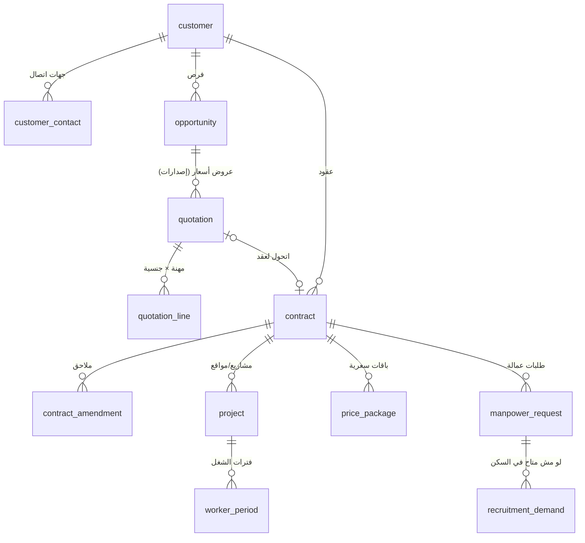

# 13 — المبيعات والعقود (Sales CRM + Contracts & Pricing) — موديولات 1 و 2

> **الوضع الحالي:** المشروع `new_project` (165) هو العميل والعقد والموقع في نفس الوقت؛ العميل `account` (203) بيتنشأ بـ workflow، و**112 مشروع مش مربوطين بأي عميل**، و8 عملاء ليهم أكتر من مشروع؛ أنواع العقود: Total Cost 150، Cost Plus 12؛ وأدوات المبيعات في الـ CRM شبه مش مستخدمة (8 Leads، فرصة واحدة، صفر عروض أسعار). السعر على العامل/المباشرة من غير باقات.
> **الجديد:** فصل **العميل ⇐ العقد ⇐ المشروع/الموقع**، ومسار مبيعات كامل لحد العقد، و**الباقات السعرية** ([04 §4.3](04-person-worker-period-ledger.md)) بتتولد من عرض السعر.

## 1. النموذج

## 2. العميل `customer`
| البيانات | التفاصيل |
|---|---|
| الأساسية | الاسم عربي/إنجليزي، السجل التجاري، **الرقم الضريبي**، **العنوان الوطني** (لازمين للفاتورة الضريبية)، القطاع/النشاط، **مجموعة العميل**، العميل الأم (فروع/شركات تابعة) |
| المالية | حد الائتمان، مدة السداد الافتراضية (بتتقترح على الفاتورة)، **أساس أيام الفوترة** (30 افتراضي / أيام الشهر الفعلية) |
| جهات الاتصال | المسؤول، المالية، الموارد البشرية — ومين منهم ليه حساب في **بوابة العميل** وصلاحيته |
| المسؤولين عندنا | مدير الحساب (المبيعات)، مسؤول التحصيل |
| المرفقات | السجل، الشهادة الضريبية، التفويضات |

## 3. مسار المبيعات

### 3.1 العميل المحتمل والفرص
| المرحلة | |
|---|---|
| `LEAD` | جهة مهتمة (المصدر: زيارة، اتصال، مناقصة، إحالة، الموقع) |
| `QUALIFIED` | الاحتياج مبدئيًا واضح |
| `NEEDS_ANALYSIS` | الاحتياج بالتفصيل (مهن، أعداد، مدة، موقع، سكن/مواصلات) |
| `PROPOSAL` | عرض سعر اتبعت |
| `NEGOTIATION` | تفاوض/تعديل العرض |
| `WON` / `LOST` | لو `WON` ⇒ عقد؛ لو `LOST` ⇒ سبب إجباري (السعر، المنافس، التوقيت…) |

كل فرصة: العميل، المسؤول، القيمة المتوقعة والعدد، تاريخ الإغلاق المتوقع، الاحتمالية، والأنشطة (مكالمات، زيارات، مهام، ملاحظات).

### 3.2 عرض السعر `quotation`
| | |
|---|---|
| الرأس | العميل/الفرصة، نوع العقد المقترح (**Total Cost / Cost Plus**)، المدة، الصلاحية، الشروط، **رقم الإصدار** (كل تعديل = إصدار جديد) |
| **السطور** (مهنة × جنسية × جنس × عدد) | **الراتب، التكلفة/رسوم الخدمة، السكن، المواصلات** (وهل بيتفوتروا منفصلين) ⇒ **إجمالي سعر الخدمة** — نفس شكل الباقة |
| **تحليل التكلفة** (داخلي، مش بيظهر للعميل) | لكل سطر: الراتب + استهلاك تكلفة الاستقدام الشهري + الرسوم الحكومية (لو Total Cost) + التأمين الطبي + GOSI + السكن والمواصلات الفعليين ⇒ **التكلفة الشهرية والهامش المتوقع** (أو تكلفة المورد لو العمالة هتيجي من مورد داخلي) |
| الاعتماد | لو الهامش أقل من حد (إعداد) أو فيه خصم ⇒ اعتماد مدير المبيعات/الإدارة (configurable) |
| المخرجات | PDF عربي/إنجليزي بقالب، إرسال بالإيميل، وتسجيل رد العميل |

## 4. العقد `contract`
| البند | التفاصيل |
|---|---|
| الأطراف | العميل، **السجل التجاري بتاعنا** (المُصدِر للفواتير) |
| النوع | **Total Cost** (الشاملة — الشركة بتتحمل الرسوم الحكومية) / **Cost Plus** (العميل بيتحمل الرسوم الحكومية + GOSI 2%) |
| المدة | البداية، النهاية، التجديد التلقائي، فترة الإشعار |
| الحالة | `DRAFT`, `ACTIVE`, `RENEWAL_PENDING`, `NOT_RENEWING`, `SUSPENDED`, `CANCELLED`, `EXPIRED` (بدل `new_contractstatus` الحالي) |
| **سياسة الفوترة** | دورة الفوترة (يوم البداية)، مدة السداد الافتراضية، الضريبة، قاعدة الإضافي (أو على مستوى المشروع) |
| **الالتزام بالعدد** | لكل مهنة/جنسية: العدد المتعاقد عليه ⇒ مقارنة بالمسلّم (تحذير في أمر التسليم لو اتعدّى) |
| الاستبدال | مدة توفير البديل (SLA) |
| الدفعات والضمانات | دفعة مقدمة (فاتورة دفعة مقدمة وخصمها)، ضمان بنكي/شيك ضمان وتاريخ انتهائه |
| الغرامات والشروط | نص/بنود |
| **الباقات السعرية** | بتتولد من سطور عرض السعر المعتمد، وبتتعدل بملحق |
| المرفقات | العقد الموقّع والملاحق |
| **الملحق** `contract_amendment` | أي تعديل (مدة، أسعار، أعداد، شروط) = ملحق باعتماد وتاريخ سريان ⇒ نسخة جديدة؛ تعديل الأسعار بيعمل **مستند تغيير سعر** للعمال الحاليين ([05 §2.6](05-movement-documents.md)) لو اتقرر تطبيقه عليهم |

### 4.1 التجديد
تنبيه قبل النهاية (90/60/30 يوم — إعداد) لمدير الحساب ⇒ فرصة تجديد ⇒ عرض سعر تجديد (بنفس الأسعار أو معدّلة) ⇒ ملحق تمديد أو عقد جديد؛ عدم التجديد ⇒ خطة إنهاء: رجيع العمالة أو نقلها لمشاريع تانية.

## 5. المشروع / الموقع `project`
| | |
|---|---|
| البيانات | الاسم، الكود، العقد، المدينة/الحي/العنوان، **مدير المشروع** (عندنا)، **المشرف** (عندنا)، جهة الاتصال عند العميل، مركز التكلفة |
| إعدادات المشروع | قاعدة الإضافي، سكن/مواصلات من العميل أو منّا، تعليمات خاصة |
| `is_internal` | للمشاريع الداخلية (بدل الاعتماد على اسم/كود `HeadOffice` و `pro00137`) — موظفي الشركة مابقوش على "مشروع" أصلًا |
| الحالة | نشط / موقوف / منتهي |

## 6. طلب العمالة من العميل `manpower_request`
| | |
|---|---|
| السطور | مهنة × جنسية × جنس × عدد × تاريخ البدء × المشروع، والباقة السعرية |
| المصدر | فرصة جديدة، عقد قائم (طلب إضافي)، **أو طلب استبدال** من أمر رجيع ([05 §2.3](05-movement-documents.md)) |
| التلبية | من **العمالة المتاحة في السكن** (المطابقة بالمهنة/الجنسية) ⇒ أمر تسليم؛ أو من **مورد داخلي**؛ أو ⇒ **احتياج استقدام** ([12](12-recruitment-and-government-relations.md)) |
| المتابعة | المطلوب مقابل المسلّم، مدة التلبية، المتأخر |

## 7. خدمة العملاء
تذاكر من العميل (أو من البوابة): شكوى على عامل، طلب استبدال، طلب زيادة/تقليل، استفسار فاتورة — بنوع وأولوية و SLA ومسؤول، ومربوطة بالعامل/المشروع/الفاتورة.

## 8. التقارير والمؤشرات
| التقرير | المحتوى |
|---|---|
| مسار المبيعات | الفرص حسب المرحلة والقيمة والمسؤول، نسبة التحويل، أسباب الخسارة |
| العروض | المرسلة/المقبولة/المرفوضة، متوسط الهامش المتوقع |
| العقود | النشطة، اللي قربت تنتهي، التجديدات، الملغاة |
| **الالتزام بالعدد** | المتعاقد عليه مقابل المسلّم لكل عقد/مهنة |
| طلبات العمالة | مدة التلبية، المتأخرة، مصدر التلبية (سكن/مورد/استقدام) |
| الإيراد والربحية | لكل عميل/عقد/مشروع: الإيراد الفعلي والهامش الفعلي مقابل المتوقع في العرض |
| رضا العميل | الرجيع حسب السبب، الاستبدالات، الشكاوى |

## 9. الترحيل
- كل `new_project` ⇒ **مشروع** + **عقد** (النوع، البداية/النهاية، الحالة، مدير المشروع).
- العميل: من `new_customerid` لو موجود (53 مشروع)، والباقي (112) **محتاج ربط يدوي** بعميل قبل الترحيل (تقرير استثناءات).
- **الباقات:** بتتبني من الأسعار الفعلية على المباشرات المفتوحة (مجمعة بالمشروع × المهنة × الجنسية)، والأسعار الشاذة بتتحول "سعر خاص".
- مجموعات العملاء (17) والعملاء (203) بعد إزالة المكرر.

## 10. أسئلة للتأكيد
1. **العقد الواحد ممكن يغطي أكتر من مشروع/موقع** لنفس العميل (المقترح)، ولا كل مشروع ليه عقد منفصل؟
2. **عمولات المبيعات:** محتاجين حساب عمولة لمندوبي المبيعات؟
3. **اعتماد عرض السعر بالهامش:** فيه حد أدنى للهامش يحتاج اعتماد؟ (ولا الاعتماد دايمًا على كل عرض؟)
4. **قطاع الأفراد والساعات** (كيانات قديمة في الـ CRM زي `new_IndvContract`, `new_hourresource`): خارج النطاق، ولا محتاجينه؟
5. **الدفعات المقدمة وخطابات الضمان:** مستخدمة مع العملاء؟
