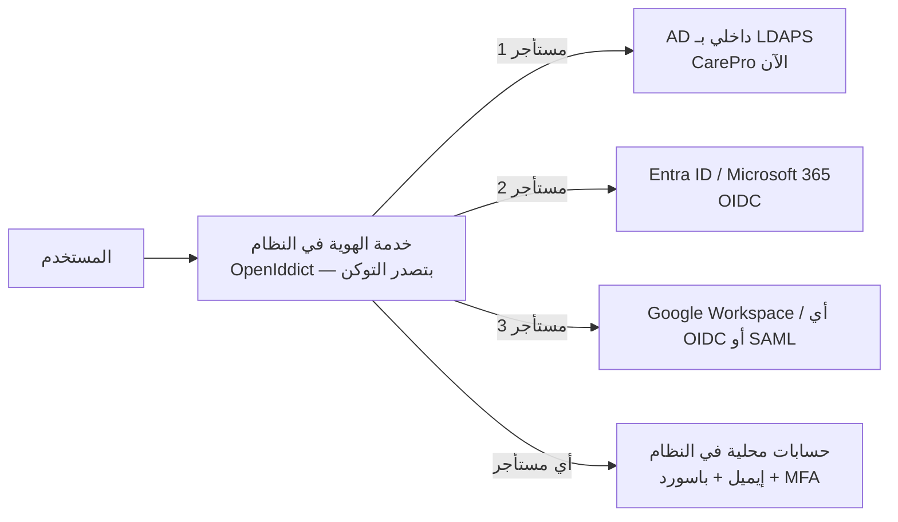
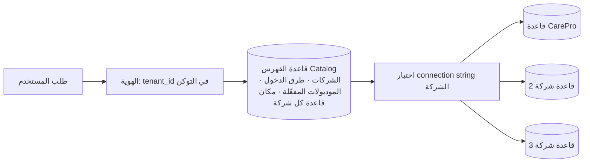
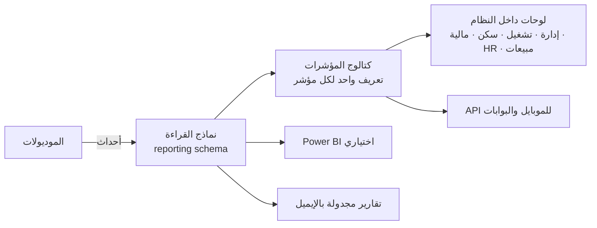

# 14 — المنصة والمعمارية التقنية

> بيترجم مبادئ [00](00-design-principles.md) لقرارات تقنية: موديولات مستقلة قابلة للتفعيل/الاستبدال، أمان من الأساس، تكامل سلس، وتقارير بتعريف واحد.
> **بيعالج مشاكل الوضع الحالي** ([06](../01-current-system-analysis/06-data-quality-issues.md)): القراءة والكتابة SQL مباشر على جداول الـ CRM، باسورد حساب الخدمة نص صريح في `Web.config`، تواريخ UTC يدوي، منطق مخفي في workflows، مطابقة مستخدمين بـ `LIKE`، وتقارير بتعريفات متعارضة.

## 1. التقنيات المقترحة

| الطبقة | الاختيار | السبب |
|---|---|---|
| Back-end | **.NET 10 (LTS)** — ASP.NET Core Web API | نفس خبرة الفريق الحالية (.NET)، دعم طويل |
| بنية الكود | **Modular Monolith** (موديول = Bounded Context) | بسيط في التشغيل، وكل موديول ممكن يتفصل خدمة لوحده بعدين |
| الوصول للبيانات | EF Core (الكتابة) + Dapper/Views (التقارير) | |
| قاعدة البيانات | **SQL Server 2022** (schema لكل موديول) — أو PostgreSQL | خبرة موجودة، Collation عربي، Temporal tables للتدقيق |
| Front-end | **React + TypeScript** (قرار: الأفضل للمشروع) — Vite، TanStack Query/Router، React Hook Form + Zod، **MUI** بدعم RTL كامل، i18next عربي/إنجليزي، AG Grid/TanStack Table للجداول الكبيرة | أكبر نظام مكونات ودعم RTL ناضج، وأنسب لشاشات بيانات كتيرة (جداول، فلاتر، نماذج طويلة)، والـ TypeScript بيتولد من OpenAPI مباشرة |
| الموبايل | **Flutter** (موجود فعلًا: `carepro_mobile`) — تطبيق الإدارة + تطبيق العامل/الموظف | |
| الاعتمادات | **محرك اعتماد خاص بالنظام** (وحدة Workflow) — المسارات بيانات تُعدَّل من الشاشات بإصدارات ([05 §4](05-movement-documents.md)) | قرار 2026-10-16: بدلًا من Elsa 3 (انظر §4.4) |
| المهام الخلفية | Hangfire (أو Quartz) | ترحيل الأحداث، ZATCA، التنبيهات، الاستهلاكات، المزامنة |
| الرسائل | Outbox داخل القاعدة + معالج داخلي (in-process) في البداية ⇒ RabbitMQ/Service Bus لما نفصل خدمات أو ننقل للسحابة | |
| الكاش | In-memory في البداية ⇒ Redis لما نحتاج أكتر من سيرفر | |
| الملفات | Blob Storage (سحابي) أو MinIO (on-prem) — S3-compatible | المرفقات، PDF/XML الفواتير، ملفات Excel |
| المستندات | QuestPDF (PDF عربي)، ClosedXML (Excel) | |
| البوابة الخارجية | **YARP** API Gateway | الـ API الخارجي، Rate limiting، فصل الداخلي عن الخارجي |
| المراقبة | OpenTelemetry + Serilog ⇒ Seq/ELK + Grafana | |

### 1.1 الاستضافة: on-prem الآن، جاهز للسحابة
- **الآن:** سيرفرات الشركة (Windows Server + IIS أو Kestrel كخدمة، SQL Server الحالي، تخزين ملفات MinIO أو مجلد مشترك خلف واجهة تخزين).
- **جاهزية السحابة من أول يوم:** إعدادات بالبيئة (مش في الكود)، تخزين الملفات من خلال واجهة S3-compatible، الأسرار من مخزن أسرار (Windows DPAPI/Vault دلوقتي ⇒ Key Vault بعدين)، Docker images جاهزة، ومفيش اعتماد على مسارات أو مشاركات Windows ⇒ النقل لسحابة داخل المملكة = تغيير إعدادات ونشر.

### 1.2 الهوية مع Active Directory داخلي
- **خدمة هوية داخل النظام (OpenIddict)** بتصدر OpenID Connect للويب والموبايل، والتحقق من الموظف **بـ LDAP على الـ AD الحالي** (`JRCO`) — زي البوابة الحالية بس بشكل آمن (LDAPS) — + **تحقق ثنائي TOTP** (تطبيق Authenticator).
- ربط المستخدم بـ **objectGUID** في الـ AD (مش بالاسم)، والمجموعات من الـ AD ممكن تتربط بأدوار النظام.
- الحسابات الخارجية (العملاء/الوكلاء/الموردين) على نفس خدمة الهوية بحسابات محلية + MFA، والعمال برقم الجوال + OTP.
- لما يحصل انتقال لـ Entra ID ⇒ إضافته كمزوّد دخول (federation) من غير تغيير في التطبيق.

### 1.2.1 تعدد الشركات (Multi-Tenancy) والهوية — **من غير AD لكل شركة**

> **توضيح المصطلحات (2026-10-16):** "الشركة" هنا = **شركة بتشغّل النظام** (Tenant): ليها مستخدمينها، وعمالتها، وموظفينها، وشجرة حساباتها، وإعداداتها — **مش العميل** اللي بنصدر له فواتير (ده `customer` جوه الشركة). يعني النظام الواحد بيشتغل عليه أكتر من شركة، وكل شركة كأنها نظام مستقل بالكامل.

**مستويين منفصلين:**
| المستوى | المعنى | مثال |
|---|---|---|
| **الشركة المشغّلة (Tenant)** | شركة بتشغّل النظام: مستخدمين، عمالة، موظفين، عملاء، موردين، **شجرة حسابات**، إعدادات — **معزولة تمامًا** عن غيرها | CarePro، وشركة تانية بعدين |
| **السجل التجاري (Legal Entity)** | السجلات جوه نفس الشركة — **Care-Pro 05 و 07 سجلين لنفس الشركة (قرار مؤكد)** | Care-Pro 05 و 07 |

**الهوية: النظام نفسه هو مزوّد الهوية (Identity Broker)**، وكل مستأجر بيختار طريقة دخول مستخدميه من الإعدادات:

- **الشركة مش محتاجة AD**: لو عندها AD/Entra ⇒ تربطه (Federation) ومستخدميها يدخلوا بحساب شركتهم؛ لو مفيش ⇒ حسابات محلية في النظام بـ MFA.
- **التعرف على الشركة وقت الدخول:** بنطاق الإيميل (`@carepro.com` ⇒ مستأجر CarePro ومزوده) أو بعنوان خاص لكل شركة (`carepro.<domain>`) — ولما نروح السحابة كل شركة ليها دومينها/عنوانها.
- **مستخدم واحد ممكن يدخل أكتر من شركة (قرار 2026-10-16):** حساب واحد (هوية واحدة) + **عضوية في كل شركة** مسموح له بيها، وأدوار وصلاحيات **منفصلة في كل شركة**. بعد الدخول بيختار الشركة (ولو ليه شركة واحدة بيدخل عليها مباشرة)، والتوكن بيتصدر **للشركة المختارة** (`tenant_id`)، وتغيير الشركة = توكن جديد. النظام بيرفض أي وصول لبيانات شركة مش مختارة.
- **جوه الشركة:** الصلاحيات ليها نطاق **السجلات التجارية** (مثلًا محاسب Care-Pro 05 بس، أو الاتنين)، والشاشات المالية بتشتغل على **سجل مختار** لأن كل سجل ممكن تكون له شجرة حسابات مختلفة.
- مكان البيانات: المستخدمين وعضوياتهم وطرق الدخول في **قاعدة الفهرس**؛ الأدوار والصلاحيات ونطاقاتها جوه كل شركة.
- الحسابات الخارجية (العملاء/الوكلاء/الموردين/العمال) بتتبع المستأجر برضه.

**عزل البيانات — قاعدة بيانات منفصلة لكل شركة (مقترح، 2026-10-16):**

| | قاعدة مشتركة لكل الشركات | **قاعدة لكل شركة (المقترح)** |
|---|---|---|
| العزل | منطقي (tenant_id + RLS) | **فعلي** — بيانات شركة مستحيل توصل لشركة تانية حتى لو حصل خطأ |
| النسخ الاحتياطي والاسترجاع | للكل مرة واحدة | **لكل شركة لوحدها** (استرجاع شركة من غير ما تأثر على غيرها) |
| خروج شركة من النظام | حذف صفوف من كل الجداول | **تسليم/حذف قاعدتها** |
| الأداء | شركة كبيرة ممكن تبطّأ الباقي | كل شركة مستقلة، وممكن قاعدتها تتنقل لسيرفر لوحدها |
| تحديث النظام (migrations) | مرة واحدة | على كل القواعد (أوتوماتيك بالـ migrator) |
| التقارير بين الشركات | سهلة | محتاجة تجميع (نادرًا مطلوب) |
| التكلفة | أقل | أعلى شوية لكل شركة |

**ليه المقترح قاعدة لكل شركة:** العملاء هنا شركات منفصلة (B2B) وعددهم قليل (عشرات مش آلاف)، وبياناتهم حساسة (رواتب، هويات، فواتير)، وكل شركة عايزة نسختها الاحتياطية ومسؤوليتها عن بياناتها.

**التصميم:**

- **قاعدة فهرس (Catalog)** صغيرة: الشركات، طريقة دخول كل شركة، الموديولات المفعّلة، ومكان قاعدة كل شركة (السيرفر واسم القاعدة — والأسرار في مخزن الأسرار).
- **قاعدة لكل شركة** فيها كل الموديولات (schema لكل موديول زي ما هو).
- **الـ migrator** بيحدّث الفهرس وكل قواعد الشركات بأمر واحد، ويقدر يعمل قاعدة لشركة جديدة.
- **`tenant_id` و RLS بيفضلوا** جوه كل قاعدة كخط حماية تاني (تكلفتهم بسيطة)، وده كمان بيسمح إن شركات صغيرة جدًا تتشارك قاعدة لو اتطلب، بإعداد في الفهرس.
- **الإطلاق الأول:** CarePro لوحدها ⇒ قاعدة الفهرس + قاعدة CarePro. فصل جدول `tenant` لقاعدة الفهرس وتوجيه الاتصال حسب الشركة هيتعمل قبل إضافة شركة تانية (والكود الحالي جاهز لأن كل البيانات عليها `tenant_id`).

> النتيجة: CarePro يدخل بالـ AD الحالي، وأي شركة جديدة تتضاف كمستأجر بطريقة دخولها (AD تاني / Entra / حسابات محلية) من غير أي تغيير في الكود.

### 1.2.2 جلسة الويب مقابل التوكن (قرار تقني 2026-10-16)
- **الويب (React على نفس الدومين):** كوكي جلسة مشفر (HttpOnly، SameSite=Strict، Secure) بيتصدر بعد الباسورد + MFA + اختيار الشركة — مفيش توكن متخزن في المتصفح (أأمن ضد XSS)، ومعاه header `X-ERP-CSRF` إجباري لأي تعديل.
- **الموبايل والأنظمة الخارجية:** توكنات OpenID Connect/OAuth2 (OpenIddict) — بتتضاف مع تطبيق الموبايل والـ API الخارجي، على نفس خدمة الدخول ونفس قواعد MFA والعضويات.

### 1.3 حجم الفريق: إحنا الاتنين
المشروع هيتبني **بيني وبينك** (أنا بكتب الكود والاختبارات والتوثيق، وإنت بتراجع وتجرب وتقرر وتشغّل على السيرفرات). عشان كده:
- **نبسّط البنية في البداية:** تطبيق واحد (Api + Worker في نفس الـ host لو مناسب)، SQL Server بس، من غير Redis/RabbitMQ لحد ما نحتاج.
- **نبني على شرائح رأسية صغيرة** (Vertical slices): كل شريحة شغالة من الشاشة للقاعدة ومختبرة، وتقدر تجربها قبل اللي بعدها.
- **الأتمتة بدل الأشخاص:** اختبارات آلية لكل قاعدة عمل، CI يشغلها مع كل تعديل، ونشر بسكربت.
- كل قرار واتفاق بيتوثق في `docs/` عشان أي جلسة عمل جديدة تكمل من نفس النقطة.

## 2. هيكل الحل

```text
src/
  BuildingBlocks/            ← مشترك تقني: Outbox/Inbox، Audit، الترقيم، تعدد السجلات، الترجمة، التواريخ والمبالغ، الأخطاء، الصلاحيات
  SharedKernel/              ← أنواع مشتركة صغيرة (Money, DateRange, LegalEntityId, Codes)
  Modules/
    Platform.Identity/  Platform.Organization/  Platform.Workflow/  Platform.Documents/  Platform.Integration/  Platform.Reporting/
    Sales/  Contracts/  Recruitment/  Workforce/  GovRelations/  Operations(+PeriodLedger)/  Housing/
    Timesheets/  Billing/  WorkerHR/  StaffHR/  Payroll/  Finance/  Procurement/  LaborSuppliers/
      ├─ Domain/          (الكيانات والقواعد — بدون أي اعتماد خارجي)
      ├─ Application/     (الأوامر، الاستعلامات، الأحداث)
      ├─ Infrastructure/  (EF، المحولات)
      ├─ Contracts/       (الواجهة العامة للموديول + أحداثه المنشورة — اللي غيره يقدر يستخدمه بس)
      └─ Api/             (Endpoints)
  Hosts/
    Api.Host/             ← API الداخلي للويب والموبايل
    Worker.Host/          ← المهام الخلفية والـ Outbox
    Gateway/              ← API الخارجي (YARP)
  Web/                    ← React
tests/  (Unit / Integration / Architecture / Contract / E2E)
```

**قواعد إلزامية (بتتختبر آليًا بـ Architecture Tests):**
- موديول **مايقراش ولا يكتبش** في schema موديول تاني — التواصل عن طريق `Contracts` (استدعاء) أو **أحداث منشورة** (Integration Events).
- الـ Domain مايعتمدش على EF ولا HTTP.
- كل موديول **قابل للتفعيل/التعطيل** من سجل الموديولات لكل سجل تجاري، ومنافذه الخارجية (زي المالية) ليها محولات ([11](11-finance-and-accounting.md)).

## 3. الخدمات المشتركة (Building Blocks)

| الخدمة | التصميم |
|---|---|
| **تعدد السجلات التجارية** | `legal_entity_id` على البيانات اللي بتخصه + فلتر تلقائي حسب صلاحية المستخدم |
| **التدقيق (Audit)** | كل أمر بيتسجل: مين، إمتى، منين، البيانات قبل/بعد (جدول تدقيق + Temporal tables للجداول الحساسة)؛ **المستندات المالية مابتتحذفش** |
| **الترقيم** | خدمة ترقيم لكل (سجل × نوع مستند × سنة) بصيغة قابلة للإعداد، و**بدون فجوات** للفواتير |
| **التواريخ** | التواريخ التشغيلية `date` (بدون وقت)، الطوابع الزمنية `datetimeoffset` UTC، العرض بتوقيت الرياض، وعرض **هجري** اختياري |
| **المبالغ** | `decimal(18,2)` + العملة، تقريب موحد (half away from zero) |
| **الأكواد والقوائم** | كل حالة/نوع = كود ثابت + labels عربي/إنجليزي للعرض بس (ممنوع منطق على النص) |
| **السياسات والإعدادات** | جداول إعدادات بتاريخ سريان ومستوى (عام / سجل تجاري / عميل / عقد / مشروع) |
| **سجل الموديولات** | المفعّل/المقفول/المتكامل لكل سجل، والقوائم والصلاحيات بتتبعه |
| **المرفقات** | على أي سجل، بنوع وتاريخ انتهاء وصلاحية اطلاع |
| **الإشعارات** | داخل النظام، إيميل، SMS، واتساب، Push — بقوالب عربي/إنجليزي وتفضيلات المستخدم |
| **الاعتمادات** | خدمة موحدة (وحدة Workflow): المهام، الخط الزمني، الإصدارات؛ ثم التفويض والتصعيد ومهلة الإنجاز |

## 4. الهوية والصلاحيات والأمان

### 4.1 الهوية
| المستخدم | الدخول |
|---|---|
| موظفي الشركة | **SSO** (Entra ID أو AD FS على الدومين الحالي) بـ OpenID Connect + **MFA** — والربط بـ object id (بدل مطابقة الأسماء بـ `LIKE` الحالية) |
| العملاء، الوكلاء، الموردين | حسابات خارجية (OpenIddict/Duende أو Entra External ID) + MFA |
| العمال | تطبيق العامل: رقم الجوال + OTP، صلاحيات محدودة لبياناته |
| الأنظمة | OAuth2 Client Credentials + نطاقات (scopes) |

### 4.2 الصلاحيات
- **أدوار (RBAC)** بالعمليات: عرض/إنشاء/تعديل/اعتماد/تنفيذ/تصدير لكل نوع مستند.
- **نطاقات بيانات (ABAC):** السجل التجاري، الإدارة، المشروع/العميل، مجموعة المسير، المورد — (مدير المشروع يشوف مشاريعه، المشرف عماله…).
- **أمان على مستوى الحقل:** الرواتب، التكلفة والربحية، الحسابات البنكية — بدل فرق `HeadSalary`/`CareAdmin` الحالية.
- **فصل المهام** في العمليات المالية (المنشئ ≠ المعتمد ≠ الصارف).

### 4.3 الحماية
| البند | التطبيق |
|---|---|
| الأسرار | Key Vault / HashiCorp Vault — **مفيش باسورد في ملفات الإعداد** |
| التشفير | TLS 1.2+ لكل الاتصالات، TDE للقاعدة، تشفير الحقول الحساسة (IBAN، أرقام الهوية) |
| الامتثال | **نظام حماية البيانات الشخصية (PDPL)** (الغرض، الاحتفاظ، سجل الاطلاع، الحذف/الإخفاء)، ضوابط **الهيئة الوطنية للأمن السيبراني (NCA ECC)**، OWASP ASVS |
| الاستضافة | البيانات **داخل المملكة** |
| الويب | WAF، Rate limiting، CSP، حماية CSRF/XSS، Parameterized queries فقط |
| الاختبار | فحص كود (SAST)، فحص المكتبات، اختبار اختراق قبل الإطلاق |
| السجلات | سجلات أمنية مركزية (SIEM)، تنبيه على الدخول المشبوه وتغيير IBAN والصلاحيات |
| النسخ الاحتياطي | يومي + Point-in-time، **RPO ≤ 15 دقيقة، RTO ≤ 4 ساعات** (مستهدف)، اختبار استرجاع دوري |

## 5. التكامل

| المكون | التصميم |
|---|---|
| **API خارجي** | REST `/api/v1/...` بإصدارات، **OpenAPI** موثق، Idempotency-Key للعمليات، Pagination، رسائل أخطاء موحدة |
| **Webhooks** | اشتراك في الأحداث (فاتورة صدرت، عامل اتسلم…) بتوقيع HMAC وإعادة محاولة |
| **Outbox/Inbox** | الأحداث مابتضيعش ومابتتكررش؛ طابور الفشل (DLQ) وشاشة متابعة |
| **الموصلات** | ZATCA (إطلاق أول)، ملف مُدد/WPS وملفات البنوك (إطلاق أول)، استيراد البصمة Excel (إطلاق أول)، استيراد تقارير مقيم/أجير/GOSI (Excel)، SMS/واتساب/إيميل؛ ولاحقًا API مقيم/قوى/GOSI/مُدد والبصمة المباشرة والبرامج المالية الخارجية |
| **مزامنة الـ CRM الحالي** | أثناء الانتقال: قراءة فقط من `Care_Pro_MSCRM` ⇒ قاعدة وسيطة (staging) ⇒ بناء البيانات وسجل الفترات + تقارير تسوية — ولا كتابة على الـ CRM |

## 6. طبقة التقارير



- **نماذج قراءة** بتتحدث بالأحداث (أو Views) — التقارير مابتلمسش جداول الكتابة.
- **كتالوج المؤشرات:** لكل مؤشر (العمالة في السكن، المباشرات، الرجيع، التحصيل، الربحية…) تعريف واحد مكتوب ومختبر، وكل اللوحات بتستخدمه — بدل التعريفات المتعارضة الحالية ([تحليل 05 §7](../01-current-system-analysis/05-reports-and-kpis.md)).
- كل تقرير: فلاتر بالصلاحية، تصدير Excel/PDF، وجدولة.

## 7. الجودة والتشغيل

| البند | التطبيق |
|---|---|
| المستودع | Git — فروع للميزات + Pull Requests بمراجعة |
| CI/CD | GitHub Actions أو Azure DevOps: بناء، اختبارات، فحص أمني، نشر |
| البيئات | Dev ⇒ Test ⇒ **UAT** (المستخدمين) ⇒ Staging ⇒ Production |
| القاعدة | Migrations بالكود، ومفيش تعديل يدوي على الإنتاج |
| **الاختبارات** | Unit على قواعد الدومين — **معادلات الفاتورة والمسير بحالات اختبار من البيانات الفعلية** (الـ 6,333 سطر المطابق)، Integration، Architecture tests (حدود الموديولات)، Contract tests للأحداث والـ API، E2E (Playwright) للمسارات الأساسية |
| المراقبة | Traces/Metrics/Logs، Health checks، تنبيهات (فشل ZATCA، Outbox متأخر، مهام فاشلة) |
| الأداء | الحجم الحالي آلاف السجلات؛ التصميم مستهدف **50,000 عامل** و**500 مستخدم متزامن** — API بدون حالة قابل للتوسع أفقيًا |

## 8. المتطلبات غير الوظيفية (مستهدفة)
| | |
|---|---|
| زمن الاستجابة | الشاشات < 2 ثانية لـ 95% من الطلبات؛ توليد تحضير/فاتورة مشروع 500 عامل < 30 ثانية |
| التوفر | 99.5% في ساعات العمل |
| اللغة | عربي (RTL) وإنجليزي كاملين، والتقارير والطباعة باللغتين |
| الوصول | متصفحات حديثة، ويب متجاوب للموبايل |
| الاحتفاظ | المستندات المالية 10 سنين على الأقل (حسب الأنظمة)، وسجل التدقيق |

## 9. قرارات مؤكدة (2026-10-15)
1. **الاستضافة:** سيرفرات الشركة حاليًا، والتصميم **جاهز للسحابة** بعدين.
2. **قاعدة البيانات:** SQL Server.
3. **الواجهة:** React + TypeScript (+ MUI بدعم RTL).
4. **الهوية:** Active Directory داخلي ⇒ خدمة هوية داخل النظام بتتحقق من الـ AD بـ LDAPS + MFA.
5. **التنفيذ:** إحنا الاتنين ⇒ بنية مبسطة في البداية + شرائح رأسية صغيرة + أتمتة اختبارات ونشر.

### 4.4 قرار محرك الاعتماد (2026-10-16)
- **القرار:** محرك اعتماد خاص بالنظام في وحدة Workflow بدلًا من مكتبة Elsa 3.
- **السبب:** المطلوب محدد (مسار بمراحل ومعتمدين يُعدَّل من الشاشات، وإصدارات، ومهامي، وموافقة ورفض وإرجاع). أما Elsa فمكتبة كبيرة لها قاعدة بياناتها ومصممها ونمط تشغيلها، وتحتاج تكييفًا مع عزل الشركات (RLS) والصلاحيات، وصيانتها أثقل على فريق من شخصين.
- **التصميم:**
  - مسار واحد لكل نوع مستند في كل شركة، بمراحل متتالية.
  - المعتمد في كل مرحلة: مستخدم محدد، أو أي حامل لدور (مع نطاق السجل التجاري)، أو مستخدم يحدده المستند عند الإرسال (المدير المباشر، مدير المشروع).
  - كل تعديل يُحفظ إصدارًا جديدًا، ويكمل المستند الجاري على إصداره.
  - يقرر في المرحلة أول معتمديها، ولا يعتمد أحد مستندًا أرسله بنفسه.
  - إن خلت مرحلة من معتمد عند فتحها تُصعَّد إلى مديري الشركة.
  - الوحدة المالكة للمستند تُبلَّغ بالنتيجة لتحدّث حالته.
- **لاحقًا:** التفويض أثناء الغياب، ومهلة الإنجاز والتذكير والتصعيد الزمني، وشروط المسار (مثل حد المبلغ). ويمكن إضافة Elsa خلف الواجهة نفسها إن ظهرت حاجة إلى سير عمل معقد طويل المدى.
