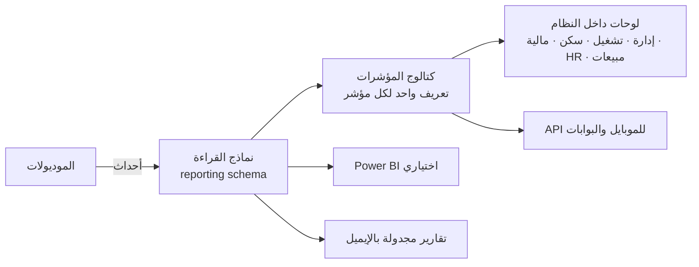

# 14 — المنصة والمعمارية التقنية

> بيترجم مبادئ [00](00-design-principles.md) لقرارات تقنية: موديولات مستقلة قابلة للتفعيل/الاستبدال، أمان من الأساس، تكامل سلس، وتقارير بتعريف واحد.
> **بيعالج مشاكل الوضع الحالي** ([06](../01-current-system-analysis/06-data-quality-issues.md)): القراءة والكتابة SQL مباشر على جداول الـ CRM، باسورد حساب الخدمة نص صريح في `Web.config`، تواريخ UTC يدوي، منطق مخفي في workflows، مطابقة مستخدمين بـ `LIKE`، وتقارير بتعريفات متعارضة.

## 1. التقنيات المقترحة

| الطبقة | الاختيار | السبب |
|---|---|---|
| Back-end | **.NET 10 (LTS)** — ASP.NET Core Web API | نفس خبرة الفريق الحالية (.NET)، دعم طويل |
| بنية الكود | **Modular Monolith** (موديول = Bounded Context) | بسيط في التشغيل، وكل موديول ممكن يتفصل خدمة لوحده بعدين |
| الوصول للبيانات | EF Core (الكتابة) + Dapper/Views (التقارير) | |
| قاعدة البيانات | **SQL Server 2022** (schema لكل موديول) — أو PostgreSQL | خبرة موجودة، Collation عربي، Temporal tables للتدقيق |
| Front-end | **React + TypeScript**، مكتبة مكونات بدعم **RTL** كامل، عربي/إنجليزي | |
| الموبايل | **Flutter** (موجود فعلًا: `carepro_mobile`) — تطبيق الإدارة + تطبيق العامل/الموظف | |
| الاعتمادات | **Elsa Workflows 3** (مسارات configurable — [05 §4](05-movement-documents.md)) | |
| المهام الخلفية | Hangfire (أو Quartz) | ترحيل الأحداث، ZATCA، التنبيهات، الاستهلاكات، المزامنة |
| الرسائل | Outbox داخل القاعدة + MassTransit (in-memory/RabbitMQ — وبعدين Service Bus لو اتنقلنا للسحابة) | |
| الكاش | Redis | الصلاحيات، القوائم، الإعدادات |
| الملفات | Blob Storage (سحابي) أو MinIO (on-prem) — S3-compatible | المرفقات، PDF/XML الفواتير، ملفات Excel |
| المستندات | QuestPDF (PDF عربي)، ClosedXML (Excel) | |
| البوابة الخارجية | **YARP** API Gateway | الـ API الخارجي، Rate limiting، فصل الداخلي عن الخارجي |
| المراقبة | OpenTelemetry + Serilog ⇒ Seq/ELK + Grafana | |

## 2. هيكل الحل

```text
src/
  BuildingBlocks/            ← مشترك تقني: Outbox/Inbox، Audit، الترقيم، تعدد السجلات، الترجمة، التواريخ والمبالغ، الأخطاء، الصلاحيات
  SharedKernel/              ← أنواع مشتركة صغيرة (Money, DateRange, LegalEntityId, Codes)
  Modules/
    Platform.Identity/  Platform.Organization/  Platform.Workflow/  Platform.Documents/  Platform.Integration/  Platform.Reporting/
    Sales/  Contracts/  Recruitment/  Workforce/  GovRelations/  Operations(+PeriodLedger)/  Housing/
    Timesheets/  Billing/  WorkerHR/  StaffHR/  Payroll/  Finance/  Procurement/  LaborSuppliers/
      ├─ Domain/          (الكيانات والقواعد — بدون أي اعتماد خارجي)
      ├─ Application/     (الأوامر، الاستعلامات، الأحداث)
      ├─ Infrastructure/  (EF، المحولات)
      ├─ Contracts/       (الواجهة العامة للموديول + أحداثه المنشورة — اللي غيره يقدر يستخدمه بس)
      └─ Api/             (Endpoints)
  Hosts/
    Api.Host/             ← API الداخلي للويب والموبايل
    Worker.Host/          ← المهام الخلفية والـ Outbox
    Gateway/              ← API الخارجي (YARP)
  Web/                    ← React
tests/  (Unit / Integration / Architecture / Contract / E2E)
```

**قواعد إلزامية (بتتختبر آليًا بـ Architecture Tests):**
- موديول **مايقراش ولا يكتبش** في schema موديول تاني — التواصل عن طريق `Contracts` (استدعاء) أو **أحداث منشورة** (Integration Events).
- الـ Domain مايعتمدش على EF ولا HTTP.
- كل موديول **قابل للتفعيل/التعطيل** من سجل الموديولات لكل سجل تجاري، ومنافذه الخارجية (زي المالية) ليها محولات ([11](11-finance-and-accounting.md)).

## 3. الخدمات المشتركة (Building Blocks)

| الخدمة | التصميم |
|---|---|
| **تعدد السجلات التجارية** | `legal_entity_id` على البيانات اللي بتخصه + فلتر تلقائي حسب صلاحية المستخدم |
| **التدقيق (Audit)** | كل أمر بيتسجل: مين، إمتى، منين، البيانات قبل/بعد (جدول تدقيق + Temporal tables للجداول الحساسة)؛ **المستندات المالية مابتتحذفش** |
| **الترقيم** | خدمة ترقيم لكل (سجل × نوع مستند × سنة) بصيغة قابلة للإعداد، و**بدون فجوات** للفواتير |
| **التواريخ** | التواريخ التشغيلية `date` (بدون وقت)، الطوابع الزمنية `datetimeoffset` UTC، العرض بتوقيت الرياض، وعرض **هجري** اختياري |
| **المبالغ** | `decimal(18,2)` + العملة، تقريب موحد (half away from zero) |
| **الأكواد والقوائم** | كل حالة/نوع = كود ثابت + labels عربي/إنجليزي للعرض بس (ممنوع منطق على النص) |
| **السياسات والإعدادات** | جداول إعدادات بتاريخ سريان ومستوى (عام / سجل تجاري / عميل / عقد / مشروع) |
| **سجل الموديولات** | المفعّل/المقفول/المتكامل لكل سجل، والقوائم والصلاحيات بتتبعه |
| **المرفقات** | على أي سجل، بنوع وتاريخ انتهاء وصلاحية اطلاع |
| **الإشعارات** | داخل النظام، إيميل، SMS، واتساب، Push — بقوالب عربي/إنجليزي وتفضيلات المستخدم |
| **الاعتمادات** | خدمة موحدة فوق Elsa: المهام، الخط الزمني، التفويض، التصعيد |

## 4. الهوية والصلاحيات والأمان

### 4.1 الهوية
| المستخدم | الدخول |
|---|---|
| موظفي الشركة | **SSO** (Entra ID أو AD FS على الدومين الحالي) بـ OpenID Connect + **MFA** — والربط بـ object id (بدل مطابقة الأسماء بـ `LIKE` الحالية) |
| العملاء، الوكلاء، الموردين | حسابات خارجية (OpenIddict/Duende أو Entra External ID) + MFA |
| العمال | تطبيق العامل: رقم الجوال + OTP، صلاحيات محدودة لبياناته |
| الأنظمة | OAuth2 Client Credentials + نطاقات (scopes) |

### 4.2 الصلاحيات
- **أدوار (RBAC)** بالعمليات: عرض/إنشاء/تعديل/اعتماد/تنفيذ/تصدير لكل نوع مستند.
- **نطاقات بيانات (ABAC):** السجل التجاري، الإدارة، المشروع/العميل، مجموعة المسير، المورد — (مدير المشروع يشوف مشاريعه، المشرف عماله…).
- **أمان على مستوى الحقل:** الرواتب، التكلفة والربحية، الحسابات البنكية — بدل فرق `HeadSalary`/`CareAdmin` الحالية.
- **فصل المهام** في العمليات المالية (المنشئ ≠ المعتمد ≠ الصارف).

### 4.3 الحماية
| البند | التطبيق |
|---|---|
| الأسرار | Key Vault / HashiCorp Vault — **مفيش باسورد في ملفات الإعداد** |
| التشفير | TLS 1.2+ لكل الاتصالات، TDE للقاعدة، تشفير الحقول الحساسة (IBAN، أرقام الهوية) |
| الامتثال | **نظام حماية البيانات الشخصية (PDPL)** (الغرض، الاحتفاظ، سجل الاطلاع، الحذف/الإخفاء)، ضوابط **الهيئة الوطنية للأمن السيبراني (NCA ECC)**، OWASP ASVS |
| الاستضافة | البيانات **داخل المملكة** |
| الويب | WAF، Rate limiting، CSP، حماية CSRF/XSS، Parameterized queries فقط |
| الاختبار | فحص كود (SAST)، فحص المكتبات، اختبار اختراق قبل الإطلاق |
| السجلات | سجلات أمنية مركزية (SIEM)، تنبيه على الدخول المشبوه وتغيير IBAN والصلاحيات |
| النسخ الاحتياطي | يومي + Point-in-time، **RPO ≤ 15 دقيقة، RTO ≤ 4 ساعات** (مستهدف)، اختبار استرجاع دوري |

## 5. التكامل

| المكون | التصميم |
|---|---|
| **API خارجي** | REST `/api/v1/...` بإصدارات، **OpenAPI** موثق، Idempotency-Key للعمليات، Pagination، رسائل أخطاء موحدة |
| **Webhooks** | اشتراك في الأحداث (فاتورة صدرت، عامل اتسلم…) بتوقيع HMAC وإعادة محاولة |
| **Outbox/Inbox** | الأحداث مابتضيعش ومابتتكررش؛ طابور الفشل (DLQ) وشاشة متابعة |
| **الموصلات** | ZATCA (إطلاق أول)، ملف مُدد/WPS وملفات البنوك (إطلاق أول)، استيراد البصمة Excel (إطلاق أول)، استيراد تقارير مقيم/أجير/GOSI (Excel)، SMS/واتساب/إيميل؛ ولاحقًا API مقيم/قوى/GOSI/مُدد والبصمة المباشرة والبرامج المالية الخارجية |
| **مزامنة الـ CRM الحالي** | أثناء الانتقال: قراءة فقط من `Care_Pro_MSCRM` ⇒ قاعدة وسيطة (staging) ⇒ بناء البيانات وسجل الفترات + تقارير تسوية — ولا كتابة على الـ CRM |

## 6. طبقة التقارير



- **نماذج قراءة** بتتحدث بالأحداث (أو Views) — التقارير مابتلمسش جداول الكتابة.
- **كتالوج المؤشرات:** لكل مؤشر (العمالة في السكن، المباشرات، الرجيع، التحصيل، الربحية…) تعريف واحد مكتوب ومختبر، وكل اللوحات بتستخدمه — بدل التعريفات المتعارضة الحالية ([تحليل 05 §7](../01-current-system-analysis/05-reports-and-kpis.md)).
- كل تقرير: فلاتر بالصلاحية، تصدير Excel/PDF، وجدولة.

## 7. الجودة والتشغيل

| البند | التطبيق |
|---|---|
| المستودع | Git — فروع للميزات + Pull Requests بمراجعة |
| CI/CD | GitHub Actions أو Azure DevOps: بناء، اختبارات، فحص أمني، نشر |
| البيئات | Dev ⇒ Test ⇒ **UAT** (المستخدمين) ⇒ Staging ⇒ Production |
| القاعدة | Migrations بالكود، ومفيش تعديل يدوي على الإنتاج |
| **الاختبارات** | Unit على قواعد الدومين — **معادلات الفاتورة والمسير بحالات اختبار من البيانات الفعلية** (الـ 6,333 سطر المطابق)، Integration، Architecture tests (حدود الموديولات)، Contract tests للأحداث والـ API، E2E (Playwright) للمسارات الأساسية |
| المراقبة | Traces/Metrics/Logs، Health checks، تنبيهات (فشل ZATCA، Outbox متأخر، مهام فاشلة) |
| الأداء | الحجم الحالي آلاف السجلات؛ التصميم مستهدف **50,000 عامل** و**500 مستخدم متزامن** — API بدون حالة قابل للتوسع أفقيًا |

## 8. المتطلبات غير الوظيفية (مستهدفة)
| | |
|---|---|
| زمن الاستجابة | الشاشات < 2 ثانية لـ 95% من الطلبات؛ توليد تحضير/فاتورة مشروع 500 عامل < 30 ثانية |
| التوفر | 99.5% في ساعات العمل |
| اللغة | عربي (RTL) وإنجليزي كاملين، والتقارير والطباعة باللغتين |
| الوصول | متصفحات حديثة، ويب متجاوب للموبايل |
| الاحتفاظ | المستندات المالية 10 سنين على الأقل (حسب الأنظمة)، وسجل التدقيق |

## 9. أسئلة للتأكيد
1. **الاستضافة:** على سيرفرات الشركة (on-prem زي الحالي) ولا سحابة داخل المملكة؟
2. **قاعدة البيانات:** SQL Server (المقترح — خبرة موجودة) مناسبة؟
3. **الواجهة:** React (المقترح) ولا Angular؟ — حسب خبرة فريق التطوير.
4. **الهوية:** عندكم Microsoft 365 / Entra ID، ولا Active Directory داخلي بس (الدومين `JRCO.Local`)؟
5. **فريق التنفيذ:** فريق داخلي (كام مطور؟) ولا جهة خارجية ولا مزيج؟ — بيأثر على تقسيم المراحل.
