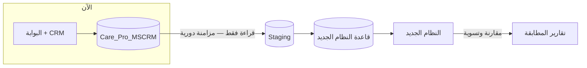
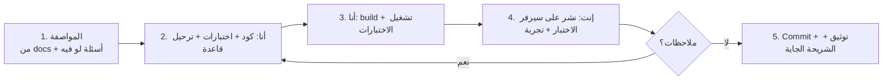

# 01 — خطة التنفيذ والانتقال

> مبنية على التصميم في `docs/02-target-architecture` (00–14) وقرار التنفيذ: **إحنا الاتنين** بشرائح رأسية صغيرة ([14 §1.3](../02-target-architecture/14-platform-and-technical-architecture.md)).
> **قاعدة ثابتة:** النظام الحالي (البوابة + الـ CRM) **مابيتعدلش** — الانتقال بيكون بالقراءة منه بس، والمستخدمين بيتحولوا للنظام الجديد عملية بعد عملية.

## 1. أسلوب الانتقال (Strangler Fig)

| مرحلة الانتقال | الوضع |
|---|---|
| **موازي (قراءة)** | النظام الجديد بياخد بيانات الـ CRM ويحسب بنفسه (الفترات، التحضير، المؤشرات) ونقارن — المستخدمين لسه شغالين على الحالي |
| **تحويل عملية (Cutover)** | من تاريخ محدد، العملية بتتعمل في النظام الجديد بس، والـ CRM بيتجمد للعملية دي (للقراءة والأرشيف) |
| **إيقاف** | كل العمليات اتحولت ⇒ الـ CRM أرشيف للقراءة ثم يتقفل |

**قيد مهم في الترتيب:** الفوترة الحالية بتتحسب من المباشرات اللي في الـ CRM. لو الحركة (تسليم/رجيع) اتنقلت للنظام الجديد، الـ CRM مش هيعرف بيها ⇒ **الحركة + التحضير + الفوترة لازم يتحولوا مع بعض** في تحويل واحد في **بداية دورة**.

## 2. المراحل

| المرحلة | المحتوى | التحويل | شرط الخروج |
|---|---|---|---|
| **0 — التأسيس** | الـ solution، البنية المشتركة، الهوية (AD + MFA)، الإعدادات، محرك الاعتماد، المستندات، التدقيق، واجهة RTL، النشر على سيرفر الاختبار، المزامنة من الـ CRM | — | الدخول بحساب الـ AD شغال على سيرفر الاختبار + المزامنة بتسحب البيانات يوميًا |
| **1 — البيانات الأساسية + سجل الفترات** | الأشخاص والهويات، العمال (المصدر والكفيل/المورد)، العملاء/العقود/المشاريع (فصل)، الباقات المشتقة، السكن الأساسي، **بناء سجل الفترات** + تقرير الاستثناءات، لوحة إدارة v1 من البيانات الجديدة | موازي | تحضير سبتمبر/أكتوبر المحسوب من السجل يطابق سطور فواتير الـ CRM ≥ 99% (والفرق مفسّر) + الاستثناءات اتراجعت مع العمليات |
| **2+3 — التشغيل والفوترة** | مستندات الحركة (وصول، تسليم بالباقات، رجيع، نقل، إجازة، بلاغ، إيقاف، خروج، تصحيح)، مسارات الاعتماد، التحضير، الفاتورة والإشعارات، **ZATCA**، سندات القبض والتوزيع، أعمار الديون، التنبيهات | **تحويل A** (بداية دورة) | شهر موازي كامل: فواتير النظام الجديد = فواتير الحالي (بعد تفسير الفروق) + ZATCA شغال على بيئة المحاكاة ثم الإنتاج لكل سجل |
| **4 — الموظفين والرواتب والمالية** | موارد بشرية الموظفين (الهيكل، العقود، البصمة Excel، الإجازات، الاستئذان، السلف، الجزاءات، نهاية الخدمة)، شؤون العمالة (الإجازات، التصفية، السلف)، الرواتب بالمسيرات + ملف مُدد/WPS والبنوك + GOSI، الموردين الداخليين، **المالية الكاملة (الوضع A)** | **تحويل B** (بداية شهر مالي) | مسيرين موازيين مطابقين + ميزان مراجعة متوازن + أرصدة افتتاحية معتمدة من المالية |
| **5 — المبيعات والاستقدام والبوابات** | CRM المبيعات، عروض الأسعار، العقود والملاحق والتجديد، العمولات، الاستقدام، العلاقات الحكومية كاملة، بوابة العميل، تطبيق العامل/الموظف، بوابة الوكيل | تحويل C | |
| **6 — إيقاف الـ CRM** | أرشيف نهائي للقراءة (عارض بسيط للبيانات التاريخية)، ثم إيقاف | — | موافقة كل الإدارات |
| **لاحقًا** | السكن بالتفصيل، المشتريات والأصول، الربط المباشر (البصمة، مقيم، قوى، GOSI، مُدد API)، الانتقال للسحابة | | |

## 3. طريقة الشغل بينا (لكل شريحة)

**تعريف "خلصت" (Definition of Done) لأي شريحة:**
- الشاشة/الـ API شغالين عربي وإنجليزي، والصلاحيات متطبقة.
- **قواعد العمل عليها اختبارات آلية** (ولو فيه معادلة: حالات من البيانات الفعلية).
- ترحيل القاعدة (migration) موجود ومختبر.
- سجل التدقيق شغال على العمليات الجديدة.
- التوثيق اتحدث (القرارات الجديدة في `docs/`).
- إنت جربتها على سيرفر الاختبار ووافقت.

## 4. البيئات

| البيئة | المكان | الاستخدام |
|---|---|---|
| Dev | الجهاز ده (`C:\Integrated-ERP-CRM`) — .NET 10 SDK و Node 24 موجودين | التطوير والاختبارات الآلية |
| Test / UAT | سيرفر من سيرفرات الشركة | تجربتك وتجربة المستخدمين |
| Production | سيرفر الشركة (ثم السحابة) | التشغيل الفعلي |

## 5. المتطلبات قبل ما نبدأ كود (منك)

| # | المطلوب | ليه |
|---|---|---|
| 1 | **مستودع Git بعيد** (GitHub/Azure DevOps — خاص) | نسخ احتياطي للكود + CI |
| 2 | **SQL Server للنظام الجديد** — يفضّل **2022** على سيرفر/Instance منفصل | سيرفر الـ CRM الحالي **SQL Server 2016 RTM من غير تحديثات** (خطر أمني + مزايا أقل)، والأفضل مانحطش قاعدة النظام الجديد عليه؛ للتطوير ممكن **SQL Server Developer/Express** على الجهاز ده |
| 3 | **حساب خدمة في الـ AD** للقراءة بـ LDAPS (bind) | دخول المستخدمين |
| 4 | **سيرفر اختبار** (Windows Server + IIS أو تشغيل كخدمة) | تجربة كل شريحة |
| 5 | صلاحية قراءة فقط على `Care_Pro_MSCRM` لحساب المزامنة (موجودة حاليًا بـ Windows auth) | المزامنة |
| 6 | **حسابات ZATCA** (بيئة المحاكاة) لكل سجل تجاري — قبل المرحلة 2+3 | الفوترة الإلكترونية |

## 6. المخاطر

| الخطر | الأثر | التخفيف |
|---|---|---|
| بيانات الـ CRM فيها تناقضات (مباشرات مكررة، تواريخ ناقصة، أسعار فاضية) | سجل الفترات يطلع غلط | تقرير استثناءات + مراجعة مع العمليات **قبل** التحويل + قواعد تصحيح موثقة |
| منطق مخفي في الـ workflows مااتغطاش | سلوك مختلف بعد التحويل | قائمة [تحليل 04 §11](../01-current-system-analysis/04-processes-and-approvals.md) كـ checklist اختبار + شهر موازي |
| الفريق شخصين | بطء/اعتماد على شخص | شرائح صغيرة، أتمتة الاختبارات والنشر، توثيق كل قرار |
| ZATCA (تسجيل الأجهزة والشهادات لكل سجل) | تأخير تحويل A | البدء في بيئة المحاكاة من المرحلة 1 |
| مقاومة التغيير/تدريب المستخدمين | استخدام ضعيف | تجربة المستخدمين في UAT لكل عملية + أدلة مختصرة |
| أسئلة مفتوحة (الموردين، العمولات) | تأخير موديولات | التصميم بيعاملها إعدادات ([99](../02-target-architecture/99-open-questions.md)) |

## 7. الخطوة الجاية
قائمة مهام **المرحلة 0** بالتفصيل في [03-phase-0-backlog.md](03-phase-0-backlog.md)، وربط البيانات في [02-data-migration-mapping.md](02-data-migration-mapping.md).
